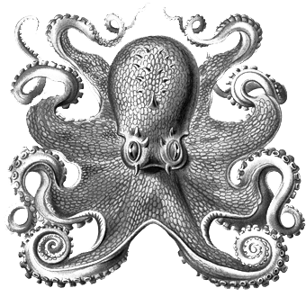

# 004 信任不能成为关系支柱 (修订)

> Posted by 花生和尚 on 二 26th, 2012 in 杂论

信任不能成为关系支柱，其实很显然。因为信任非常脆弱。一张照片，一段录音，一点误会，就可能造成信任崩溃。而这只是一个层面。另一个层面更本质：主动选择以信任做关系基础的人，对待信任问题有偏执倾向。她对于"必须要信任"的坚持越强烈，就越是强调**绝对诚实**。而**绝对诚实**甚至比**诚实**更脆弱。我举个例子——这是一个经典的博取信任的常规措施：报告行踪。不断的报，一直很准确，结果是对方越来越肯定"信任感"，同时也越来越对未来的信任感有更大的期待。然后，**有一次报错了**。我们为了说明问题，给这个“有一次报错”加上一条道德两难：说实话，就能让朋友丢掉性命。让它变成一个不能解释的误报。结果是什么呢？结果是对方之前的期待越大，把握越强，在此时就越放不下。越会有恐怖的联想，越受折磨。几十年都兢兢业业的报过来了，为什么这一次不老实？ 为什么？ 为什么还躲躲闪闪？为什么解释不通？为什么？为什么？为什么！！！ 这桥段眼熟不？

信任越是完美无缺，越是脆弱。并且，越是完美无缺的信用记录，越是能构建出对信任的偏执狂热。有个记录完美的伴侣，这人多半就嘲笑过那些记录不佳的人们——"我老公老实得很"，这话各种无法忍住啊。这话说出了口，对信任的偏执就搭上了自己的信用。加上了自己的信用这枚沉重的砝码，它就变成了一种狂热了。不但要查岗，还要查电话，查短信，查qq，查银行交易。**在任何一方面出现一个：**——这笔钱怎么花的？——我忘了。"我忘了"、"可能是"、"我没那个意思"，都会变成"托词"。

**谈话者A：** ……这就没有个人空间了吧。感觉这不叫信任，反而是“不信任”。如果信任，哪里需要时时查呢？

因为她的确是没法确信对方是不是托词啊。人有多疑的天性：人们不自觉的认为**没有相信该相信的**不如**相信了不该相信的**危险，于是宁可信其有，至少保留对“可能有”的“合理”预防。问题是，如果你自己不接受任何被欺骗的可能性的话，将逐渐把问题推向一个不可操作的境地。

**谈话者A：** 信任不是应该在“可能有”的时候去相信“他没有”么？

是的。在这里我们把概念区分开：我们把这叫做**信仰**。信任是靠信用支撑的，是要随时验证的。**信任**从根上说是个**授信问题**。信仰则不凭证据而立，可以无视自己内心的犹豫。

**谈话者A：** 信任就是“不接受任何被欺骗的可能性”？靠的是“他以前从来没骗过我”？

你要注意语境。我明白你说的这个意思，但是我们应该看到：假设要把这个“信任”替换成一个更精确的词，那么在此处应该替换成**信用**，而不是**信仰**。

我刚才推演的，是这个策略的发展路径。你要这个信用体系能承受你对对方授信到“托付终身”的程度，你势必对这个体系的强壮性有近乎偏执的要求。除非你对自己看得很便宜，否则你无法放下这种执着的。而你越是执着，你就越是在伤害这个体系有效性，增加脆弱性，也就是你的执着本身就会伤害你所执着的东西。你在用火做冰棒。而要是你甚而用了"他这人什么别的好处都没有，就是一个老实"来作为你选择的唯一支撑。那么这个结局几乎是注定的，这就是一段受了诅咒的关系。

而这个策略又是怎么诞生的呢？无非是一开始坚信“信任就是两个人在一起的基础”，然后一而再，再而三的失败，最后心灰意懒，找了一个“老实人”settle down.

这是一种充满了悲剧性的思维方式：关系之所以失败，不是因为“老实”不正确，而是对方“不够老实”。改正的方式就是找个“更老实”的。最后就找一个"什么好处都没有，就是一个老实"的。而这一切，只需要你坚信不移的坚持"信任是关系必不可缺的基础"。你坚持这点，最后因为疑心病而崩溃的机会就很大。你只能看你有多幸运罢了。

如何解决这个问题？

你要坚持“被骗了也心甘情愿”，你自然有**足够的**信任。哥林多前书第十三章第十一节：永远忍耐，永远相信，永远期盼。

**谈话者A：** 被骗了也心甘情愿，不是“信仰”了么？

是的。

那么，如果你做不到被骗了也心甘情愿，又不能用信任作为关系支柱，你要怎么办？你可以用比信任更结实的材料来做。比如，在法律上具有强制效力的契约：譬如婚前协议，甚至包养协议;比如直接现金交易——我先收钱，再交货，先给我两千万，然后我们再谈恋爱。这要比所谓的信任牢固得多。我们如果换一个视角，也可以视作这是一种更有效的授信方式——提供抵押品。抵押品，要比"良好交易记录"更能有效降低风险。

**谈话者A：** 就跟贷款似的。

是的，原理相同。但是你能看到：那不是爱。

**谈话者A：** 显然不是。

还有另一个选择，就是爱。我爱你，死在你手里无怨无悔。因此你不必提供任何抵押，你就是信用无穷大。不要以为这是一个笨策略，这个策略极其强力。

**谈话者A：** 那要是爱上一个骗子……

站在“骗子”的角度上讲，如果你看到一个人这么爱你，你只有两个选择：第一，你信;第二，你不信。如果你真的信，那么骗她岂不是很荒谬的选择吗？伤害她岂不是很奇怪吗？**那是你的**。你会放火烧自己的房子吗？会没事射杀自己的马好吃肉吗？即使你不爱她，你也必然珍惜啊。

**谈话者A：** 都不爱，珍惜什么？

你的房子很破，你住的很不爽，你会烧掉它吗？那是**你的东西**啊。你就是不爱，你也会珍惜嘛。这跟爱不爱有什么关系？

**谈话者A：** 爱你的人，就是“你的东西”？

是的。爱你的人，就是你的。任何一个对你绝不加害的人，只会帮助你的人，对你都是一种**资源**不是吗？譬如你是独生子，确信父母全心**真爱**自己的话，会不会想着去骗父母一大笔钱？那钱本来就是你的。你年纪越大，心智越成熟，你就会越发觉：伤害真爱自己的人是很愚蠢的，蠢不可及。实际上，会主动谋算伤害爱自己的人的人，他们的问题是**不相信真爱**，所以，这实际上就是我说的第二种情况：你不信。不信的话，你会利用对方"难得的愚蠢"。因为你自然会觉得这是暂时的，我只有这个机会利用她。所以我要尽快，我要"抓住机会"。但是：如果她是**真爱**，那么这人将会在一次次伤害和掠夺之后很快发现他的"真爱不存在论"受到了严重的挑战。他会发现：她不是蠢，她不是不知道真相，她的确是在恒久忍耐，她是**勇敢**，她不是**软弱**。她是**真爱**。当然，你也总是可以选择不要做这种坚持。这取决于你。

---
> 一次整理：萨颀
> 二次整理：花生和尚
> 三次整理：炉子
> 四次整理：哪吒