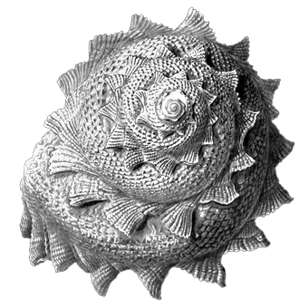

# 019 爱的理由

> Posted by 花生和尚 on 二 26th, 2012 in 杂论

**谈话者A：**一个人爱上另一个人是为了什么？what’s the cause of love?我想知道为什么会爱上一个人。

这个问题首先必须要分开来看。这就好像说炸弹为什么会爆炸，有两种“正确答案”:

a)它被点着了。

b)因为它的内容物具有短时间迅速膨胀的特性。

人为什么会爱上另一个人——竭尽所能，不求回报的爱——也有两种答案。

一个是诱因：贪婪，性欲，感恩，恐惧，对胁迫的习惯和接受……这类诱因是千千万万的，就好像要让一个炸弹爆炸其实可以有千千万万种手段一样。

第二类原因，就是人有爱的本能，就像火药有爆炸的性能一样。你必须要爱，你被“设计”、“打造”成这样的东西了。至于为什么要这样设计，为什么要把你打造成这样，这不是你的问题了。

**谈话者A：**爱的本能，是出自于本能，对繁殖的需要吗？

不，不是出于繁殖的需要。如果是繁殖的需要，那么在爱人离开之后，你就不该有什么留恋。更不必说因为某人死了就终身不再爱另一人了，那不是很明显的降低繁殖效率吗。所以爱也许和繁殖有关，但是**很显然**不是**为了**繁殖。至于那些丁克家庭就更不必提了。

**谈话者A：**那到底是为了“什么”而爱？

因为你有这个本能啊，不去爱你就难受啊。追溯到人的本能，再往上就是神学了。如果是动物的本能，那么你可以追溯到进化。但是人的本能不等于动物的本能。

所以说爱一个人是为了自己不难受的本能？

并不完全如此，不爱和难受之间不是直接关联的。不爱，你会因为人生缺乏意义而难受。不爱，你的人生就缺乏意义。缺乏意义，于是你会难受。不爱，你就 好像一台没有任何工作线程的电脑。你只是在不断的运行，你的一切进程都是为了不断的尽可能久的运行下去。但是这种运行的意义何在？你不跑游戏，不作图，不 生成文档，也不支撑任何服务，也不上网……你只是不断的杀毒整理磁盘，不断的打补丁。这样就算你永远运行着，你的意义何在？人和动物的分别就在于人能意识 到这个问题。并且由衷的恐惧没有意义，实际上，你毫无意义不影响你生存。但是人还是会害怕，你只要是一个理智成熟到一定程度的人，你都会对此感到纠结。但 是动物不会。

**谈话者A：**我的人生没有意义我不就白活了，这样的想法吗。

是的。没有意义，我拼命活着干嘛？那么什么是有意义的呢，既然没意义你受不了。

**谈话者A：**过的时间，做的事情令自己不觉得浪费了。

不，这个回答不对。只对系统健康有意义，是伪意义。这里所说的意义，都是利他的。必须是利他，因为利己的那些，实际上就是等效于杀毒，整磁盘，打补丁。不是吗？

**谈话者A：**那什么是利他的？例如改变世界？为世界为国家做出贡献也是？

改变世界，是指向外部的，做出贡献，也是对外部的贡献。你存在的意义，如果要有那么，必须是作用于你自身之外的事物的。但是我们不离题太远。回到本 题：人为什么会是这种样子？人为什么竟然会忧虑自己的存在没有意义呢？事实上你要是可以不忧虑，你完全可以活着。你忧虑这个，实际上对你没什么具体的好 处，那么你为什么还是会忧虑？这是为什么说这种忧虑是本能。它是本能，因为在你自身内部已经找不到原因了，你的设计者才知道原因。

其实要我从进化论角度去解释爱的起源不是不行。人具有爱的机制，有利于种群的生存，一个彼此互爱的群体会比彼此不爱的群体有更高的效率和更强的战斗力，你也可以把这种群体收益看做是爱存在的原因，如果你并非有神论者的话。

但是，这样去认识爱会带来一个问题。就是如果我不想要那个群体收益，我就不必爱了。或者我得不到那种收益，我就不该爱了。我之所以会在乎我的意义， 是因为自然选择把人类造就成这个样子，以便人类能繁荣昌盛。既然如此，那么这岂不是成了一种需要克服的缺点吗？如果我可以不在乎，或者只是骗的别人相信我 在乎，那么我的策略岂不是更合理吗。不错，那更合理。更有利于你更爽的活下去。但是那个问题还是在那：你活着是为什么呢？你还是不由自主的会忧虑它，即使 你“看穿了”这个忧虑存在的原因你仍然会继续忧虑——在人的本能中加入爱，可以让人类整体上更繁荣——你就算看穿了这一点，那又怎么样呢？你还是要爱啊。

**谈话者A：**你还是会去忧虑爱？所以爱就这样存在着？

是。你摆脱不了，它就像一块石头一样存在着，不由你决定的存在着。你只能考虑怎么对待它，你没法丢掉它，没法摆脱它，它是你的核心组成部分。你无法在不把自己弄残甚至弄死的前提下去掉它。这就好像有心脏你就可能得心脏病，但是你没法因为讨厌心脏病就去掉心脏一样。

所以，你为什么会爱她从根本上讲就是你有爱的本能，而她在这个本能发作时恰好在场。恰好，就是命运，实际上并不存在别的特别的原因了。谈不上正确的时间遇到正确的人，是恰好的时间。适逢其会，命运。

---
> **一次整理：轩辕**
> **二次整理：花生和尚**
> **三次整理：炉子**
> **四次整理：哪吒**
