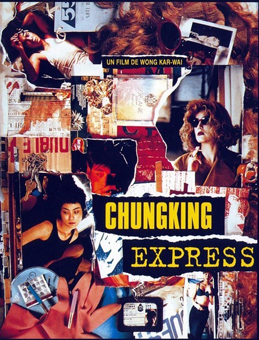

# 119 我打赌你今天不会想起我

> Posted by 花生和尚 on 二 27th, 2012 in 杂论

我刚才打赌她下线之前不会找我说话，我猜对了。

赌这种东西干嘛？不要做任何会增加自己怨恨的事。

**谈话者A：** 我没有怨恨啊。

这种“因为你而输掉的赌”就会。人家不知不觉就让你因为她输掉了，搞多了，你会觉得她欠你东西的。就像有人总赌某匹马，输多了会怪马跑得不好，然后赛后会去打骑手一样。你打这种赌，你说你欠不欠抽，这叫陷人于不义，明白了吗？

**谈话者A：** 明白了。

---
> 一次整理：Z3
> 二次整理：花生和尚
> 三次整理：拉古拉古
