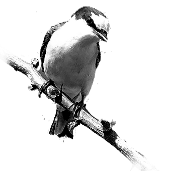

# 121 “玩”的心态

> Posted by 花生和尚 on 二 27th, 2012 in 杂论

现在的小孩子好喜欢拿感情事开玩笑，真的很多。果壳就不说了，还有喊着要找gay结婚的，还有越说越欢乐的。还有兴高彩烈拿肛交神马的好玩 的，直播爆男朋友菊的，喜欢玩下限的。我这两天一直在说：一切对他们都是游戏——玩恋爱、玩上床、玩结婚、玩分手、玩生孩纸、玩堕胎、玩自己、玩别人、玩 bisexual、玩LES。他们就是玩，连叛逆也不是。

其实他们是无所谓的，任何态度都不是认真的。比如爱过什么的，或者抵制日货什么的，保卫XX岛什么的，颓废什么的。美国七八十年代那时候是非常认真 的，虽然人家很叛逆，但是人家是真正的按照那个原则是重构了自己的价值的，是老老实实穿着麻衣棉帽鹿皮鞋游走世界的。这些不是批判，是叙述。

他们谈恋爱似乎很动情，但是事实上，只要要求他们寂寞个一两个月，就要考虑要不要另找一个了，其实他们只能在非常确定的形态中生活，根本不可能为了 谁改变这点。一旦任何游戏威胁到这个生活形态，那么他们就会跳出这个游戏，露出本来面目来。玩MZ，如果搞到要坐牢，立马招供;玩恋爱，如果搞到要守身， 立马劈腿。其实他们根本就不会冒什么真正的风险，或者做什么真正的努力，他们本质上是老老实实走着家里安排的路，他们在朋友们面前极端不屑一顾的路。

我之前在果壳只是觉得很多问题比较空洞，现在却开始觉得空洞的不是问题，而是态度本身了。某些看似严肃的问题，其实只是用来扮演严肃的道具罢了。幼 稚不要紧，错也不要紧，我极端厌恶这种人，就是哭天喊地来的，问了问题，但是却在谈论的时候卖萌开玩笑。悲伤尚且不认真，你活该去死，配不上任何关切，甚 至连被背叛都不配。理想提前幻灭了，这些孩子，从一开始就已经幻灭了。
说个实在的，我要问你们有什么理想，大约你们各自都会回答一些。要是我问，你周围的人有什么理想，你们觉得如何？这个问题很奇怪吧，你的同事有什么理想？ 过自己想过的日子——他们的理想说穿了就这一句话。不管你过得是什么日子，到最后你都会觉得这正是我想过的日子，除非你有真正的理想。否则，你有什么理由 去拒绝这种对自己生活的习惯？只要达到**可持续**你的生活就会稳定，稳定久了，你就会满足。人必定满足，人就是这么一种**适应的动物**。

所以这类所谓的理想，事实上是**无理想**——这不是个动宾短语，而是个名词。就像**无侠**，空的侠，空的理想。去掉了这个**让你真正不安于室的动 机**，加上**日子总过得下去**，加上**你终究会趋向满足**那么还有什么事情值得认真？于是一切成游戏，任何影响到舒适的东西而最终不能兑换成更大的舒适的 东西，都是不值得的。所以，我为什么要等你？我为什么要在意你？我为什么要守着你？

七零后过过真心穷的日子，也过过来了。没有防晒霜，他们不觉得有什么太大不妥。奋斗什么的不是问题。我谈不上在指责什么东西，各有各命。我只是有时不免觉得可惜，用这种游戏的态度。有些东西，永远尝不到，甚至连梦想都梦想不到。

而另一件令人绝望得事实是他们并不觉得这是损失，真心地不觉得。因为当做游戏，可以一遍遍重来，还因为游戏的快感，对他们已经满足了，足够了。就算 他们明知那只是过家家的一点小情趣，比起真东西来不值一提，但是他们仍然觉得这已经足够了，而且在他们能想象的将来，一直会够下去。

不爽就分手呗，换一个呗。

——难道一辈子永远这样换下去？

一辈子永远换啊，有什么不可以？

——要是最后孤独终老呢？

没事啊，到时候养老院里也很好玩的。

既然如此，为什么还要谈理想？吃饭，见面，门路，都是钱。好吃的、好玩的、新妞，爱本身就是一种理想，没有理想的能力，你根本不可能真正的体会到它有多甜蜜。在体会不到这种甜蜜的前提下，你根本不可能坚持，连很短的几个月都坚持不住，甚至可能连一刻都坚持不住。

我说的不是恋爱，恋爱什么也不是，我说的只是爱本身。不是那些卿卿我我的过程，不是那些花前月下海誓山盟，也不是床上的高潮，也不是那些精美小礼 物。是去掉这些之后的爱本身的甜蜜，是哪怕这些一丁点也没有、也不可能会有的绝望之后的甜蜜。那种甜蜜，根本不能和这些小感动小惊喜同日而语。

止步于游戏，不能真正的认真，这种甜蜜根本连窥见的机会也没有，漫长的人生，你就要靠那些小感动小惊喜去撑。于是你只好不断的换人，不断的重来，甚至要去寻找狗血，搞出剧情，玩出花样——不然人生真的犹如无梦的永夜。

---
> 一次整理：炉子
> 二次整理：花生和尚
> 三次整理：拉古拉古
