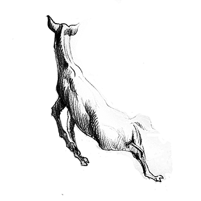

# 122 既知道，又觉得

> Posted by 花生和尚 on 二 27th, 2012 in 杂论

**前情提要：**

一位初三的女生想搭一位大二的男生。(以下是对这件事情的讨论)

**谈话者A：** 只要是因为爱(或者说是懵懂的好感)在一起的都没什么错的说——这句话本身让我很凌乱。

她们没想过敢“爱”她们的人会是什么样的人。

**谈话者A：** 这里的“爱”指的是什么？对于那么大的孩子而言，想这些就有点超出思考能力了。

建立亲密关系啊。不的，倒是没有超出他们的能力，只是超出了他们的承受力。为什么这么说呢？因为比如现在有一个初三的姑娘爱我，对我表白，然后**假 设我真的爱她**，我第一念头就是担心她只是绯色幻想。这个担忧远超过得到她的冲动，我并不害怕什么世俗眼光啊，父母干预啊什么的东西，如果她的确有意愿的 能力，那么这些都不重要——capability of will——她缺这个基本的理性能力的基础。

现在反过来想吧，我要怎样才会去要她呢？就是并不担心她会怎样，也不在乎自己可能有的麻烦，那意味着贪婪至极了。已经工作的人，不同于还在上学的人，他们没有借口可言的。二十多岁，已经工作，却敢接受初一女生的示爱，你想想这背后的逻辑看看，会不会不寒而栗。

这种情况，真爱仍然是可能的，但是唯一办法只能是隐忍，等待。要眼睁睁的看着她先去爱别人，在别人那里先受无法回避的伤害，等着她明白，等她有能力 真正的持有意愿，然后才可以服从——或许那时候她的爱已经被时间风干了，那么那个就不是爱啊，只是一时的兴趣罢了。可惜的是，本来这不要紧——假设她是真 正的成人的话，你对我有迷恋，你自负其责，**那么来一发也行：**)可惜你是小妹纸，我没有犯这种错的资格。

小妹子其实完全可以想得到这点，但是问题在于第一步：小妹子**不会认为自己的不是真爱**，于是对方的一切行为都可以被合理的解释为为了真爱冒险，是 为了真爱抛弃对名声的顾虑。小妹子真正的问题，是**对爱无敬畏**。如果你有敬畏，就会有对自己这个是不是真爱的永远不能释怀的怀疑，从而可以推理到对方也 该有这种怀疑。然后你将对方的行为和“对方必然也有这个怀疑和顾虑”**两个**因素合起来考虑，你才能看到他扑过来的**可怕**。

只要你对爱有敬畏，你就能得出这全部结论，这并不困难。坏就坏在她们不觉得在不知道什么是爱的前提下说爱有什么问题，她们**知道**自己不知道，但是 她们丝毫不**觉得**自己不知道，**不觉得**，还探索什么？你都不觉得草丛里有老虎，你怎么会没事天天盯着草丛找老虎？你根本就没想过草丛里可能有老虎，你 就不可能看到对方做的事情的穷凶极恶。

其实，你早就知道你不知道，这极其容易证明。你问这帮妹纸，什么是爱？她们根本就答不出来。我说的“答”是标准很高的，给出一个你觉得ok的答案， 在我看来是谈不上“答”的，因为我会简单追问。一问她们就会发现自相矛盾，而且自相矛盾在极其浅显的地方，不经指出，她们会觉得这很令人满意，指出之后， 她们却否认不了。

知道自己不知道，只是不觉得自己不知道。有些已经**不觉得**到了这种程度：连“知道不知道”都不知道了，做了一点自己的自我追问，发现答案都挺满意的，可以解释自己全部的已知问题，体系自洽了，于是就**肯定**自己知道了。

但是你没发觉一个很基本的事实你丢开了吗？扮演反对者的，事实上只是身为初中生的你自己。能令身为初中生的自己满意的答案，即使身为初中生，你也 **应该**明白那并不**应该**令你满意。你只要清楚的承认这个事实，你就仍然应该回到**我不知道**的原点上来。我自己难不倒我自己，那么这便是真理了。其 实，**自己难不倒自己，这仍然不算真理**真的是一个超过初中生接受能力的命题吗？是吗？

所以我说：以初中生的智力，本来是可以看到这种穷凶极恶的，可惜他们不**觉得**自己不知道爱。

**谈话者A：** 意思是说，她的潜意识知道而显意识不知道？

不是不知道——事实上，她们完全知道自己不知道。因为一旦掰开，全是最朴素和不能否决的道理。对这个命题的论证如钢铁，不能丝毫改易。即使你只有初中生的思考能力，你也无法有丝毫不承认，并且这一系列朴素的命题，即使你身为初中生，你也全都**知道**，但是你不**觉得**。

既知道，又觉得，这是一个真正通明的境界，这并不是必然能同步达成的境界。

这就好像一个新手指挥官，告诉他夜间要安排足够的巡逻。他也学过指挥学课程，他能清清楚楚的推导出为什么应该这么做，但是他不**觉得**有必要做。

**觉得**是一种**感情上的接受**，**知道**，是一种**理性上的接受**。**知道**和**觉得**之间有重大的鸿沟，这是悔恨之源。对任何**觉得**的事，都去求**知道**;任何事，**知道**了，便能达致**觉得**。这是极高的境界，这种人极少悔恨。这两者完全同步，常常要等到老年。

常规的路径是知识体系先封闭，在封闭了上十年之后，完成了全部的**觉得**，五十知天命，六十耳顺，年七十，从心所欲而不逾矩。年七十，就是**既知道，又觉得**。

**谈话者A：** 有提前达到这个境界的方式么？

永不满足的思考咯，我刚才说的是**常规途径**，这条路事实上已经废弃了。

**道理蛮简单：**古代那种到了几十岁就封闭知识体系的条件已经没有了。你仔细去想这个过程，你会发现这实际上是对理性的理解问题。这实际上是从查知答案 到接受答案的过程，**你怎么知道计算终结了**？你怎么知道你看到的这个答案，不是一个半成品？**让我自己满意是不够的**，**神满意才算够**。

**谈话者A：** how？

利用别人的神性啊，为什么会有本群存在？你们觉得我一直在做什么？**我在等待被反对**。我不断的重新再讲，不断的重复，就是在寄希望于一切人，能从我的话里面看到真正的破绽的人。

因此，我的答案如果会让我感到极其困扰，并且我也推无可推时，我可以简单的相信这是**计算尚未结束**，**计算永未结束**。我可以简单的先丢开它去吃饭，然后让别人来反对，从而希望与**计算结束**，可是并不会结束?

我关心这个问题，我不关心其它的。当我的智力不足，我就变成问题的宿主(host)。等到我死亡，再将这个问题和当时的答案继续传下去。

**谈话者A：** 可是我明明知道问题不会有答案，却去寻找问题的答案，算什么呢？

当然有答案。比如说，我不大相信我关于爱的这个论述会有太天翻地覆的动摇了。大概会有类似相对论对于牛顿定律那种颠覆式的继承，但是那大概要等到出现极其新的历史事件，比如见到了外星人，于是参考其它物种的文明，我们会有一次在比较大的层面上修改这个定义的机会。

**谈话者A：** 或者是走了另一条思维路程，但是仍然不会有结果，就好像无穷小永远不会是0。

误差0.000001毫米，这还有误差，但是对你有差吗？:)指导你的一切行为早就绰绰有余了。

**谈话者A：** 可是假如那是测量误差呢？就是无数次的测量的平均值只是从概率上无穷贴近了答案。

不太可能，你在理性的路上走得不够久。这个世界是极其和谐的，这东西只要微微的轻轻的改动一点，整个世界都会颠覆。我在这几十年里，检查过的事实可 以说绝不在少数，在最近这十五个月里，做过的努力你可以看到，也只能说是概率上的无穷趋近。事实上，我自己本身就是很强的爱人，这个结论背后的重量，绝不 轻易，它错的余地很小很小了。

**谈话者A：** 因为仍然存在着你所看到的都是某一种特殊情况的可能性。

有可能。

**谈话者A：** 只要有这个可能性，我就无法安心去相信这个答案。

我正是因为从未排除过这种可能，才一直守着这个群。我只能保证：我没有因为个人的好恶而回避过挑战，没有无视过任何真正的质疑，没有给质疑者设定过任何妨碍求取这个答案的身份标准。

**谈话者A：** 可是会不会有一种可能是答案根本就不存在一个描述，答案本身就是一个无法表达的东西？

不会，**爱是服从的志愿**。

**谈话者A：** 我虚构一个神出来，然后我来利用这个神来下定义：对于这个物种而言，爱是……(从这个物种产生到覆灭所有被神鉴定为是爱的事例)中的感情。

没用。

**谈话者A：** 如果是这样子的定义不就相当于是没有答案了么？因为不会有人在人类覆灭后存在。

你现在离题甚远了，你这说法，类似于把马换个名字，马就不存在了。重回原题吧，**既知道，又觉得**。

**谈话者A：** 我觉得所谓“知道”和“觉得”是不是潜意识和显意识的问题呢？“知道”是潜意识中事实上已经推论出了答案，“觉得”是显意识没有接受这个答案，或者是显意识没有涉及到这个答案的问题？

从理性上一旦知道，就能从感情上达成接受，那是一种对理性本身真正敬奉者才能做到的境界。那是需要经过对理性本身高强度的挑战，然后才能达到的一种自觉的状态。你要注意，我说的是敬奉，不是**崇拜**;**理性者**不是**理性主义者**。

理性者用理性来求取答案，但是他仍在清楚地看着理性能解决什么问题，以及这个问题现在被解决到了什么程度，应该对这个答案做多少保留。

理性主义者则相信理性可以解决一切问题，一切问题也唯有理性可以解决，于是他们一旦达到推无可推，就对答案并无保留，**他们不相信逻辑之外尚有领域**。于是一旦逻辑穷尽，他们就认为计算已经结束，这个结果就是答案。

“对这个问题，只有三种选择，A不行;B不行，C也不行。逻辑上这三个选择已经完备，所以计算已经结束。结论是**不行**”。

**谈话者A：** 哪里不对么？

当然不对，否则人类早就停止发展了。举个简单的例子：光速怎么可以全都一样？！怎么可能在火车上往前发出的光和往后发出的光在地面上检测出来的结果是相等？！你看到这个例子了吧。

**谈话者A：** 你意思是说所谓的不可能是在当前知识下限制了想的方式？而不是本来就不可能？

你觉得不可能，不等于不可能;全人类觉得不可能，也不等于不可能。**计算永未结束**，这恰恰是真正的理性者应该有的态度。**永不绝望**，**哪怕是理性本身这么告诉你也不必绝望**。

**谈话者A：** 我承认我恐惧这个东西，想到这个答案就会恐惧，非常恐惧，从内心发出的颤抖。因为我会怀疑我过去所做的一切都是错的。

那是因为你太弱啦：)逻辑对你是不可战胜的魔法，你每次跟它争辩，你都输得一塌糊涂，输的自己底掉，于是你投降了。**逻辑说是对的，就是对的，逻辑说是错的，就是错的**。

**谈话者A：** 我用什么和逻辑争辩呢？直觉么？

敬畏，对**错误的可能性**的敬畏。即使你凭着一己之力，完全无法发现任何错误的可能，你仍然要敬畏，要准备承受失败。

**谈话者A：** 我想说用信仰，永远相信**计算永未结束**。

敬畏是信仰的光泽。

**谈话者A：** 我们做的所有都未必正确。

是的，所以我永远不敢说我对你的爱就是爱本身，你永远可以说我不爱你。所以爱的第一条，就是不可以追求被承认。

**谈话者A：** 那么很多人可能一辈子都没有爱，哪怕是对自己的孩子。

一个人一辈子反共，却有可能是共军的间谍哦 :)骂你，不理你，离开你，逼迫你，但是他却可能爱着你。爱到不惜犯原罪，爱到不惜被误解，爱到不惜被抛弃。

**谈话者A：** 但是假如我看着我母亲为了自己的爱让我弟弟变成一个会被社会抛弃的人呢？

判断他人是原罪，**你不知道答案**。你不知道你母亲爱不爱;你也不知道你弟弟是不是被抛弃;你也不知道他是不是**变**成这样的;你也不知道你母亲是不是他**变**的原因。

恕我直言，上面任何一个问题，其**规模**都远远的超出你的想象。

**谈话者A：** 嗯，我明白，但是从概率上讲确实存在着概率是我的想法。

仅仅凭着你的语气，我就敢说你低估了你说错的概率，而且不是低估一点半点。

**谈话者A：** 我一直认为是父母的态度让弟弟变成这样子，至少这是我曾经的判定，也是我父母对外界宣称的答案。

人是极其复杂的，人的关系复杂得可怕。相比之下，多元偏微分方程这类问题简直简单得可笑。你将来要是有问题要请我替你分析的话，你会看到分析可以到多么复杂的程度。

**谈话者A：** 说实话，我可能会选择鸵鸟。

你鸵鸟不了，不然以我的收费之高，条件之苛刻，你也不会找来了。反正我不急：)等你真正不能鸵鸟的时候，你自然知道该怎么做。

---
> 一次整理：圆圆的星星
> 二次整理：花生和尚
> 三次整理：拉古拉古
