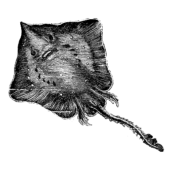

# 127 性教育问题

> Posted by 花生和尚 on 二 27th, 2012 in 杂论

我们总是赋予孩子纯真、善良，可孰不知，孩子也并不是完全无错的，我们把未成年想得太“纯真”了。人性是个很复杂的问题，它也体现在未成年的身上，只是折射的角度不一样，比如我们不能理解的90后的态度行为。

**谈话者A：**你的意思是，未成年人要承担责任？这样推是不是错误的？

不好说错不错。我们有个糟糕的设置就是“十八岁成年”这个设置。

我个人还是认为把我国未成年人性行为越来越多的理由归结为“好奇心”和“国家教育”太牵强。好奇心这条可以去掉，青少年当然有好奇心。糟糕的青少年，当然要怪糟糕的成人，百分百怪糟糕的成人。只是等到结果出来，责怪已经没有意义。

我们有种奇怪的思维方式就是似乎找到责任，就等于解决了问题，我把这个思路叫做“借粮官头”，现在现状如此。第一号问题是：这是不是好事？而这个问 题不能靠大人们的直觉好恶，而要靠历史的眼光，要**横跨上下数千年，左右环视一切诸国**的**历史的眼光**，这个眼光是没有道德判断的。不依赖情绪的用这个 眼光来看待青少年的性行为提前，并不能简单的说它是**坏的**。用这个眼光去看待这个问题，事实上得出的结论是：人类在改变，纯粹的改变，要考虑的是这个改 变的后果。

实际上，我并不认为这个问题是可以“解决”的，因为它客观上说，是上一代的历史性改变的结果，是信息革命的结果，是全球化的结果。如果我们要“解 决”这个问题，我们就要重新回到原有的经济方式，要放弃大量的知识要放弃大量的成就。说得不好听我们大概连高铁和三峡大坝都要拆掉，电话也不妨拆掉，互联 网要拆掉，同时停止对外贸易停止新闻自由。你知道谁这么干过吗？大明朝，大清朝，日本幕府，大英帝国……这是一个长长的“死者名单”。

换句话说，青少年的性行为是系列不可避免的事实的不可避免的后果。试图消除这个现象的根源是不可能的，是反历史的。你不可能既选择优越的生活，又想 着自己的孩子有“传统美德”。**但是**这只是问题的一面，这一面，说的是**我们不能回到过去**，说的是**我们不可能“部分的”来到现在**;问题的另一半 是：**如果我们面向未来呢**？这有些像时装，如果你穿的是五十年代的服装，你可能基于两种理由：A)你是想回到过去，B)你是想去到一个相似的，即将回归 的**未来**。

**问题在于：**性伦理的未来是什么？是朝着现在的方向一去不复返，还是**昨日再来**？如果是后者，那么你在教授你孩子的时候，你就不是在教她回到过去， 而是在教她**迎向未来**。我们考虑这一问题的基本逻辑，不应该是以“过去的荣光”来作为立论的基础，而应该是以“这是未来更好的选择”为立论的基础。

遗憾的是在这个问题上发表意见的学者们的语气也罢，论证的实质也罢，**往往**出于前者，这就使得他们有一种**根本性**的荒谬。从而从开口开始就令人 ——包括他们结论的赞同者——感到一种脆弱和无谓。甚至连青少年也可以轻易的把他们的立论踩得粉碎——“这个时代已经不同了，老大”。这才是我们的性教育 的根本问题——我们基于未来的研究严重不足，成人们事实上是在基于一种严重的不安全感，试图**回到过去**。他们试图通过灌输，使时光倒流。别说面对未来， 他们甚至事实上就**没有**接受**现在**，他们装作不知道现在的青少年在干什么。教育官员们假装这是少数现象，以免被不能面对现实的家长们用唾沫淹没，于是 你们就看到了荒腔走板的讳疾忌医的性教育策略——它来自脆弱而极少思考未来的家长群体，并由一个没有勇气、唯唯诺诺的教育系统加以执行。

同时这个系统又完成了“君子远庖厨”的隔墙作用，让家长们可以自欺欺人下去。唉，最烦我妈说，我们当年吧啦吧啦那是因为我们中国人的文化革命根本没 有完成，直接一句话现在又不是当年，可是每次说她还是继续这么说。我们事实上就像韩国人一样，是在用手机开飞机的农业文明，我们极端欠缺面对文化巨变的 **勇气**。这是长期以来缺乏民族性的文化变革的经验造成的，我们在几千年里，从未真正的经历过实实在在的文化变革。

五四运动只是浮云，辛亥革命也是浮云，甚至文化大革命也是浮云。老大帝国，必有这样的性教育。我并非指责谁应该为此负责，要说负责，就要怪为什么上帝创造了这样一个中国让它一面环山，一面荒漠，一面冰原，一面是世界上最宽最深的海洋，而内部又有大量平原。

**谈话者A：**老大帝国，必有这样的性教育，其实这也是很没意义的一句话，接下来我们应该是解决问题。

是的，我是在说为什么说指责毫无意义。现在的问题是：我们的性教育**应该**朝向何处去？目前这个问题分成两个层面。第一，是要寻找答案;第二，是在答案未明之前，现下怎么办。

我个人的看法：我们不该把眼光放在如何性教育**少年儿童**上！我们应该把**家长们**召集起来开班！上性教育课的根本**不该是少年儿童**！以小组研讨的形式，引导家长们进行广泛的性伦理和性知识的讨论，才是真正最有建设意义的手段。

我们应该去研究如何克服这一方案的具体困难，如何解决这个方案的操作性问题，我们应该首先**打醒家长**，坦诚的向家长说明问题。消除他们的自欺欺 人，与他们去讨论如何干预他们的孩子的性伦理。讨论应该是开放式的，不求统一的，你是什么地区，坦诚讨论出来的结果是什么，那就照什么执行。因为在这一点 上，**没有人有正确答案**。即使讨论完毕，也允许各个家庭有各个家庭自己的想法。

**你自己不知道什么样的性伦理才是未来的性伦理，凭什么要强行替别人决定？**你能做的最大努力，只是给人提供检查自己性伦理的机会。**我可以简单 的断言无论教育部如何召集专家去研究未来的伦理变迁走向其结果**一定是错的**。因为逻辑上根本不存在一个**普遍**适合**中国**人的普适选择，甚至把这个单 位细分到省也没用，分到什么都没有用。就好像人的成长历程一样，这个东西完全是一个人一个样的吧。

再加上性本身就是一个具有私密属性的东西，省会和地区乡县的文化本身就是分裂的。而且这一分裂会因为他们本身在经济中的地位的差别，而长期性的不 同，将来并无同一化的预期。省会和地区乡县的文化本身就是分裂的，而且这一分裂会因为他们本身在经济中的**定位**的差别而长期性的不同。要求全国，甚至全 省实施统一的性伦理教育本身就是错的。教育部对此心知肚明，但是他们现在选择的方式是什么呢？就是置性伦理于度外，只教授**性知识**。所谓垂手而治，只要 在全国性的破除掉对性的讳疾忌医的心态就好了。

剩下的所谓伦理，父母自然会教育的吧。问题是：**教授哪些性知识**以及**如何教授性知识**，**本身**就是性伦理问题！因为这个原因，我们教育部的必 **然对策几乎只剩下一条：**采用**最保守原则**。教授最无争议和最大共识的那部分性知识。这样一来，教育部在客观上等于把全部的性教育缩小到了**聊备一格**的 程度。同时，由于性生理和心理研究是目前科学研究的“应许之地”，这一领域的研究成果变化太快。以至于教育部为了避免今年教的明年被最新研究打耳光，不得 不在原有的保守程度上**进一步保守**。保守到仅仅教授**绝对事实**的程度。什么绝对事实呢？就是女生有阴道，男生有阴茎。解剖结构因为我们对性传播疾病的 认识事实上尚未稳定，所以呢，“暂时”不教。因为我们对性生理和心理的认识尚未稳定，所以呢，“暂时”不教。

而教育部的这种“保守”，可以说是无从改变的，是可以预期的。身为家长和青少年自己，面对这一现实，头一个认识就应该是**抛弃对现有学校教育的幻 想**。家长去求教，去自己组织研讨，并且要抱着和青少年共同学习的态度去共同学习，去找信息，去找人。家长们自己要非常清醒的认识到这个必要性和危险性， 才会有足够的动力这么去做，这绝不是白费功夫。子女在性方面成熟，即使在现实方面也会成为巨大的竞争优势，这是会实实在在的反馈到他们的收入和幸福感上 的。

你们不是担心他们面对同龄人没有竞争优势吗？那么这个方面人家做得稀烂，甚至根本不做你做好，你的孩子就有竞争优势，有更多的余力和更好的心态去竞 争这个优势，甚至在将来比他的智力上的优势更有决定性。你花几十万送他去上哈佛，他却有可能因为性挫折自杀，你不解决这个问题，他遭遇性挫折的几率可以达 到百分之八九十，以至于你要面对的已经不是他遭不遭遇性挫折的几率，而是要面对他遭遇之后**幸存**下来的几率了。

现在的孩子遭遇这个挫折的几率已经高到爆表了，导致抑郁、心理扭曲甚至自杀倾向的几率大得可怕。他们茫然无知的加入赌局，在输的精光之后变得阴冷、 凶狠和怨恨。赚到钱或者“事业成功”对这样的人来说，其实只是多了自焚的汽油。选择在于你自己手里，你完全有改变的机会和能力。你**知道**，但是你**不觉 得**，这才是问题所在。你的房子在燃烧，别等消防局了。这道理很复杂吗？

简单的来说，**总结为以下几点：**

1.从公共政策的角度去讲**家长的性教育**才是短板。

2.性伦理的讨论**应该**下放到地市级，让地方对问题的具体设置有影响的余地。教育部应该给出若干种方案，交给地方去选择，以这种方式去掌握主导以及贴合现实。

3.我们关于性伦理的讨论，必须彻底的去掉“回到美好过去”的色彩，转而去严肃而积极的探讨未来。

从个人的角度来说，**对家长来说：**

1.除非你能改变地球地貌，否则你要认识到中国的公共教育系统能完成性教育工作的可能性是极低的。身为家长，你要立刻考虑进行个人的努力。

2.你不能仅凭经验去做你子女的老师，更不能凭自己的好恶去决断子女的对错。你要做好准备面对惨烈的事实——你**不知道**你睡着和出差时你的儿子/女儿在干嘛，不要装作知道！

3.**性成熟是可以折算成现金和远大前程的优势**，是一个投入小而收益巨大的投资领域。道理很简单——别人很少积极主动的这么做，而这一方面对所有 人都有重大影响。谁在和你孩子上床，怎么上的床，怎么下的床，会严重的决定你孩子的**收入**和**地位**。如果你很现实，那么回避这个努力是愚蠢的。

4.你比你的子女明智，你比其它的专家更关心ta，你说你该不该成为ta的参考信息来源？

**对于青少年自己：**

1.请承认自己的无知，敬畏**未知**。没有这一条，你的悲剧根本就是活该。敬畏是**被选择的畏惧**，这是一种选择，是一种智慧。没有敬畏不但不值得自豪，反而令你成为一个只有挨了耳光才会醒的笨蛋，有些耳光你根本挨不起。

2.去学！去听人说话！获取知识本来就犹如采矿不是在地上拣金子！不想接触任何错误信息的，根本不懂得分辨对错。

我坦白告诉你好了：别人跟你说的，全他妈是**错的**，你自己的也是错的！因为别人说的是错的就不听，这是你幼年时代所谓的“学习”惯出来的娇毛病。 **学习**是从在不知道对错的前提下分出错误开始！不是从背会某种“正确观点”观点开始！批评别人给出的信息，可以; 批评别人给出信息的行为，这叫不知好 歹; 批评给出信息的人本身，这叫诽谤！你开口批评之前，有想过这三者在行动上有什么区别吗？如果你发觉这三者的区别你分不出，那么你就想清楚：你根本就 没有自我教育的基本能力，你自我教育的结果存在着错得荒腔走板的可能性！

这个结果，甚至连被坚持的资格都没有。这个**荒腔走板的可能性**，随时可能把敢信任到依赖你的人害死或者拖入地狱——你自己死是活该，谁管你。十几岁年纪自诩性伦理大师，攻击一切和你相悖或者令你不爽的意见，这叫不知死活。

---
> **整理：四季**
> **定稿：剑寒秋水**
