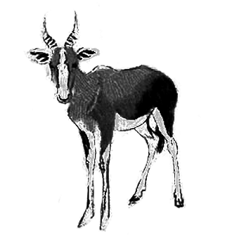

# 129 我对自己的长相毫无自信

> Posted by 花生和尚 on 二 27th, 2012 in 杂论

**谈话者A：** 我对自己的长相完全没自信啊，怎么办？

你是对自己毫无自信吧，因为你如果对自己有真正的自信，你根本不会问对长相不自信的问题。

**谈话者A：** 我什么成就都没有，并且还没有即将有成就的迹象啊。

你有真正的价值的话，你的一切缺点都是护甲。

**谈话者A：** 怎么理解？

能屏退其实只是贪婪的人，就好像亿万富翁最好丑点，否则的话，对他的爱岂非太廉价？

**谈话者A：** 廉价？还是不懂这句话。

爱人是因为对方身上的缺点而称爱的。

**谈话者A：** 处处完美的人，让人不愿靠近。

那倒不是这个。

让没自信的人不敢靠近。

是处处完美的人，你去接近他，他怎么知道你是爱还是贪？美女走在路上，人人对她吹口哨，美女会觉得这是爱吗？与生俱来的缺陷，其实反而是一种祝福， 它本身有试金石的作用，能试贪。如果这些都没有，你就不得不诉诸“故意的考验”，而“故意的考验”是种原罪。唐太宗为了知道某官是否廉明，故意使人贿之， 被魏征骂到狗血淋头。

**谈话者A：** 为何被骂，难道给唐太宗说，这是种原罪？

因为这是一种欺骗，而且是用心险恶的欺骗。他若有受贿罪，那么你便有行贿罪，主动的试探非常糟糕。薛平贵试王宝钏，听过吗？薛平贵出征，战功赫赫， 衣锦还乡，试探他妻子，他假扮一个普通军汉。仅凭这一试，就该被丢弃。所以我说，有天生的缺陷，反而是祝福，因为你不必故意去试。

---
> **整理：四季**
> **定稿：剑寒秋水**
