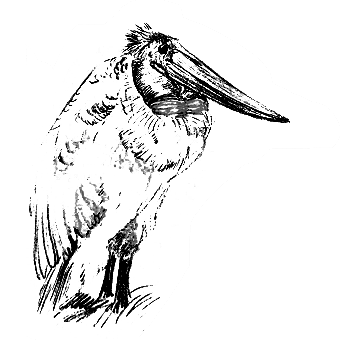

# 132 不是天使我不爱

> Posted by 花生和尚 on 二 27th, 2012 in 杂论

**谈话者A：** 有个朋友，在男朋友劈腿以后，还仍然很纠结，藕断丝连的。不相信对方这么快就从一个老实本分的人变为一个二流子，之所以纠结，还是给男朋友留了一个门，希望对方是被一时蒙蔽。现在过得很艰难，因为既不能沟通，同时也不断有新的误解产生。

“不是天使我不爱”么？

**谈话者A：** 矛盾的激化也不能让她狠心的关门离开，真是个善良的女孩子。她是愿意去爱，但是不能去爱吧。虽然知道关上门，上帝会给你开一扇窗，自己狠心关了，就没有未来可言。我不知道这是对还是错，我只知道她很不“理智”。

当然是错，错得没边。这不是理智问题，“不是天使我不爱”纯属欠抽。我们先说这个“不是天使我不爱”吧。“他一定是受人蛊惑才犯糊涂的”——这话值得当面给个耳光。

第一、你当人是弱智吗？

第二、你凭什么把人家现在的状态当做“糊涂”？

这一句话里 露出了冰冷的自居为神的心，而且露出两次。对方做任何事都请相信他有充分合理的理由，无论看起来有多荒谬，那也必须理解为有你不了解的原因。你没资格去说 别人是不是受了“蛊惑”，更何况，这一句蛊惑除了将他贬斥为弱智之外，还将他信任的人指为居心叵测，指为阴险狡诈。你哪来这资格？

第三、指称对方目前的状态是“糊涂” 意思是自居为对方生活方式和人生选择的审判官。退一万步来说，假设人家真的回来和你一起也只能做你的奴隶。

**谈话者A：** 但是如果对方错的离谱，自己也要采取行动了吧，不能跟着跳火坑吧。

你可以了解，可以关切，可以提出自己的疑虑，可以给出你觉得对方没有考虑到的因素，但是你永远没权利说对方错了。说对方受了蛊惑，这是对一个人人格 的最大否定。你有什么资格要人非要接受？你爹叫你不要读哲学，叫你读经济，你就应该读经济？你要是看了哲学书心驰神往，你就是受了蛊惑？按照一般社会观 点，读经济好找工作，所以读哲学就是神经病，所以你就是神经病？

接受这种逻辑，你的生活就会变得极其可悲。你的这种语气，事实上就是想当然的认为他也该接受这个逻辑。凭着你这份浑，扔了你就是明智决定，你没半点冤。

你还指望他“改邪归正”，事实上身在魔域的是你自己！习惯身在地狱的人，也会很怜悯的看着去天堂的家伙说“他只是一时，糊涂，受了两个鸟人的蛊惑。”想过吗？

**谈话者A：** 这也该有个界限吧。

有啊，你可以担忧，担忧他**可能**是受了蛊惑，但是你不能说“你这是受了蛊惑，老娘等着你后悔”。抱着后一种念头，活该被一切人抛弃。

**谈话者C：** 为什么叫 不是天使我不爱？

字面意思还不明白吗？就是自己假设一个完美品格，时时刻刻在对对方做道德判断，去评判对方是不是达标。“不相信你这么短时间变成二流子”，二流子一词就是道德判断，意思是嫌弃对方脏，脏的她不要。

**谈话者A：** 不是说爱是君臣关系吗？你有美好的品德我追随你，你昏庸无道就离开你。

爱是你是纯洁无暇的，于是我来分享荣光;你是卑污不堪，我便割袍断席吗？就是爽才跟你混，不爽就闪人吗？趋炎附势谓之爱？

**谈话者A：** 志愿也是我的自由，个人有个人的价值观。

你只服从你觉得ok的意愿，那么这意愿和你自己的意愿有何区别？别人只是一个发音器罢了。譬如你晚上想爱爱，对方除了爱爱之外的一切意愿你都不服 从，你只服从要爱爱的意愿，你这个真的叫做服从她吗？“不是天使我不爱”，只是从形式上和**服从的志愿**兼容，但是论及本质 这根本无爱可言。

**谈话者A：** 更爱自己一点。

更爱自己？不，这是根本不爱别人，所以也别怪别人对你露出恶魔的一面。因为你抱着这个念头，你口口声声所说的爱就不过是个骗局。

**谈话者A：** 爱自己，就是通过“爱”的方式来让对方赞同，认可自我，施行自己的意愿。唔，一个甜蜜的陷阱。

这话偏题了，我不理会。你要当心，你是真爱，你才能成为“不可伤害之人”，损害你去谋他自己的利益才是很可笑的事。如果你是假装爱、幻想爱，对方察 觉之后，假设对方贪的话，对方的合理政策是趁你醒或者翻脸之前尽量掠夺。因为从你身上牟利的机会有限，所以，说出“他只是一时糊涂，受了蛊惑”这实际上已 经把自己置于死地了。不但谈不上善良，反而首先傲慢得可憎。从现实角度来说又无意间给了自己强烈的诅咒，可以说愚蠢得可怜。因为你的意思是“不是天使我不 爱”，而只爱天使意味着你什么爱也没有，你付出的是你欺骗人的代价罢了。

**谈话者A：** 唔，问题出在哪呢？意识里先设定了目标，再通过目标和现实的比对，得出对对方的判断。

出在她接受了“主流恋爱观”啊，那个建立在自我满足的基础上的恋爱观，那个以爱为挖掘幸福的铁锹的恋爱观。这个恋爱观是扯淡的，所以有扯淡的结果。

---
> **整理：四季**
> **定稿：剑寒秋水**
