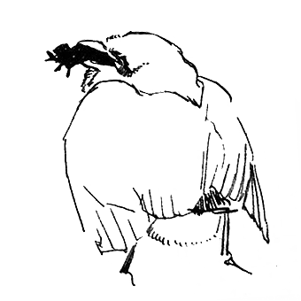

# 137 怎么对待追求者

> Posted by 花生和尚 on 二 27th, 2012 in 杂论

**谈话者A：** 最近有个男的追我，我表示觉得很纠结啊。

纠结什么？

**谈话者A：** 感觉和他不适合，但是很适合做朋友。我和他说清楚了的，但他说就只是告诉我他喜欢我，这件事 而且他总是自信满满觉得我会喜欢他，不知道该怎么告诉他。

告诉他什么？

**谈话者A：** 就是我们真心不适合这件事。

没必要啊，你只是觉得不舒服。

**谈话者A：** 但是我每次和他聊天说到什么事总会很自信地表达我会和他过一辈子这件事。

你可以告诉他这样去想，你觉得不舒服，这是缺乏对你的尊重，就这么直白的告诉他好了。假设没有这份不尊重的话，也许他还有点机会，但是装作没有是没用的。

**谈话者A：** 嗯。

姐神目如电，保证他再也不扯，除非他脑筋有水。

**谈话者A：** 总觉得他是在慢慢渗入我的日常生活。

中国人？

**谈话者A：** 嗯，同一个城市，特种兵退役。

为什么肯定不合适？

**谈话者A：** 性格吧，感觉我自己的问题。

具体点咯。

**谈话者A：** 按他朋友的话来说他们现在出来都是变兵痞了，我自己性格上不是很安分，不适合像他现在想找人过日子。

你要学会又客观又具体，不然你很容易最后发觉你以为是事实的东西其实只是一种感觉。

**谈话者A：** 我自己就是那种看上去长大了懂事了，实际上还是和小孩子一样很幼稚的不懂事的爱闹的，他呢就是那种有点被部队塑性了。

军人？

**谈话者A：** 嗯，特种兵。

网上？

**谈话者A：** 嗯。

之前现实认识？

**谈话者A：** 不认识。

纯网上？是啊，我觉得我在网上各种爱玩什么的。

**谈话者A：** 我之前在YY上认识他，一开始什么事都没有，就是一般的朋友。他有一次出任务，很久没回来，后来知道他的消息就 是他左膝盖中枪做不了剧烈运动，回不了部队了。然后他情绪很不稳定，我就是一直在安慰他，各种鼓励什么的。后来他有一天就说给我学了一首歌，叫我去听，我 过去之后他给我唱了，然后忽然就告白了。之前有点苗头我是感觉到了，但是感觉就是他就只是玩暧昧什么的。

什么时候告白的？

**谈话者A：** 八号。

我们说说这个问题吧——**怎么对待追求者**。

追求者是一种很需要慎重的存在，**追求者有以下几个特征：**
1.强烈的动机。
2.他们相信“追理论”。
3.他们有主观上良好的初衷。

这是一种交杂而混沌的状态，既有希望，又有重大的问题。希望在于，他们有主观上良好的初衷;问题在于，他们满脑袋混账理论，完全不清楚自己在做什么。之所以说他们满脑袋浆糊，是因为以下几点：

1.他们普遍的相信，女人总会被感动。

也就是说，搞定女人是个力气活，还没搞定，只是力度还没到位。之前送100块的东西没感动，现在改送1000的，不行就送10000的，再不行，就 等着她得绝症，送肝！送肾！总而言之，只要功夫深，铁杵磨成针，就是你是铁石心肠，我也要有一天让你融化！这是他们的基本信念。

这一基本信念有个毛病，就是将任何挫折都归咎于努力还不足，而不是路线本身有毛病。所以他们完全不懂得尊重对方的拒绝，仅仅这个信念本身，就构成了对对方自由的严重侮辱，而他们却极难转变这个信念，**因为按照这一信念：**你这么说，只是你还没被我感动！这是个自锁死结构。

2.他们普遍的相信对女人好是女人无法抗拒的总战略。什么叫“对你好”呢？千依百顺，逆来顺受，这是消极战术;还有积极战术，送东西，献殷勤，帮忙，吹捧赞美……总而言之，就是给你好处 让你上瘾，让你依赖，让你有负疚感，最后就范 “接受他”。

上面两条，第一条，本质上就是强迫;第二条，本质上就是欺骗，因为第二条本质上就是贿赂，是利用你的人性弱点，利用你的贪婪，利用你的同情心。

这两条，导致“追求者”这种存在变得很危险。因为你身为人类，必定有人类与生俱来的弱点。你的确贪婪，的确渴望关注，的确会依赖，的确会有同情心。而另一方面，在**良好的主观动机**这一方面，真正爱你的人和他们是一样的。

因此你要面对的最关键的两难是：你不知道这家伙有没有救。他到底是一个误入歧途的真正爱人者，还是一个不知道自己到底有多贪婪和凶恶的未觉醒的混 蛋？因为现在的流行恋爱理论的熏陶，基本上人人都会默认的接受“追理论”，很难碰得上能超脱这一点的人选。所以，**一概**拒绝并不明智，有将婴儿与脏水一 起倒掉的嫌疑。

那么很多女性很自然的采用第二机制：“我喜不喜欢他”。喜欢他，他是个未觉醒的爱人也罢，是个未觉醒的混蛋也罢，我都愿意给他机会;不喜欢他，不管 他会成为什么，我都不愿意给他机会。但是，**这一方法有个致命问题：**这是基于你自己的贪婪。可以说，基于这一植根于最大获利逻辑的筛选标准，你必定也会“受 追”。那意味着他有很大机会会被你喜欢然后建立起一种和“追理论”兼容的亲密关系，一种基于相互贪婪的关系。

基于相互贪婪的亲密关系，看起来牢固，实际上有无穷尽的痛苦的可能。除非你非常幸运，否则将来一旦撞上任何一条，都会弄得非常折磨。

我之前说过**爱人者自然爱一切人**，在这里，我们要给出第三个方案。基于你对一切人普遍的爱，如何处理追求者。

他要追你，你对他虽无爱情那样的热爱，仍然有对一般所有人都该有的普遍之爱。换句话说，仍然存在着**我爱你**作为处世的前提。那么基于这一前提，第 一点，就是应该给机会。首先考虑能不能给机会，这本身就是**仁者爱人**。 **我自己其实没什么关系，如果追我能让你变得强大，变得更好，我并不介意借你追一追**。这就是**给机会**的分寸，给对方学习爱的机会。让你追，但是诚实的 告诉你我的感受，如果你试图吹捧我，我会告诉你我不高兴;如果你试图强迫我，我会警告你这是对我的伤害;如果你认为你肯定可以搞定我，我会告诉你这是对我 的侮辱;如果你真的令我高兴，我也并不会为了驱逐你让你死心而装作不高兴;如果你一定要问我到底爱不爱你，你到底有没有希望，我可以告诉你，在基本的层面 上，我爱一切人。

设若我对你有了你期待的那种激情之爱，我不会特意隐瞒来折磨你。而你有没有希望，这一点并不取决于我，取决于你，如果你一定要我许诺你考试过关，你才肯去考的话，那么这件事的意义何在？难道你是在过家家吗？ 毋庸讳言，你要经历一个常规手段全部幻灭的过程。

我的灵魂如此高贵，不容收买，鄙视怯懦，憎恶侮辱。我的心有足够的强壮，你的战术必定会逐一幻灭，你如果说有希望，那么也只会出现在那些手段逐一幻 灭之后，出现在你真正开始爱我之后。而我必须诚实的警告你，爱不能换爱，即使真的到了那一天，你的确让我看到你是真正意义上的爱我，我仍然可能离开。如果 你并不能接受我的自由，那么你那时的所谓爱，也不过是一个骗局。

如果这些东西你仔细想好之后，仍然决定要走上爱我的道路，那么我们顺其自然就行。那时，无论成与不成，我们各自必定不会有什么悔恨，因为学会爱本身就是你爱我的回报。在你学会之后，你将必定认同这一点，我不介意**借你追一追**，追吧。

**谈话者A：** 就是我现在是在下断言么？

什么意思？

**谈话者A：** 我下了我不爱他或者是我和他不可能这个断言。

是。首先，你不是不爱他，你是不喜欢他。注意这个差别，这里的爱，是指爱的原意。他受伤，你去安慰，这就是爱了，只是不是那种移山倒海的爱。我刚才 说得已经很清楚，真正懂得爱的人，对任何人都可以说是爱的，任何人问，你爱不爱我，你都可以回答**爱**。只是他们会很容易误解为那种移山倒海的爱，因为担 心他们的误解，你只能笑而不语而已。不回答，或者说“不是那种爱”，不等于**不爱** 。所以从严格的意义上说，你只是不喜欢他，不是不爱他

第二，你和他不可能，这并不一定是一个断言，而可能是个**赌注**。你是在果断的**赌**你和他不可能**，骰子分大小，你买了大而已。如果输了，你自动的要赔——你错过了一个人。你事实上是下注了而已，注下在“不可能”那边了，这是你的权利，谁也无权干涉。

不判断人和这是不同的，只是差别很微妙而已。你如果不想，你完完全全可以直接拒绝对方，切断一切联系，这没有任何问题，谈不上背叛了什么爱的原则， 这是**可选策略**。但是我们在谈的是**最佳策略**，将来真正能爱你的人，很可能在这些人中间出现。不给他机会，对你自己是损失是一方面，对于那个他，太过 残忍了。

所以给他追求的机会，也是给自己么？

是。但是，你要当心分寸。给你追求的机会，不等于先做情人试试看。一般人很容易自动的把“接受你的追求”脑补成“我明天就是你的女朋友”，这叫欠抽。

接受你的追求，给你追求的机会，意思是你可以试试看能不能把我变成你女朋友，我现在还**不是**你女友，**而且还差着老长一段距离**。你脑袋要清醒， 不要搞错意思。这个给你追的机会，对你最现实的含义是：我暂时不会切断联系，你想说什么想做什么，我会适当考虑，我不保证肯定回复你。或者会接受你的各种 提议，比如你约我去旅游，我不见得去;你给我发短信，我不见得回。你要是对此无法接受，那我只好跟你说再见。不然怎么办？你一下开心了或者闲了，给我来个 一百条，我条条都要回，这没操作性。你说要去哪玩，我就非要去，不去就是不给你机会，我们最好现在就切断联系，免得到时候尴尬。

说实在的，这些话其实懂爱的人要这么想，根本一开始就知道“追理论”信徒往往被这些再正常不过的状态搞得很纠结，弄得很难过啊很消极啊什么的，可能 就打道回府了。那么这也是一种很好的结局。如果他能完全接受，那么这不正好是一个良好的开头吗？你又有什么理由不对他抱希望呢？你的观感自然也会改变。

---
> **整理：四季**
> **定稿：剑寒秋水**
