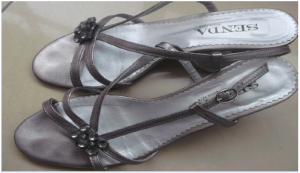
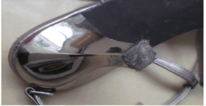
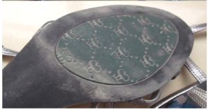
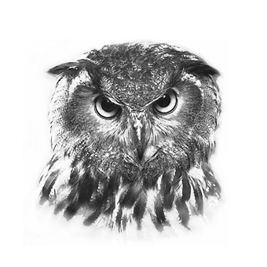

# 138 格物致知

> Posted by 花生和尚 on 二 27th, 2012 in 杂论

上图为当事人所提供的旧物信息

推测的信息：

这姑娘走路爱跺脚，走路蹦蹦跳跳的，大约年纪不大，应该是学生，情窦初开这种。性格比较活泼，比较无忧无虑，应该是大城市的孩子，这个城市很可能有地铁，而且地铁系统比较发达。

**谈话者A：**爱跺脚？蹦蹦跳跳~~这个爱跺脚从哪里看啊？鞋跟磨损程度吗？连有地铁也能看出来？

每一点推断都有原因。

首先，这个款式原本应该是个细高跟的礼服鞋，但是这姑娘选择了中跟版本，而且是做工比较好的品牌。有品位但是又不是品味优先，有品质要求，但是并不 追求极高品质，很可能吸引她的正是兼顾了时尚和运动两种特性的设计。这双鞋的脚跟垫板已经踩到变形、纤维散开，那么意味着这鞋应该很穿过一段了。而这位姑 娘显然很常穿这双鞋，应该是有常规性的逛街习惯。

第二，前掌摩擦很小，那么这意味着这鞋很少接触粗糙地面。那意味着这个城市多半有地铁，从地铁到购物城，很少在大街上踩人行道。这个地铁必定站点较多且密，而且很多从地下直入商业中心的设计。

既然选择这样的品牌，又爱逛街，那么多半是还在花父母钱，而且很得宠，所以总可以去逛。她也并不挥霍，因为这个牌子并不特别贵，而且显然她并没有弄 很多双换着穿。她这个样式，有成熟意味，应该是在上大学，那么多半是在自己家所在的城市上大学。因为如果是大城市，一般很大几率在自己的城市上学，这是其 一。其二，如果不在家乡，应该没那么多机会出门。

**谈话者A：**嗯，说的很对。

如果常在学校穿，那么应该磨损更厉害，那么，要么她很宅，要么在学校不常穿。但是会选这个务实牌子的姑娘不会太不爱学习，因此更可能是学习期间不常穿。

**谈话者A：**嗯，在学校一般不穿高跟鞋，这种细跟的走起来有声音。

上面的若干条是互相交织着印证的，因此结论应该比较靠谱。

**谈话者A：**嗯，推测的差不多全说对了~

此外，你走路很少乱跑，不常变向，比较直奔主题。应该是不爱和太多人一起出去，多半只有很少的几个好友。

**谈话者A：**这个也看出来了？全对了。怎么看？

因为前脚掌外沿和鞋尖几乎没有磨损，那么意味着你很少变向和紧急停步。如果是大群人出门 打闹和避让是难免的，你不常和大伙出去，你常和很少的朋友出去。但是很显然要么这些朋友和你的品味几乎一样，要么你们就不是扫街那种逛街，要么是去博物馆 艺术馆。前者，意味着她和你品味很相近，或者你对她的品味很了解。因为你很少因为她突然看中某个你没想到她会看中的东西急停，如果是总去同一类活动，结论 也一样，就是是趣味相投的老友。

**谈话者A：**对，是这样的。

考虑到大城市本地上学的背景，恐怕有些是高中好友，很无奈的一点是，你很难和外地同龄人相处。你的朋友基本是北上广，你即使拿出十二分耐心也和外地同学他们亲热不起来。

**谈话者A：**嗯，因为我想做的有些人家不感兴趣……

**谈话者C：**而且你喜欢小清新，而且你还对西藏云南什么充满向往。

**谈话者A：**对啊。

呵呵，未必是小清新。

**谈话者A：**为什么是未必，对云南向往不一定就是小清新。

那个鞋子的选择，你爱看茜茜公主吧？

**谈话者A：**嗯嗯。

希望有一天能轰轰烈烈。

**谈话者A：**还好。

看起来那些细节没什么，其实是有很深的原因的，而且互相交叉纵横。其实其它解释慢慢就会自然被淘汰，以至于逐渐你会发现只能是这样。选这样一双鞋，并且穿成这样，这背后的原因是可以做很多靠谱的推测的。

**谈话者A：**确实，你的推测都很靠谱。

---
> **整理：四季**
> **定稿：剑寒秋水**
