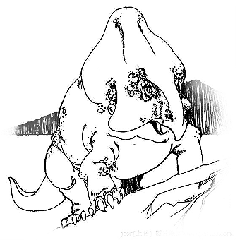

# 156 论日久生情

> Posted by 花生和尚 on 二 27th, 2012 in 杂论

**谈话者A：** 时间的流淌，情义的浓厚，就慢慢会成为一种义务。

你是在说日久生情。这不对，日久和生情没有任何必然的关系。因为爱不可以被强迫！

相处日久，在一般的社会环境中，就会造就一种关系。在最低的水准上，也可以被称作熟人关系。我们为什么特别在意熟人？因为我们认为**已知**是一种优 势，为了保存这种优势，我们会非常自然的希望通过优待，来收买熟人的注意力，这种熟识关系是相互的，人的思维结构也是彼此相似的。

所以，只要相处日久，就会至少因为熟识而产生这种**相互贿赂关系**。**贿赂是一条单行道**，它不同于交易，交易每一单都是清楚而相互自愿的，所以一 旦终止，也不构成一种辜负和抛弃。但是贿赂则不同，无论是行贿者停止贿赂，还是受贿者停止受贿，都构成抛弃和辜负，**一种无法收手的贿赂的义务**，它是自 然的具有强制性的。

但是，一旦具有了强制性，爱就不存在了。不得不对你好，不敢不对你好，则对你好不成其为**服从**，而是**屈从**。因为**志愿性**已经消亡了，至少，受到了损伤和污染。

**谈话者A：** 日久生情不是相互的吗，我怎么看到的是一厢情愿？

刚才说的这个过程是相互的啊，我没说**日久不能成婚**，甚至，也没有**日久不能生情**。我说的是，**日久不能生【爱**】。设若我们说日久生情说的是爱情，那么日久所生的爱情，先天就是残废的。

**谈话者A：** 日久会生情的，只是不同的人，不同的相互关系，生出不同的情分。

家人——亲情，爱人——爱情，友人——友情。

那需要额外的努力去回到各自的本位，去无视熟人关系造成的天然的“义务”。

---
> **整理：四季**
> **定稿：剑寒秋水**
