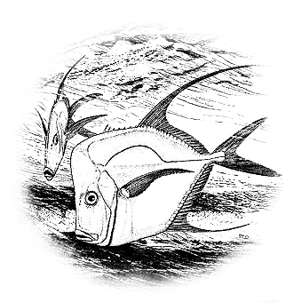

# 160 我不相信你爱我

> Posted by 花生和尚 on 二 27th, 2012 in 杂论

以下是线程《请让我冷静十分钟》的一个片段。

————————————————————————

“这点诉求当作**正当性诉求**来捍卫，捍卫得越坚决，你的爱越苍白，偏偏，它的确可以当作**正当诉求**来捍卫。在捍卫的时候，你杀死了对方对你的信念，是你自己亲手掐死的，别怪对方对你丧失信心”。

————————————————————————

**谈话者A：** 如果A让B失去了信念，那么，如果B的爱不能这样容易消除。B在没有信念的情况下如何爱A。

忍痛呗！不靠任何信念，不抱任何希望，纯靠忍痛。纯靠“绝不仅仅因为痛苦而放手”的**倔强**。

可是都没有信念了呀。

这没有包含信念啊，所谓的信念，是指“我相信你爱我”。这里没有信念了，无所谓相信不相信了，但是仍然坚持，那是因为**倔强**。

**谈话者A：** 不相信，那就成了：无所谓你爱不爱我，反正我爱你，对吧？

有时候也不能这么说了。

**谈话者A：** 什么时候？

你要知道，你爱别人，不是维持亲密关系的充分条件，两人能在一起，仅仅你爱他是不够的，**必须**还要对方对你有爱，因为**承受你的爱是很不方便**的。**对方至少要爱你爱到肯让你爱的程度**。

**谈话者A：** 所以就只有忍痛。这个爱他，也不对他造成什么不利啊！

换句话说，在当时那个情境下，觉得自己丧失信念的人，觉得自己已经根本不相信对方在爱的人，**事实上**是犯了一个错误。因为对方还在啊，**既然他还 在你身边，他当然爱你**。我们先确认这一点，再来看自己觉得已经丧失信念的人在想什么，她只是**觉得**自己已经没有信念了。或者更深刻的说：她**宁肯** **觉得**自己已经没有信念。

**谈话者A：** 为什么？他这样的原因何在？

你要知道，无论你认为存在什么样的“事实”，这一“事实”都同时也是你的一种“感觉”。“他不爱我了”无论如何，都可以加上“我觉得”，变成“我觉 得他不爱我了”，这是永远不存在逻辑上的问题的。而我们刚才看到了：他既然还在，他就至少要承受你的爱，而肯承受爱，本身就是爱的证据。那么问题就出现 了：**她犯了错误**，剩下的问题**只**是**这个错误是无意的，还是有意的**，但是错是一定错了。

走到这个节点上，我们已经可以说出这样一个结论：刚才的那个问题“A已经让B失去了信念，B如何在失去信念的前提下继续爱”就成了一个诡异的伪问题。因为A只要还在，那么B**本来就不该失去信念**。但是失去信念，无论该也罢，不该也罢，总是B无法辨伪的一个“事实”。

**谈话者A：** 你说的A**还在**，是不是A还愿意接受B的信息？

对身为局中人的B来说，B终究是真实的觉得自己已经绝望了的，那么，刚才我们说的问题在这里就导致我们的讨论要分成两个部分。

**第一部分：**B是无意的。她只是缺少自省的本能，她只是并不懂得观察和分析，所以被“诱导”出了这种绝望。

**第二部分：**B是有意的。**她事实上在心底里的最深处是知道A仍然有爱的。**只是对她来说这并不够，于是她**宁肯**相信**他已经无爱**。因为，那样的话，**更容易离开**。

**谈话者A：** 恩！

你看到了吗？第二种，是自欺欺人，为了自利而自欺欺人！客观来说，九成以上的几率，发生这种事，都是第二种情况，其实是**她觉得不够**，而不是**他已经像她说的那么无爱**。**能因为被爱得不够多而放手，而止歇，那么这本身也不是爱，是贪啊**！

**谈话者A：** 那么如果第一种情况呢，B会继续爱，可是一定会改变爱的策略。

第一种情况，其实是似危实安的，因为那是因为幼稚和不成熟。

**谈话者A：** 我觉得还有其他情况啊。

**如果**——注意这个前提——如果对方有爱，那么这其实没什么，当然这仍然要看机缘。比如，要看对方对爱本身理解到什么程度。如果对方也懵懂，思考 问题也简单粗暴，那么这种问题本身虽然属于其实可以消除的误会，但是却会因为双方的无能而导致失败。但是，那失败不能归因于**无爱**，而要归因于**无 能**！无耐心，无谦卑，无体谅的自觉，无深刻理解和观察的能力，就会造成这种无能，第一种情况最后的结果是：多年以后，突然发现自己错了。“我好傻”！这 种时候，**倔强**的意义重大。倔强的本质，是**非理性坚持**，或者更深刻的说，是**反理性坚持**，“我知道**应该**怎么做，但是我不愿！”，“去你妈的’ 应该’！！”

**谈话者A：** “应该”，属于理性。“愿意”与否，属于是否是爱。

这是危险的，但是却是宝贵的东西，明白吗？因为你永远是无知的，你也永远是错的，于是在事情的最终关头，你的理性必定指向一个错误的方向。

**谈话者A：** 应该是定义了一个错误的结论然后按照结论来做。

以至于最正确的选择，就是无视这狗日的理性！Go an extra mile!多行一步！

**谈话者A：** 跟着感觉来。

不，这不是跟着感觉来。注意，我推出“反理性坚持是正确的”的这个论证，是完全基于逻辑的，这里被质疑的对象，不是绝对理性，而是**你个人的理 性**，之所以说这时倔强是正确的，恰恰是因为倔强在**绝对理性**的角度去看，是正确的。你需要注意的是**倔强的限度**，这个限度是什么？是**不到黄河心不 死**。

**谈话者A：** 那就要记得爱对方的初衷。

最佳策略，永远是简单的坚持爱的原则。这总是会被证明是最正确的。**倔强**，只是在那个艰难的时刻为了继续坚持而寻找的一根拐杖。

**谈话者A：** “简单”的结论，总是在令人畏惧的复杂论证后，得出的。

不经过这令人畏惧的复杂，你会心含侥幸，无可消除的侥幸。

**谈话者A：** 所以说，这个侥幸也会让人蒙混？

**横生怯懦**！这个话题还有什么要问？好，我补充一句，我们刚才说到倔强的形式，事实上正是**不到黄河心不死**。那么这个和迷茫所**造成**的**不到黄河心不死**有什么不同？

这两者有**根本**的不同，前者**非常清楚黄河在哪**，它是在智慧的前提下做的**选择**;后者，则是在既不情愿又无能自脱的情况下所**落入的窘境**。 这是两回事，只是看起来一样，似乎都要以无法坚持为结束，但是它们的姿态是完全不同的。前者是平心静气的，仍然可以敏感的感受到最细微的幸福;后者是焦躁 不安的，即使事实上被恩宠着也无法觉得有丝毫快乐。这有天壤之别！

**谈话者A：** 嗯，理解，前者更接近初衷。

实际上，所谓的选择，往往并不在于行为的指向不同。而在于行为的方式不同，指向往往相同的。

比如这个啊，其实都是**坚持到无法坚持**，不是吗？只是**一个因为爱**，**一个因为贪**啊！一定要学会爱。

**谈话者A：** 有了爱，才可能不贪。

没那么文艺，理由很简单，基于爱和基于贪，去做同一件事，前者在天堂，后者在地狱。但是那句**爱是服从的志愿**，其实是超乎一般人想象的复杂的东西，永远别觉得它“好简单”，这个定义虽然是我提出来的，但是我也不知道它的全部含义到底有多深，我只知道，还没见底。

---
> 整理：四季
> 定稿：剑寒秋水