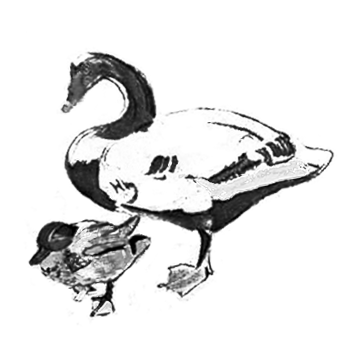

# 166 婚姻的必要性

> Posted by 花生和尚 on 二 27th, 2012 in 杂论

**谈话者A：** 相爱的人一定要结婚吗？

这个问题……当然不一定啊。有一种看法，认为婚姻正在消亡。这看法并不是很没道理的。婚姻正在和生育一样，变成奢侈品和可选项。实际上，爱情也是，甚至亲密关系都是。社会越是发达，生产力越是提高，这些概念就越是显得更像一种爱好，而不是一种必须。

以前，婚姻、亲密关系，都是有非常重要的社会性的功能的。客观说，它能提高人的生存机会——这可不是开玩笑——可以提高人的劳动生产率，可以提高国 家或者部族的竞争力。但是现在，这些功能都被高度发达的公共及私人服务大大的削弱了。你不再需要一个妻子来帮你煮饭，收拾屋子，或者在你生病的时候照顾 你，或者在你伤心的时候安慰你，或者帮你做各种小事。这些功能是真正的可以由其它角色更好的承担的，反过来也一样，丈夫之于妻子也一样。这些东西，在社会 没这么发达的时候，的确是只有夫妻这样的强力伦理才能做的。但是现在呢，有贼进屋，喊警察很可能比叫你老公更实在和有效(显然，我不是在说落后国家)。有 心事要说，心理治疗师要比你妻子更好用。总而言之，当一个现代人——穷人除外——不想结婚， 他会发现无婚姻的生活完全是可以行得通的。而不像古人们——“以后你病了，谁来照顾你呢？”

我客观的说：很多人不该结婚，尤其是为了“要幸福”，他们根本不该结婚。现在这个时代，结婚的充分理由是什么？“结婚有什么好？”既然结婚已经和你 的社会地位没什么关系了(以前不结婚的男人是被歧视的)，也不再意味着绝对永恒的陪伴了(现在离婚很容易)，也不再意味着财富上的优势(很多国家对家庭有 税收优惠，但是现在这一点在削弱)，也不再意味着在生育后代上有优势(无婚可以生子，在发达国家，儿童几乎是由社会福利支付抚养费用的)那么，婚姻还有什 么用？

**谈话者B：** 爱好啊。

不错，现在的婚姻，应该出于对婚姻生活的**爱好**，这才是现代人结婚应有的依据。现在你考虑是否结婚的话，请当作爱好来考虑，**这是不是你非常执着的一种爱好？**

不要小看**爱好**这个词，有人觉得“**爱好**”，意味着玩玩而已，是闲着无聊的消遣。所以，如果有人把婚姻当作爱好，表示那很不正经，觉得太“轻”，太 “不负责任”。实际上这是误解，实际上， 爱好是**人的价值**所在。你生活在世界上，你的价值不是活到九十九天天都吃饱饭，更加不是有把握活到九十九，有把握天天吃饱饭，你就“圆满”了。如果 一个**人**一旦发现自己可以衣食无忧活到九十九，于是任何其它无关的事情都不做了，这个“人”，算是一个人吗？

不错，婚姻生活在不久的将来，将会变成类似集邮收藏一类的行为。**付出一切，享有隐秘的私人的小小乐趣**。外人无法理解，金钱无法衡量。“为什么要 花几十万，就买这么一张小邮票呀。这是能吃还是能喝？！”婚姻即将变成这样一种“莫名其妙的选择”。能真正的选择婚姻的人，将会有集邮家一样的隐蔽的骄 傲。他最终留下了些自己满意的东西，他相信这是有价值的，如此而已。在外人看来很难很难理解，但是在集邮家的眼里，这些外人很值得同情。你的痴迷，是“必 要”的吗？你的爱好，是“必要”的吗？这个答案，和“婚姻是不是必要的”的答案相同。如果你认为人的一切爱好都是不必要的，那么你终将对婚姻感到失望。如 果你本来就对婚姻并不在意，那么你无法勉强。如果你本身热爱**爱他人**，那么，你的爱好对你是“必要”的吗？“我拼死拼活，就是为了多些时间完善我的收 藏”这样想的人，显然认为它是必要的。

课后问题：在人类目前的阶段，再具体点说是我们所处的这个时代，这个社会。撇去家庭压力，社会压力之类的不谈，通常来 说集邮这样的**爱好**，不去选，外人一点压力也没有，也不会遗憾。但是婚姻，对于有能力不去选的人，是不是会构成遗憾呢？我的意思是 这两个爱好是不是还是有很大的区别呢？

也谈不上可惜。比如，集邮家的儿子，继承了老头子的全部收藏，他就应该成为集邮家吗？或者平常就跑得飞快的人，就应该去尝试做职业运动员吗？有能 力，不代表他**应该**要有爱好。的确可惜，但是那是**外人的遗憾**，和当事人没什么关系，遗憾又怎样？这种遗憾是你选择的必然附带的组成部分啊。

**课后问题：**我的问题是，有能力不选择婚姻的人，他看到别人的婚姻，会不会有遗憾？

这是一个私人问题，无法做公共的讨论。

**课后问题：**其实我是想问，婚姻 若是当作爱好……这个爱好……要比集邮之类的爱好**普遍存在于人的人性之中**吧？

是，人有爱的本能。所以这个“爱好”其实人人都有。“爱美之心，人皆有之”——就像这个一样。只是，有很多人的这个天生的爱好被败坏了。比如失败了 几次，或者因为大量问题的误导导致了过度的畏惧，他们缺少正面的体验，于是就被蒙蔽了。这个有点像他本来会很喜欢开赛车，但是他完全不相信自己买得起赛 车，偶然开了几回都开得乱七八糟，于是他会**相信**，或者**以为**“赛车”是根本不好玩的。这的确很遗憾，但是很常见。

**课后问题：**集邮家能给外人解释他的骄傲吗 也就是说，当结婚完全成为一个爱好的时候，是不是外人永远没可能理解结婚的人了？

这个问题没有回答的意义。

**课后问题：**如果外人理解不了，认同这个爱好的人会越来越少吧。

“有多少人认同”很重要吗？

**课后问题：**穷小子和富家女在外界反对下反而更容易私奔……不过私奔之后的日子却不一定好过。

日子不好过算什么问题？真正的问题是，日子不好过了，就不“爱”了，结果白奔了。

**课后问题：**我想知道，现代人的婚姻到底是什么？

这个是完全独立的线程了。

---
> 整理：四季
> 定稿：剑寒秋水