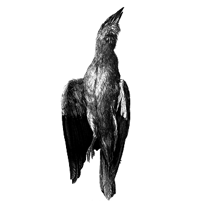

# 168 以貌取人有没有合理性？

> Posted by 花生和尚 on 二 27th, 2012 in 杂论

你是想问，以貌取人有没有合理性吗？

**谈话者A：** 嗯！对！

以貌取人当然有合理性，只要你知道怎么去看。

**谈话者A：** 意味着更好的基因？

也有教养和习惯，有审美能力，有智慧和勇气，这些东西在外貌上都有表现。你的言谈举止也是你外貌的一部分，很大一部分，相貌暗示举止。举个例子来 说，青春痘不去挤它，就不会留疤。到处都是这类伤痕的，暗示心理有弱点。总用一边吃饭导致脸不对称，为什么有人总是用一边吃饭？他是否知道这个问题？是知 道而故意置之不理吗？置之不理的原因是什么？是故意惩罚他的父母还是藐视外貌主义？藐视以貌取人的话，是因为什么原因？是因为为自己不平？还是政治性的？

相的确是由心生，只是只知道好不好看的人是看不见的。你看那些佛像，那些大成就者造像，他们很可能头骨畸形瘦骨嶙峋，或者衣衫褴褛，但是他们却被奉为新的美学标准。耶稣算是美男子吗？

**谈话者A：** 没见过，不知道。

如来佛祖满头镙发，你现在看起来觉得很美丽而已，这些存在反过来定义了美，而不是相反。以貌取人并非不可取，问题是你是怎么个“以貌取人法”。“明星相似法”就不要拿出来献丑了。

**谈话者A：** 可是照这样说来，以貌取人，归结到底还是以“心”取人，因为相由心生。

是的，当然啊。

**谈话者B：** 相由心生可不是这么用的。

它原本怎么用的，这里不关心，这里只是借用这个词汇罢了。

**谈话者A：** 这也是其真正道理所在，但是没有能力识别相貌所代表含义的人，那是不是就没有道理在了？

你这是生怕弄错而已。

**谈话者B：** 这也是其真正道理所在？什么道理？

因为每一处结果都有其必然的“心”方面的原因，所以我们才会说相由心生是有道理的。

并不见得都有心方面的原因。有很大部分得自遗传，有很大部分得自意外。问题是，你拿什么当作帅的标准？

**谈话者A：** 帅的标准，这个仁者见仁吧。

释迦牟尼帅不？

**谈话者A：** 跟他不熟，不知道

**谈话者B：** 释迦摩尼就是加了神圣光环

很凑巧的一点是，关于释迦牟尼的长相有着非常详细的说明，即所谓三十二相，八十种好。三十二相我罗列如下——注意，这些是在佛教造像中老老实实遵循了的：

**一、足下安平立相：**立在大地上时，脚底与地面密切结合，这一点当然不符合现代医学的观念。
**二、足下二轮相：**两个脚心各有一个“轮宝”肉纹，这在造某些趺坐像特别是大像时，是绘制出来的，立像则无法表现。
**三、长指相：**两手、两脚都细长。
**四、足跟广平相：**脚后跟宽而圆。
**五、手足缦网相：**手指脚趾间有肉皮缦网连络之纹样，如蹼。这一点汉化塑像中一般不塑出，或塑作五指并拢。
六、手足柔软相。
**七、足趺高满相：**脚背高起而圆满。
**八、腨如鹿王相：**大腿骨像鹿腿般纤细而圆。
**九、正立手摩膝相：**双手过膝的贵相，但在造像时，为保持正常比例，每适可而止。
**十、马阴藏相：**阴处的一种变化，汉化佛像均造成着衣形态，此相不塑出。
**十一、身广长等相：**身长与两手张开等长。
**十二、毛上向相：**身上所有毛均向上长。此相难以塑出。
**十三、一孔一毛生相：**身上每一毛囊生一青色毛。
**十四、金色相：**全身现纤细的金色光辉，造像时以贴金涂金当之。
**十五、丈光相：**身光照四面各一丈远，造像时以后立屏风状光背当之。
**十六、细薄皮相：**皮肤细滑不容一点尘土。
**十七、七处隆满相：**七处即两手、两足、两肩、脖颈。
十八、两腋下隆满相。
十九、上身如狮子相。
**二十、大直身相：**身量七肘。
二十一、肩圆好相。
**二十二、四十齿相：**一般塑成闭口，牙齿不塑出。
二十三、齿齐相。
**二十四、牙白相：**佛像一般闭唇，二十二至二十四相均表现不出。
**二十五、狮子颊相：**脸蛋儿隆满，像雄狮之颊。
**二十六、味中得上昧相：**喉中常有津液，食物与之混合，其味无穷，造像无法表现。
**二十七、广长舌相：**舌头又宽又长，又软又薄，伸出口来覆盖面部直到发际，造像不表现。
**二十八、梵音深远相：**发音深沉，四远皆闻，亦无法表现于造像。
**二十九、真青眼相：**瞳子如青莲花色。
**三十、眼睫如牛王相：**睫毛长而美，浓重而不乱。
**三十一、眉间白毫相：**两眉之间略上处有一白毫，右旋盘成蛇蟠状，放光，展开则可向前直射一丈五尺长。造像时于面部该处点一白点。
**三十二、顶髻相：**佛发自然成螺状卷，顶上隆起一块肉如髻形。造像作中国髻形，上亦有螺发，发常作青绀色。
本文来源于《淮北学佛网》**原文链接：**http://huaib.com/photo/fotu/fozu/200804/53.html

双手过膝，两手张开和身体等长，所有毛发都向上长，圆肩膀，渗透伸出来可以够到发际线，眉毛中混有白色毫毛，头顶有个大肉瘤，全是非洲人式的短卷 发。但是无可否认，佛陀造像是美的吧。那么，什么叫“帅”？这是一个神秘领域，这个是很不好解释的，也不能一概而论。举个例子来说，异形也很帅。事实上， 异形并不丑。

**谈话者B：** 酷更合适。

不，的确从美学角度来讲，异形可以算是非常漂亮的了。这可以算是一种相由心生的典型。你认可了它的存在，认可了它的point，你会发现它很美。这 被称为世界上最丑的动物，在一定程度上，甚至称得上宝相庄严。我只是从另一面在解释以貌取人该是什么取法，用“和阿汤哥相似的程度”来以貌取人者，只不过 是以貌取人的门外汉罢了。

我再重复一遍：以貌取人不是不可以，不可以的是拙劣的以貌取人，帅或者不帅，这是个神秘的问题。

---
> **整理：四季**
> **定稿：剑寒秋水**
