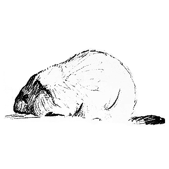

# 173 求围观的伤——论表演性痛苦与看客心理

> Posted by 花生和尚 in 泛讨论（原帖：论爱 - 爱的线程，日期不详）

## 人的三位一体：野兽、人与看客

人实际上可以看作一个**三位一体**:
- 一个预先被埋藏在你身体里的**野兽**
- 一个活在故事中的自我(**人**)
- 一个在空中俯视的**看客**

这才是完整的你。

### 看客的本质

看客的主题是**好奇**:
- 他事实上不关心人和野兽如何
- 他只关心是不是精彩曲折，是不是有趣
- 当你回顾你的苦难，却觉得兴趣盎然的时候，你的看客是面带微笑的

看客天生**厌恶野兽**，看到野兽吃瘪就会爽。

## 求围观的伤：表演性的痛苦

### 1. 对厄运上瘾

很多人会不自觉地变成水烟袋，你一点火，就会冒出安慰的烟。这里说是对**厄运上瘾**而不是对安慰上瘾，因为厄运成了挖掘安慰的利器——获得优待的法宝。

对厄运上瘾的表现：
- 将本来并不能显著地归于厄运的事件总结为厄运
- "说了晚安没有得到回应"——这被当作厄运
- 不自觉地把标准设到这个级别上，透露出对厄运的**偏好**

### 2. 空白安慰的毒瘾

"想开点"、"会好的"、"不要太在意"这些话，只要没有操作性，就属于**纯安慰**。它事实上只是在反馈自己的关切，**但却会造成：**
- 对方对痛苦和厄运上瘾的效应
- 供应毒品的效应
- 提供快感，去维持对方现状的稳定

## 看客的快感来源

### 1. 无聊的痛苦
- 如果你经常大叫：好无聊啊！！！！这就是看客的痛苦
- 你回首往事，觉得自己一事无成，这是看客的痛苦
- 像没有观众的演员那样失望

### 2. 有趣的快感
- 看客看到野兽吃瘪就会爽
- 用心体会能掌握自身的快感
- 眼神一闪，野兽就匍匐在地

## 荣耀原则与围观

讨论的时候，你应该请你的**看客**出席：
- 在场的应该是你的看客，而不是你的野兽
- 看客是你的神性自我
- 他不关心你的野兽吃不吃得饱或者仆人为不为难
- 他感兴趣的是真理本身，是有趣的观点，是真正的堂堂之战

他憎恶用卑劣的手段降低战斗的可看性。

## 如何避免表演性痛苦

### 1. 不要提供空白安慰
帮人解脱痛苦的头一个戒律，就是不能允许受助者觉得"你只是安慰我而已"。

### 2. 说实在的话，说有操作性的话
- "做瑜伽会有帮助"
- "去医院开点安眠药试试"

### 3. 识别对方的真实动机
想解决问题的，会问执行的细节;享受痛苦的，当作没听见，继续倾述痛苦。如果是后者，就要客气地终止对话。

## 真正的强者

真正的强者：
- 不会暴露自己的痛苦来博取同情
- 心里滴血，脸上含笑，任何人都看不出异常
- 外人看不出异常其实是根及格线
- 伤心欲绝的时候，那是练习承受的机会

航空母舰中了一发炸弹，还会正常航行，舰首的水手搞不好都不会感觉到舰尾中弹了，这是强大的标志。我的心是粉碎了，那没什么大不了。

---
> 整理：四季
> 定稿：剑寒秋水
