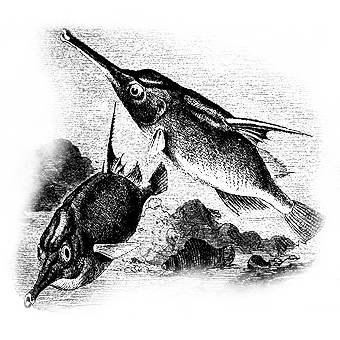

# 关于分手后联系的问题

分手到底是个什么状态？简单来说，就是双方因为某种原因找不到有效的共处方式，于是不得不结束共处的状态。这里有个关键词：有效。什么叫有效？就是**至少有一方有双方都满意的收益。一段关系，要想维持，最低的限度是至少一方**有双方都满意的收益。注意这句话，这句话非常的关键。一般人最常犯的错误，是认为一段关系要维持，需要**双方都有自己满意的收益，这话是错的。后一种"双方各自满意"的标准，不是适用于相爱关系的。**相爱关系的**相爱**，正是体现在双向的、"可能我没有收益，但是我能够满意于你有收益"的态度中。因此，相爱的两个人会分手，必然是因为两个人都到了这样的境地——他们对对方获得的收益之少感到不能承受的内疚。注意，相爱关系的复杂性在于，这种状态不可能单独达到，要达到总会是俩人同时达到。如果仅仅只有一人达不到——比如你对我的收益自己觉得很满意，我对你获得的收益自己觉得不满意，这个时候并不会因为爱而分手，而只是会走向一个新的平衡点。两人的关系状态会改变，会削峰填谷。最后要崩断，一定是最后到了两个人都无法为对方的收益感到满意，于是双方都感到了无法承受的内疚，这样才会真正的分手。

在到达这一点之前，也会有所谓的分手状态，即自己对自己获得的收益不满意而提出的分手。这种分手，是一种**非爱的分手**。那个不是**有爱而爱断裂了**的**相爱的分手**，而是**爱被证伪**，先悄无声息的变为了**无爱的互利关系**，然后**无爱的互利关系**因为**自利的不满足**而崩断。表面上看起来和前一种分手一样，但是**事实上死去的是一个"早已脑死亡的植物人"**。看得懂这两者的差别吗？

不管是有爱还是**无爱的分手**，都是因为有效性已经消失。我们先说无爱的分手。恕我直言，你就不该分。无爱的分手是一种**无意义的失败**，明白吗？无爱，你需要的是检讨自身，回头去爱。爱并不意味着你要千依百顺，并不意味着你要承受什么巨大的损失。那些无爱分手的人，之所以分手，是因为他们认定了接着"爱"自己"亏不起"，把爱和损失硬联接起来了。这是一种误解。"他找我要XXX，声称我不给他就是不爱他，所以我要是要爱我就要给XXX，那么我就不爱了，所以我就分手了"。这整个念头都是错的。错在哪？错在"我要是爱我就要满足他的愿望"。你完全可以**既不就范，又爱**。你不要就这样退席，你要找到这个**既不就范、又不伤情、仍然是爱**的办法，你**必须如此**。因为你分了手，下一段关系一样要回到这个点上来，这是一种无意义的失败法。每个人都有这个时刻，觉得自己吃亏了，自己吃不起更多的亏了，然后要逃走。这段情绪低落的时段，全都被这个人拿来**积攒逃走的勇气**，而不是**思考解决的办法**了。一天到晚在脑袋里猛转的，无非是我有多吃亏，我还剩多少东西，这个速度继续吃亏下去我要完蛋，我一定要结束这个状况。到这里都没错。错在当事人把"结束"无意间混淆为"**尽快**结束"了。因为他痛苦，于是他无意间把重点放在**尽快**上了。什么最快？咔嚓斩断最快。至少他是这么觉得的。你要的是**最终解决**，**不是尽快解决**。**无爱的分手**，全都是**尽快解决**。对于这种分手，我们无需给出什么"联系政策"，直接了当的一点意见，就是**别分**。这个点你就不该分。

注意，这个"不分"不表示要完全同等的维持和之前一样的亲密关系，这个关系肯定是要做很大改变的。目前双方都在痛苦——有爱的关系不存在所谓的"单方的痛苦"——所以这个关系方式肯定是要做改变的。这个改变本身也会很痛苦，你要接受这个痛苦，继续前进。前进到什么时候为止？前进到**爱的分手**为止。就是满足了刚才说的爱的分手的条件——不是自己对自己的收益不满意所以要分，而是彼此都对**对方**在关系中的收益之少、损失之大感到内疚。不是玩悲情，不是假高尚表演给人看，而是实实在在的双方都冷静的认识到，继续亲密关系，其实双方都在消耗。那么大量的消耗所换来的对方的收益，其实完全可以换个别的非亲密方式的形式继续为对方提供;现在有某种客观条件不满足，实实在在的有块大石头放在那儿，无可否认，无可回避;关系更有效的方式，就是非亲密关系的方式，于是分手。这种分手有痛苦，那么就消化它;现在消化不了，慢慢消化。这其实是很显然的顺理成章的策略。

那么为什么会有这种"应该刻意避免联系"的策略流行着呢？首先，有很多人是因为一种潜意识的愤怒，在用这个手段**报复**。他们不但自己这样对自己的旧侣实施报复，而且还建议别人用这个方式去报复自己旧侣的影子——别人的旧侣。无爱的人太多，于是这个声音很大。第二，很多人的爱其实都是贪利罢了。之前的一切阶段都可以用利他的快感下支撑。但是一旦真的把距离拉开，就会觉得"这样联系好辛苦，已经分开了，不值得"。"不值得"的念头会在这个新的阶段再次冒出来。人在跟前，连分手的折磨都可以甘愿承受，分了手，**人不在跟前了**，那么分手之后保持联系的折磨就很不值了。看到了吗？这样的人其实是胆怯。为了安慰自己，回避因为自己胆怯而来的自我鄙视，他们也会尽量的制造同类，去建议"最好刻意回避联系"。这两类人有特别的动机去主张这个观点，说服别人采用这个策略对他们很重要。这就导致这种策略声音很大，从而导致独立思考不足的人被带着走。一旦被带着走了，为了害怕自己的决策是错的，也会跟着喊。

事实上因为爱而选择了分手的人，为什么不要联系？那个问题摆在那，我们暂时不能以亲密关系为形式在一起，那么我们就以非亲密关系为形式的在一起好了。保持非亲密关系接着想办法和努力。如果没得努力，那么就等待这个障碍看它会不会因为某种天意自行消亡。在此之前扩大自己的心胸，让自己能满足于非亲密关系。为什么要"刻意避免联系"？这是无必要，也不应该的。是的，它是痛苦的，但是这种痛苦是一种礼物。你能接受它，你会发现你的心变得更柔软和坚韧，你对所有人的态度都会变得更加温和淡定，你会发现你变成了一个更好的人。拒绝它，拼着命的回避它，你就一直会是一个阴沉着脸一触即跳的小孩子，别人在你身上感受到的，总是阴冷、浮躁、尖酸刻薄，听到的总是抱怨、辱骂和嘲讽。前一种痛苦接纳的越多，你会发现你的心胸越是宽广，你根本不用做什么，也不用牺牲什么，其他的人都觉得温暖，会发现你是个能住人的大帐篷。所以，总的策略是，**绝对不需要刻意**回避。

但是这不是故事的全部。故事的另一部分，是某些时候，联系的条件无法满足，于是**沉默就是最好的联系**。这是指什么呢？指的是**你只要说话，就会被对方扭曲为一种表态**。不管你说什么内容，不管你是和颜悦色还是疾言厉色，不管你是谈工作还是谈哲学，只要你开口，对方就会自行展开种种联想和猜测，会脑补种种有情有义或者无情无义。你说"今天天气不错啊"，他想"哎呀呀她还是舍不得我的";你说"我同学升职了"，他想"完了她变心了";其实就是你**沉默**，他都会想"她这是因为我XXXX，所以在故意气我"。这种时候，你要沉默，因为你只能沉默了。直到他改掉这个习惯为止——这只能看天意——否则你只能沉默。问：为何不能给他信任 相信他足够强大和平静呢？

如果你相信他没有那样，你就应该说话啊。问题是他有没有那样，一望可知。你也不要自欺欺人。我完全同意你应该不断的尝试，看看他是不是处在这种只要说话就要失控的脑补的状态。但是每次尝试，发现仍然如此的时候，你有**必要技术性的停止对他的不良刺激**。他会忍不住的对你不停的说话，跟你说很多一看就知道是对妄想出来的问题的解释，觉得你肯定是因为嫌弃他没钱啊，或者被别的男人迷住了啊，或者你爹对他是偏见啊，或者猛烈的跟你谈"我们是上天注定的"啊，等等等等，各种自说自话的大发作。这种时候，你就只能沉默。你会有各种冲动要去解释不是这样的，不是那样的，你不要这样想不要那样想，你会有的。但是你接着发现你说的话都被他拿去脑补成了另一个版本，一种认定你是口是心非的版本，一种甚至是故意反过来理解的版本。你就**必须沉默**了。

这个沉默期，确实需要战术性的**刻意回避对话**。但是我的看法是应该保持观察。他会有一系列的钟摆式的变化，最后会慢慢平静下来定格，看他定在哪格上。定在一个好的点上，你可以再试一次;要是定在一个坏的点上，那你可能只好永远沉默下去了。但是那是一种无可奈何，不是一种"刻意回避"，明白吗？不是你不想联系，而是无论你说什么，对他都会被翻译为一个会让他恶毒大发作的信息。尽管**沉默本身也会被看作是另一种形式的同一信息**——不然对方也不会叫做"银子弹"了 :D ——但是沉默很显然至少是一个更低成本的选择。说不说话、说什么话，结果都一样糟，那么费力把事情搞坏，当然不如不费力把事情搞坏啊。至少省力啊。永久沉默就是这样炼成的。

我说完了。

---
> 整理：哪吒
> 编辑：哪吒
> 审核：四季
