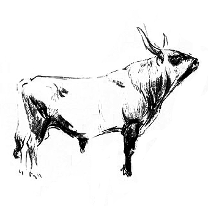

# 放下

**谈话者A：**(分手后)我想走出这个状态，我爱过他，这样的结果我认了。但我想尽快走出来。

**谈话者B：**怎么样算"走出来"？

**谈话者A：**放下这件事情，对他不再气愤。我气愤是觉得他欺骗了我。

**谈话者B：**什么叫放下？

**谈话者A：**不再想着，不再因为它吃不下去饭,睡不着觉。

**谈话者B：**这样不好？

**谈话者A：**不好，影响到我正常的工作跟生活了。

**谈话者B：**失恋了于是吃不下饭睡不着觉，这是不正常的还是正常的？

**谈话者A：**正常~感冒了会打喷嚏嘛！

**谈话者B：**是啊，我也觉得是。所以你现在是在求"不正常但是舒服些"的生活，这是有代价的。

假设我现在有一个奇妙的办法，可以现在就开始不疼了，下次你的恋爱会很乱，因为你有办法无视一切问题，反正垮掉了来群里洗个头就完事——看你的样子还打算是免费的：D。这条件反射一旦建立，以后就没法谈爱了，假设存在这种特效疗法，它的效用也和海洛因差不多。

**谈话者A：**我这个月工作很多,月底还有职称考试.但因为失恋,我工作跟学习都无法投入。

**谈话者B：**你这个月的工作和职称考试，和将来能不能谈健康的爱相比算个啥？

再说"放下"，老实说，除了忘记到想不起**，我还真不知道要怎么才算是放下。有人打比喻，说人要轻装上阵，说一件件不幸的事情发生了，你要"放下"，放下了你就轻松了。这比喻很不讲道理，这导致小孩子们吃不得亏，一旦痛苦了就要吵着"尽快放下"，其实呢？其实首先，只要你智商正常你根本就没可能放下。某人死了，某人走了，这怎么忘记？要是这种事都能忘，这人只怕生活自理能力堪忧。住在大山里唯一的生活内容就是扫地挑水浇菜做饭，你可以这么做，生活在现代社会一天收发几十封电子邮件，哪封发错了就可能要赔十来万人民币，你也学着这么做，那就是找死了。首先你就放不下，其次你也不能学人家放下，这一点没得商量。**

你只能学会怎么带着沙包走路，走出肌肉来，干脆就绝了“放下”的念。

要痛等它痛去，把这个痛当成理所当然，去掉那些“我到底要怎么才能摆脱，我到哪里去找解脱途径”的念头，你一天可以少想几个小时。你现在一天醒着的十六个小时，只怕有十个小时都在想要怎么解决这个痛苦，不去想这个，你就只痛苦六个小时罢了。

——————
> 整理：花生和尚
> 编辑：花生和尚
> 审核：四季

