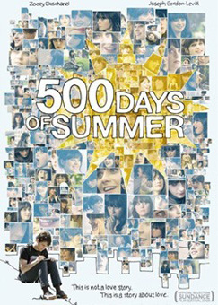

# 看片会《与莎莫的500天》

为什么没成？这是个很关键的问题。

为什么这样的没成？从任何方面看，都是天作之合。在一起这么开心，又不存在不门当户对的问题，也无所谓家庭反对，也无所谓没钱没前途。为什么没成？这么开心为什么没成？

炉子说是她没那么喜欢他，是吗？其他人觉得呢？她其实不怎么喜欢他吗？她没劈腿，没占你便宜，而且她先说了不要严肃的关系。Summer当然清楚自己喜欢他。怎么可能不清楚？一而再，再而三的说过这个话。酒吧那件事吵架之后复合，Summer第一句话就是I like you。

哪里出错了？到底什么地方错了？这个点你要是找不到，那你不觉得害怕吗？你找一个女友，未必有Summer宽容可爱，你自己未必有Tom这么风趣好玩。他们这么好，结果没成。你不找到原因，你会害怕的。

为什么没成？

坏就坏在Summer说我不想要严肃的关系，他口是心非的说了"好啊"。这诅咒了后面的一切。贪。他看起来很可爱，各种好玩，但是这一句很贪。其实他不愿意，只是他贪图眼前的开心，所以有什么都先答应着再说。他一旦答应，就意味着一个问题：只能等待Summer自己改变意愿，他自己不能再以任何形式暗示、引诱、操纵。但是他明显的在事后口不应心。

他在酒吧打架。Summer不是因为他没考虑她的感受，而是这场架是以男朋友的身份打的。这个立场，意味着一向以来他都在【假装不是】男友，意味着她上当了。她不是不想扛着，她后来试图复合来着。但是这个忌讳一犯，后面的一切都变味了，魔法消失了。

很多欢乐，只有在心情完全放松的时候才会成其为欢乐。不是笑话好笑，而是人有笑的心情。而这种愉快的心情，是容不得多少这种犹疑的。他们最大的支柱，就是这种愉快体验。心里装着事，听见笑话的反应就会慢一秒。对方说完，你要慢上一秒才反应过来。就是这【一秒】，【太漫长了】。慢上这一秒，气氛的走向就每一次都无法克制的走向冷场。

他们两次口是心非。第一次，男生为了近在眼前的开心的可能性而口是心非。第二次，是女生。

第一次他要是不是这么贪，忍住就好了。其实，他们之间当时达成的这个状态，他有机会说"不"的。她说"我不想要严肃的关系"，他应该说"没关系，那么你想清楚再来找我吧"。她【会】舍不得，后面的剧情，她就没舍得，不是吗？她会反过来，会放下这种"不想要严肃关系"的执着。后面的整个剧情都会不同。但是他【不敢"冒险"】。他太贪。其实，她"不想要严肃的关系"，本身已经是贪了。发现了吗？她试图"只喝醉，不头疼"。这个要求，其实本身就是一种诅咒。

这不是负不负责的问题，这是【认真】的问题。负责，是一种附加义务;认真，是一种必要条件。举个例子：你出去打桌球，你要打得很认真，你才会真的觉得好玩。打完之后要付台位费，这个才叫做负责。这个台位费，才对应着"负责"。打球认真，这个是【没得商量】的。不是我本人要不要求你的问题，而是这事不能这么办，是客观的、逻辑上的必然条件。她想要回避的，不是【人为添加的"责任"】，而是真正快乐的恋情所【必然要求】的投入和认真的态度。所以说这个叫贪。看明白了吗？坐车不肯出车费，这个有人可以接受。但是开车不想费汽油，有人站出来说"好啊"，这就是在帮你骗自己。前者说的是负责，后者说的是认真。

他们的关系，因为开端这个相互欺骗，结局被诅咒了。她骗自己愉快的关系可以不用认真，他骗她说这可以。越是往后，越是维持不住。他觉得她其实很认真，无法相信她不认真。她觉得他认真了，之前骗她了。越是开心，这个诅咒就越强大。

其实，他要是在开始忍几天就好了。小妹子有这种念头，是很常见的，这是一种孩子气。他不该顺着往下说。应该说：那么就不做男女朋友好啦，就这么接着交往好了，等到想认真的时候再做恋人。然后【真正的做到】不要像男女朋友那样交往，【不要】做男女朋友才能做的事。

小妹子自己也渴望，让她这种渴望来改变她自己的主意。如果这个都改变不了她的这个执念，那么这关系本来就不该开始。

可惜，他没有自信，又贪婪。他当时只顾着想着："只要说一声是，就可以和美女滚床单了！"，"将来的事将来再说"，"谁知道她会不会改变主意呢？"，"谁又知道我不会改变主意呢？"，"只要我说'好'，我就可以和美女滚床单了！"。

要一个宅到这种时候连女人味道都没闻见过的宅男在这个关头忍住不贪，太难。这不是巧合，这恰恰是命运。如果这个妹子不是这样，她也不会喜欢上他。你知道吗，成熟的女性是不会喜欢这样的小男生的。凭气味都能看出他虽然可爱，但是却是银子弹。确实需要这样的任性的小女生——任性到不想认真的小女生——才会去欣赏他的"萌"。她们往往提出各种类似这样必杀的要求来。而她们看上小"萌"物们，恰恰是不知好歹，唯求一快的年纪。

"你要答应永远对我好，只喜欢我一个人，我们才能…."

"好"

这就是为什么他们最后完蛋。提了这样必杀的要求，还说"好"，当【必杀】的要求是说着玩的吗？她后来遇到第二任的时候，她不会再提这种要求了。而这时的她，也不会再喜欢小男生了。于是，她发现"以前不能确定的，现在能确定了"。Just like that。去掉无理的要求和因为贪婪对无理要求的大包大揽，就去掉了这个诅咒了。

而这位小男生是怎么总结他的问题的呢？"一切都不是命运，一切都是巧合"，【这方向恰恰弄错了】。他无论是失恋后的处理方式，还是所谓的恢复方式，都仍然是"小男生方式"，他【仍然】没有长大，他很可能再栽跟头。别看后来那段旁白似乎很帅："没有所谓的命运，一切都是巧合"。仔细想想，一个人假设认为一切都无非是巧合，要怎么往下生存？这是句漂亮话罢了，没有操作性。

这里面有个要点要说明：小妹子说的是"不要认真的关系"。如果她说的是"不打算结婚"，则不算是"开车不想费油"。

因为关系要认真，这是人类无法免除的必要条件。但是结婚是人类的选择，这个他倒是可以考虑答应。其实你仔细想想，后者容易得多——只要不求婚就行了。前者要求的是你不要"认真"——这怎么执行？仔细想想，要怎么才能做到"不认真"？这没有判断的合理尺度。换句话说，我拼了命的努力不认真，你却有可能基于你自己的标准认为我很认真，我还没得分辨。这句话是个定时炸弹。我认为他们失败，就是败在这里了。

## 爱要对应被爱

我们说过不要去为"他到底爱不爱我"寻找证据，但是另一方面我们又提到爱要对应被爱。既然爱要对应被爱，那么必须要有一个判别的手段。这个跟"不要寻找被爱的证据"就矛盾了。这个矛盾是否意味着一种错误？

其实没有。我们只需要稍作辨明就能分开这两者。前者的爱，是【loved】;而后者的爱，指的是【charished】。

you don't find.

you don't look for evidence for being loved,
but you need some proof for being cherished.

**谈话者A：** 爱要对应被爱这个是CHARISH？

是的。这个才是"爱要对应被爱"的恰当翻译。

**谈话者A：** 我记得你说过charish是类似慈善，是你和神之间的交代？

【爱需要被"珍惜"】。爱的本质就是慈善(charity)。Charity shall be cherished.这是"爱要对应被爱"。我给你的东西是无偿的，是不求回报的，是纯然为了你的，也是不会收回的——【但是，它是不可虚掷的】，【也是不可被用作伤害的】。不单如此，这个评判标准还在【我】的手里，而不是在你手里。你们只需要比照慈善者的心态，就能完全的理解这种立场和伦理。

**谈话者A：** 评判标准是指回应的标准？还是我愿意怎么给予的标准？

我捐给你十万，不要你做任何回报，不用你给我扬名，不需要对我有任何好处，但是有两条：第一，这不该被浪费。第二，这不该被用来伤害别人——包括你自己。这两条事实上都是由慈善者【自由心证】的。慈善者【在任何意义上】觉得这份付出被浪费或者被错用了，她就有权利甚至有责任要停止继续输出。在这里事实上无需给出任何客观的指导标准。每个爱人的人心里事实上都有而且应该有这样的尺度。她的尺度无论多么"苛刻"或者"不近情理"都是在她自己自由权利之内的。唯一能调整她的"苛刻度"的是这样一个事实：假如她的标准过于苛刻，她将找不到可爱(lovable)之人。而这恰恰是一个完美的抑制因素。任何一个懂得爱人本身的满足的人，真正最在意的反倒是这样一个无人可爱的局面。因此，我丝毫不认为一个真正能做到charity的人会真的"过于苛刻"。她必定会从宽和从缓到她可以承受的尽头，而绝不会在任何意义上故意的抬高这个标准来作为自己不必付出的理由——因为对她来说这种付出是一种福利，是一种享受，而不是相反。

---
> 整理：柿子
> 编辑：柿子
> 审核：剑寒秋水
> 二次整理：四季
