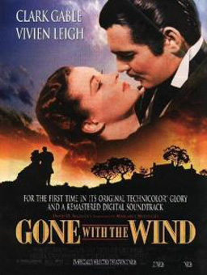

# 看片会《乱世佳人》

reid很喜欢斯嘉丽，这是毋庸置疑的。这里面，跟斯嘉丽结婚的个个都喜欢她。有人喜欢她漂亮，有人喜欢她性感，有人喜欢她的孩子气。reid无非喜欢得层次深一点。的确是层次深一点。但是，说到底还是【喜欢】。他只是喜欢到了以为自己可以不在乎自己不喜欢的部分，并且认为这个对比永远不会改变。他是以此为基础求婚的。他【并没有】抱定【必死的决心】。他也不过是另一个以为"爱就是无与伦比的喜欢"的人罢了。一旦无法喜欢一旦无法"幸福"------事实上不是无法，只是他懒得拼命------他就闪了。他比俩前任的优势，只是他比俩前任喜欢的点更深一些，不是那么肤浅的"好看""有面子"之类的东西。这个也的确撑了更久。说得厚道一点------要是运气好些，很可能可以撑一辈子。可惜，运气这东西不由人。运气好不好，谁能料得到？总之事情发生了，你没准备好，你撑不住，你就要完蛋。他只是喜欢她，到了足够令她失宠的事情发生的时候，他就喜欢不下去了。就是这么简单。

**谈话者A：**但是，她小产，他很痛苦啊。后只是韩媚兰死了而已......

瑞德关于爱的理解是扛不住不幸的事件的。然后不幸的事件发生了。斯嘉丽犯了n次糊涂，外加孩子意外身亡，就抵消了那些喜欢。

这两个人的关系过程，如果说有什么现实意义，不如说是这个：光相互喜欢不够。这俩人都是很讨人喜欢的人，男的善解人意豪侠老练，长得也不差，也风趣幽默。女的千娇百媚，各种小眼神小脾气，要说喜欢谁不喜欢他们？更别说他们还凑到一起了。这是以喜欢为基础能缔结的最好的关系了。发现了吗？又经过患难，又经过生死，后来又金钱无限，魅力无穷。可以说各种令人喜欢的要素一应俱全，要啥有啥。

这故事要说有所寓意，寓意着什么？【光喜欢，不够】。你要和人缔结永久的关系，请确保你有【必死的觉悟】。不要抱任何"我绝对不会吃亏"的侥幸。你喜欢的一切都可能瞬间消失，速度之快令你难以想象。

这一对其实又怎么了呢？老实说，发生在他们身上的不幸，谈不上是谁的错，没啥真的可埋怨的。滚下楼梯全怪对方吗？骑马意外这种事，说是教骑马和跳栏的错，还不如说是正常的运气不好。谁能滴水不漏？唯一真算的上问题的是那个心里有别人。问题是，瑞德又不是才知道，知道n年了吧。事实上这关系脆弱得很，经不起真正的撞击，毕竟谁也谈不上爱谁，实至名归呀。

艾希礼和梅兰妮虽然爱得"很没意思"，但是人家是爱。很拘谨，很没趣，很没剧情，但是他们算是爱。之所以这种感情现在不"流行"，是因为现代人胃口都被宠坏了呀。

---
> 整理：哪吒
> 编辑：哪吒
> 审核：四季
> 二次整理：四季

© 2015 论爱.
