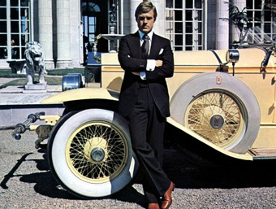

# 看片会《了不起的盖茨比》

放完了。这故事可真够简单的。Well，说说吧。

**谈话者A:盖茨比举办的酒会，好多人去;而他的葬礼没几个人去。而且他也老是贿赂别人，长了别人的贪欲，结果对自己不好，他人也会薄情。**谈话者A：**** 黛西好弱。**谈话者C：**** 是盖茨比弱吧..

问题不在她好弱。问题在于假如你是盖茨比，这个结果里哪里可以弄好一点？

**谈话者B:不该逼着她做出选择，要她立马跟我走。因为她跟他丈夫有感情，家庭也稳定，哪能说断就断？**谈话者C：**** 怎么家庭稳定了，汤姆明目张胆的找情妇？按书面的说法，就是看清这帮人的"声音都满是金钱的味道"，算是迷恋了错的人了。**谈话者C：**** 盖茨比一个重大的问题，是自己造女神。在自己心里给对方抹成完美形象，当成又圣洁，又忠贞，又长情，又道德高尚完美，又勇敢，又有同情心，又高雅，又文艺，等等等等。这是大忌。不要把人往好了描，这不客观。不要把事情往美好了想象，这也不客观。

他站那逼着daisy说她从没爱过tom，这就是这种病发作了。要逼着现实去符合他自己的完美想象，然后逼着别人给出或者干脆自己制造证据。他说起来是一往情深，其实一往情深的对象只不过是他自己的美梦，daisy只是这个梦的宿主。拿钱买热闹，造假债券换钱，想象daisy肯定会立马跟他走，想象daisy完全没爱过tom，这些迹象都是非常危险的信号。一个人开车，不是跑在实际的路上，而是跑在自己假想的理想路线上，当然要出事。

你们所爱的人一样打嗝放屁撒谎装怂，他不是天上星辰下凡。有优点，有成绩，也一样有缺陷，有令人讨厌的过去。觉得对方是多么完美多么好这是不健康的。现在问题来了：这种认知是不是违背荣耀原则了？荣耀原则不是要求把对方当成更好版本的人来对吗？不是始终首先相信对方既正直又诚实吗？

你们要知道，荣耀原则是一种对人的方法。它并不要求你在心态上去那样相信，它要求的是你在行动和态度上去那样对待。在心态上，它要求的是你不要预设结论，在不了解或者了解不透彻的时候不要先下糟糕的结论，而不是要求你绝对不能怀疑对方的荣耀。它要求的是不管你怀疑与否，你要按照对方是荣耀的先那么去对待。对方是荣耀的，自然会对得起这个对待。

但是，荣耀原则非常忌讳你因此就死掐在一种完美主义想象里面，拒绝查看事实。它不是在规定你的认知，它只是在规定你的策略起点。这么说吧，荣耀原则形同于要你在不清楚情况的时候先直走，但是绝没有叫你直走到底的说法。而是直走的时候要瞪大眼睛，看到的确要转弯，你再转弯。为什么规定你先要直走？因为要不要转弯，你要开近点才能看清楚。这是技术性的，这绝不是告诉你"世界上的一切道路都是直的"。所以，它和客观准确的认知没有矛盾。

荣耀原则允许你在心里认定某人是坏人，但是不允许你一开始按照对坏人的方式去对待他。看懂了吗？随你怎么认为，一开始你都要按照充分的礼貌的方式对人。这才是荣耀原则。千万不要以为荣耀原则不许你把人当坏人。更强的荣耀原则，要求你不管心里怎么认定对方，你要一直坚持用礼貌的方式对待对方。所以这个和我们刚才说的不要自编完美想象并不矛盾。盖茨比死在哪？就死在想得太美。死得一点不算冤。

另一点要点是：假如你现在实实在在没有看到你所爱的人身上有什么缺点怎么办？那是不是表示对方在撒谎？还是你现在肯定头脑不清醒？还是一定表示你们交往没有深入？

首先，在一般意义上达到无可挑剔是可能做到的。有人的确非常幸运，你不必特意怀疑自己的好运气。真正的危险在于，你不要因为你看到的就认定对方一定是绝对完美且将会永远的完美下去。你看到只是局部，只是现在。【你要做好原谅对方和接受对方的问题的准备】。最糟糕的是【以为高枕无忧】，而不是不可以当前心满意足。看着这个完美的人，你要准备接受他可能突然崩溃;你要多想想，要是他下一刻被证明是十恶不赦的坏蛋你会怎么做？你能承受到什么程度？你要怎么努力才能承受更多？这种承受力，永远不嫌太强。不管你现在已经有多强，你都还需要再强。事实上，一般的实际状况是，你要做到能接受她和别人暧昧的地步，你才能在实际中不因为她的一句小冒犯而发火。你在内心积累这样的力量到很深的程度，你在行为上才能初步的表现出必要的友好。你在内心仅仅能接受某些微不足道的过犯，你在行为上必定无比苛刻。你要在平时就做好准备原谅一切的心理建设，不要有任何"这是我应得的""这是她该当的"或者"这是她欠我的"这样的念头，你才能初步在行为上做得像个人样。

这个心理建设，与对方现在是否表现完美无关。即使她很完美，你也一样要去做这准备。这准备不是用来应付将来可能的糟糕状况的，而是有这准备你【现在】才能真正做好，你才能让别人现在就感觉到应有的舒适。这更多的是为了【现在】，为了【当下】。你时时刻刻能接受她另作选择，你才真正能摆正对她的态度。你一想着她是我的了，再也不能反悔了，你马上就变成个混球，混帐王八蛋到人家说都不想说你，然后人家理所当然要分手。然后你拍桌子打板凳骂街准备泼硫酸，从而更加证明别人当初瞎了眼。

好了，就说到这里。

---
> 整理：花生和尚
> 编辑：哪吒
> 审核：剑寒秋水
> 二次整理：四季
