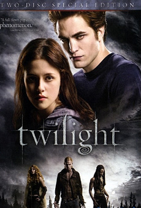

# 看片会《暮光之城》

关于电影，我们可以这么评价："没有理由怀疑男主对女主的不是真爱"。

**谈话者A：**那这部电影中要学习什么？

吸引力。

男主怎么吸引住女主的？这部片子被认为是很浪漫的片子——的确这位男主有代表很多女性的理想。

这么说吧，这位男主真正的要点，恐怕是他很善良。之前的那些引起注意的手段都是次要的，真正的要点是他很善良。他是个吸血鬼，他有强烈的冲动想杀人，他有这个能力，他也可以逃脱惩罚，他不杀人有痛苦，有实际的损失。同时，这个身份还有其它额外的代价——譬如绝对不能在阳光下现身;譬如不能跟人长久交往;譬如心理上的非人类倾向。这使得他不杀人就成了一件非常了不起的自我克制，成了一种善行。这个善良是有代价的，而且很艰难。他同时还因为这个身份的敏感处在一种绝对的孤立之中。这能激发一个人强烈的奉献欲，会令另一个人有很强的让他舒服些，开心些的念头。这种动机，说到底，就是爱。

这里我们必须同时指出几个要点：1. 那些外型条件，言谈举止，那些"吸引注意力的技巧"在这里面起到了什么作用？这个作用应该被概括为"没挡道"。它们的作用更多的是"如果没有，那么别人的这个冲动容易被压制"，而不是"可以引起别人服从的冲动"。长得英俊，效果不是令人想服从你，而是在别人起了服从你的念头之后，不至于因为你的相貌丑陋而被吓住。有钱也一样。谈吐文雅，也是一样。

一直都是这样。只是在我们现在的社会文化里，"没什么坏处"相对来说已经稀缺了——放眼望去，几乎每个身上都有各种不同的"坏处"。要是有一个，相貌没问题，家世没问题，性格没问题，说话没问题，这就很"珍稀"了。这成了一个很大的"优势"，结果令人反过来把那个当成爱的重要条件，甚至是最重要条件。这是本末倒置的。

2. 这个善良并不是以做了多少助人为乐的好事作为标准的，而是以【为他人忍受和克制】为基准的。仔细体会一下，你们会发现一个学雷锋做好事的人，未必让你觉得有多性感，但是手里握着强大力量，却能小心翼翼自我控制不伤害别人的人，很性感——【至善止于弃恶】。反过来，假设男主身上没有这个强大的力量，他的做法完全不变，你就会发现他的"善良"一下就打了巨大的折扣，失去了那种强烈的吸引力了。【拥有强大的能力，是这种造就吸引力的善良的必备基础。】——是它的【底色】。有强大的报复能力而不报复，有强大的攻击能力而不攻击，有强大的伤害能力而不伤害——前者犹如黑底，后者有如白面。画在黑纸上的白色才是我们所谈论的这种有吸引力的东西，画在白纸上的白色则是多余的。

看明白要点了吗？【你可以比善良人更善良】。实际上善良的客观标准，那个效果性的标准是几乎不变的，而且是很有限的——你很难在努力行善方面积累起多高的成绩单来。一般的来说，你能做到的实际上在大面上说和普通人没什么两样。善的分量和成色，就好像这个白色的亮度一样，向上是没有多大空间的。你的能力范围，才是给你的善添加份量的最重要的方向，那个方向是有无穷可努的力的。这才是为什么那些强大的人，一旦善良就令人难以抗拒的根本原因。为什么人会爱上善良的人？因为这是一种自我实现。这位女主很直白的想把自己变成男主的剑鞘，好让他不必那么辛苦。

为善良的人奉献，这是非常直白的自我实现的之道。人终有一死，你最后总是什么都剩不下的，所以你总要把你的生命用在别的什么东西身上。这中间，与其助恶人，显然不如助善良的人——这是毋庸置疑的。在善良的人中间，越是善良的价值高的，越是意味着你的生命奉献有意义——这也是非常直白的。一旦你确信你选的这个人是值得的，那么你做出的每一项牺牲都是一项事业的一部分。你得到什么是次要的，重要的是你做到了什么。这种感受是很令人上瘾的。不在于你知道他肯定会感恩图报或者你肯定吃不了亏，而在于这的确很开心。这种"道德毒瘾"是人类根深蒂固的东西。

我们曾经说过爱的根基是什么，就是这种"道德毒瘾"。这种心理反射驱使人们抛开自我去利他，于是才造就了现在的人类社会，否则我们是很难以现在这样的复杂度和紧密度群居的。

而刚才这个吸引力的解释，正是和这个心理反射相对应的。

---
> 整理：四季
> 编辑：晓游
> 审核：剑寒秋水
> 二次整理：四季
