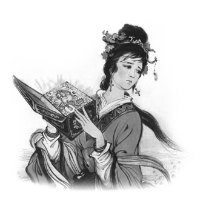

# 读书会《杜十娘怒沉百宝箱》 (I)

时间到了

说说吧

一个个来

**谈话者A:杜十娘的悲剧在于觉醒不完全，看似很有勇气，其实勇气不足。追求幸福的顺序错了，应该先赎身，在自由身的状态下追求爱情。不应该是有前提条件(遇到某爱人)下赎身。她与李甲的是在妓女与嫖客的途径认识的，途径不对本身就注定是悲剧的，妓女问嫖客要名分很荒唐。另外她怒沉百宝箱不过是一种【报复】的心态，根本也谈不上真爱。**谈话者A：**** 除了认识途径不对，对象更是不对，李某人根本不是独立的人更是不懂爱的人。跟不懂爱的人谈爱情，等于对牛弹琴。**谈话者C：****即不能摆脱父母的控制，又自己没主意。什么事情都要等别人来出个主意。他和孙富在一起的时候，交浅言深，什么破事都往外面说。**谈话者B：**** 我觉得杜十娘是没什么可说的，事实上，对她这个时代的女子，能做到这些已经属于相当勇敢的了。她对自己的身份其实并没有特别介意，依然愿意跟着李甲回家，并且非常"贴心"得准备了对策。她其实对李甲有一定程度的了解。她只是错在把希望寄托在他身上。她怒其不争，也怒自己。最后跳江我倒感觉是对自己的报复行为。**谈话者C：****我觉得十娘不是在考验，是没有拿百宝箱作为利诱。**谈话者C：**** 男二很有技巧的从为男主的角度考虑，让男主忘记了自己的初衷是和十娘在一起，把自己的安危当成了自己想要的。男主太弱，整篇基本感觉是被各路人牵着走。

目前来说，现在有这么几种看法：1.李甲这个人选不行。2.杜十娘选人有路径错误——不该从嫖客中选。

她对李甲的"忠心"，严格意义上说是【对交易伙伴的信用】。"谁能把我从这该死的瓶子里放出来，我就要实现他三个愿望"很奇妙的一点是，杜十娘在这一点上，很像一个失望的灯神

"We could have had it all "——这才是她愤怒的根源。

到了最后的时刻，她恨的是李甲吗？恐怕有大半是在恨【自己】——恨自己【为什么不早点抖开这包袱】。【"现在一切都晚了"】。

杜十娘是什么样的人？

前面的情节里，她丝毫没动声色，手里有解决一切的力量，但是却能稳坐钓鱼台，稳坐钓鱼台到了最后一刻。不管她出于什么理由，她是冒了"李甲筹不到钱自己跑路"的风险的。但是一切尽在她掌握之中——看你似乎没有信心了，给你150两，让你再搏一搏。要是真的搏不到呢？杜十娘【会放过这个机会吗】？从她的心计和果决来看，【恐怕未必】。

事实上，整幕剧直到李甲弄出卖妾的事情之前，完全在杜十娘的控制之中，不是吗？遇到剧情受阻，总是十娘玉手轻拨，让剧情沿着她想要的路线继续下去。无论老鸨、小厮、丫鬟、李甲还是她的姐妹们，个个都是她的棋子。如果照着剧本演了，十娘就含笑安坐。没照剧本演，十娘就稍加拨动。

十娘是多么强悍啊："他也使过钱的""我可不要跟别人""他只是一时困窘"——这就把价钱降到300两了。"你要是不放我走，我一剪刀下去给你来个人财两空！"——于是老鸨别无原则的就范。你要记得，她手里捏着【千万巨资】。这是一个千万富翁在【拿剪刀跟人玩命】。出了门，明知李甲在为难什么，明知李甲在忧郁什么，这位千万富翁大人一声不吭，只是娇娇怯怯的"温言抚慰"一下。为什么？因为【一切尽在我手】，【让你憋着有好处】。看到了吗，让李甲保持抑郁对她有好处。她要等着，等着她手里的财富能换取最大利益的时候再出手。不救风起于青萍之末，却要等着挽狂澜于既倒。因为等到狂澜既倒的时候，手里的筹码最值钱，效用最大。因为这个原因，所以夫君大人你就先抑郁着吧，抑郁点有好处的。

她恨的是什么？她恨的是一个没留神，失手了。她恨自己对李甲的危险状况误判了。以为他没什么的，结果上岸喝了回酒，回来动了【卖掉我】的心思！这件事在杜十娘手里是【迅雷不及掩耳】的。现在问题来了——杜十娘钢铁般的心理素质这个时候崩溃了。要是她能一直钢铁下去，其实问题并非不可挽回，她有翻盘的本钱。她只是【不想玩下去了】了。

为什么不想玩下去了？因为爱这件事灰飞烟灭了。

杜十娘的悲剧，在于她仅仅有着【对爱强烈的渴望】，却【几乎没有对爱的了解和信念】。

她脑袋里只有一个【非爱之爱】——她心里想好了爱是什么样子的，真正破灭的，是她心里的那个版本。对那个版本而言，她所做的努力已经至矣尽矣。既然这至矣尽矣的努力，失败得如此彻底，那个版本就自然变成无法追求的了。是的，可以等待。但是谁能保证下次等到的人就比李甲强？这次我如此的有把握，结果败得如此的彻底，我下次就算觉得很有把握又怎么样呢？

她用的手段表明，她其实是不懂爱的。但是她的选择的结果却又表明她极力想要爱。她要的是她真正要的东西的一个【伪劣版】。伪劣版崩溃了，她又不知道还有什么别的版本存在，于是她绝望了。

她最后的愤怒是不着调的。骂的是李甲孙富，恨的只怕多半是自己。导演骂剧务搞坏了戏，这不是自己脑筋不清楚吗？一切都在你的安排之下，垮了你怪谁？元帅打败了仗，你怪士兵无能？怪敌人狡猾？

观众感到的那种惋惜，是对爱情的惋惜吗？是对【浪费】的惋惜！身为投资人，他们【物伤其类】，兔死狐悲。他们自度站在杜十娘的位置上，捏着杜十娘的资源，自己未必能做到如同杜十娘一样的好。看到杜十娘眼睁睁的失败了，【自己心里忍不住发凉】。因此他们可以从杜十娘对那两人的痛骂和那两人悲惨的下场中得到发泄，觉得痛快——"坑了我们投资人的，自己也不得好死！！""前辈安息吧~~"

这就是杜十娘的故事。

一个失败的投资人的故事。

玩太大，玩得太狠，玩脱了。这么一个故事。

这中间有爱吗？有。柳生是爱。

仅仅凭着这是有情有义的人，就能不问你是谁，帮你去借一百五十两银子。一百五十两，不是小数目，等于三口之家三五年花销——这还是没有理财的前提下。既然要动到"借"，要去借钱来给你，这实际上已经【重过】【倾囊相助】。换成现代的概念，相当于你为了别人去借了至少十五万人民币，在没有抵押的前提下交给别人去结婚。

"十娘起身将褥付公子，公子惊喜过望，唤童儿持褥而去。径到柳遇春寓中，又把夜来之情与遇春说了。将褥拆开看时，絮中都裹着零碎银子，取出兑时，果是一百五十两。遇春大惊道："此妇真有心人也。既系真情，不可相负。吾当代为足下谋之。"公子道："倘得玉成，决不有负。"当下柳遇春留李公子在寓，自出头各处去借贷。两日之内，凑足一百五十两交付公子道："吾代为足下告债，非为足下，实怜杜十娘之情也。"

这是爱，不过不是爱具体的人，而是【爱人类】。

---
> 整理：花生和尚
> 编辑：剑寒秋水
> 审核：剑寒秋水
> 二次整理：四季

