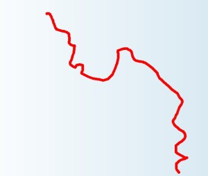
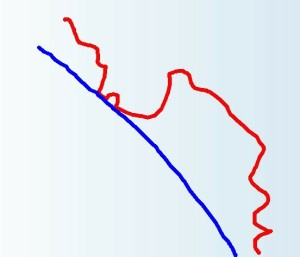
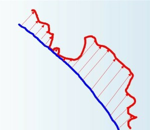
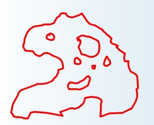
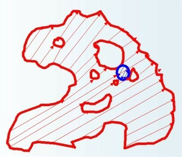
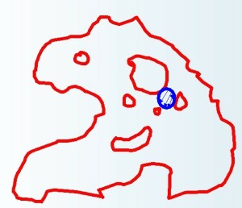

# 1.3.1 扩展第一边界

> Posted by 小鬼 on 三 16th, 2013 in 1.3 行动自由

昨天讲到自由的两条界限，今天我们来讲下这个“由后果定义的边界”。

首先要意识到的一点是，后果是客观的。

这句话怎么理解呢？就是一件事你做了它，后果是什么，并不是由任何人为的条款所决定的，而是由**客观规律**所决定的。因此，会有什么样的后果，并**不取决于**这后果是否符合法律或者道德的约定——这是一个人最常犯的错误。私心认为我没有做错什么，为什么别人要对我发怒呢？为什么别人要敌对我呢？或者在策划行动之前，抱有“只要我不主动的做坏事，别人就不会伤害我”的想法，甚至“只要我不主动的做坏事，自然有上天保佑”这样的想法。问题是，这些规则都并不属于**客观规律**——无论是法律也罢，道德也罢，自信天护神佑也罢，这些并非这个世界的**客观运行规律**的一部分。决定后果的，只有**客观规律**。

他的确是不该怪你，但是这件事发生了，他怪你了——“该与不该，他怪得对不对”这是另一回事。它是否会发生，则要看人类的心理规律，看物理规律。

你未能避免的后果，都在**客观规律**的层面上是公平的，是你行为**理所当然**的结果。你那样输入，在这样的前提条件和运行规律之下，便有这样的输出——这个结果和你当初的选择在物理层面上是绝对一致的——否则世界就会崩溃了，你不是要打破能量守恒就是要打破动量守恒再要不就要打破逻辑。

这没什么好讨价还价的——就如同你松开苹果，就不该抱怨苹果会落地一样，**不要**认为他人对此要承担什么**个人的责任**。他人表面上看起来似乎有选择，甚至可能是“主动”伤害了你，但是客观上，他们的心态，他们的认知，他们的行事准则在推着他们**不得不**如此。这种**不得已**，不仅仅表现为“不这样就会死”(很多人仅仅只能谅解这种苦衷)，也表现为他人可能觉得“这样更有利可图”(因为**人有免于匮乏的自由**)。“有利可图就该抓住”同样可以被看成是对方的一种类似“不这样就会死”的不得已——不要在后果的层面去抱怨这点。学会不抱怨这点，才能**比较正确的考虑**你**行为的后果**——这一点非常重要。

这就是**后果的客观性**。

第二个要点：后果有不可预测性。

虽然我们有对自然的一定程度的认识——也可以说我们终身都在谋求能预测我们行为的后果，但是我们要认识到，至少目前充分准确的预测一件事情的后果是超出我们能力的——因为因果关系极端的复杂，同时还会沿着时间方向无限的延续。因此，我们不可能在任何意义上对它进行彻底的推测，我们无法做出绝对睿智的选择，以便能避免一切我们不想要的后果——因为那无疑要求我们有无限深入和细致的对现状的了解，和无限强大的运算能力能推知一切我们可能的选择的组合对于无限久远的未来的全部影响。这一点是显然的。

因此，第二个要点的直接结果就是：看问题要有限度。做决定要恰当的短平快——具体考虑一个举措可能的后果要考虑到多远，这是一门艺术。但是可以肯定的是：不是越远越好。这同时意味着**你无法通过发展智慧去回避对勇气的需要**。因为真正面对问题的时候，能让你停止纠结，停止强迫性的不断考虑得再彻底一点的东西，其实正是勇气本身。缺少勇气的一种表现就是**无限制的诉诸智慧**。将一切的错误的根源都视作愚蠢、无知和莽撞，而**从不视为天意**——言下之意就是假设“当时当事人再智慧一点，这件事就可以避免”。这样的言论，不管是用在别人身上，还是用在自己身上，从深刻的意义上说，实际上就是在“无限诉诸智慧”。我们经常在“小男生读历史”的时候看到这种“治学方法”。结果也果然培养出了大量的“聪明人”:**善谋寡断**，永远处在永无休止的更深的盘算之中。

要解决这个问题，就要明明白白的接受**后果是具有不可预测性的**，从而彻底断了“避免一切不良后果”的念头。**做好准备接受不良后果**——并不是你努力讨好某人，某人就一定能被讨好的——那是不可测的。你一定会做错的，这是毫无疑问的。该有什么后果，在你已经努力之后，你愿意和不愿意都只能去面对。所以停止患得患失，考虑好你应该考虑到什么限度，然后考虑到这个限度，然后**下注**。

这个要点最后落实到实处，就在于你要多出一个**考虑到什么限度**的机制：在考虑问题之前，你要先考虑**你能考虑到什么限度**。你有多少时间来考虑，你有多少资源能用来优化你考虑的结果，你所试图避免的后果是否允许你使用这么多的资源，你的手段有多大的可靠性，在往后推算几步之后，结果的可靠性就提升到了不值得进一步投入的程度？你要遵循这种方法，给自己设下一个**考虑问题的限度**。学会**有限的**考虑问题，并且在限度一旦到位的时候，果断的下注。然后学会愿赌服输，**不要归咎**他人和上帝(因为这是你身为人类天生的局限，其实谁也怪不了，怪了也没用)。

超出这个限度而得出“更好的”结论，反而从战略上是一个愚蠢的办法——因为那会导致你**全局性**的过度思考，意味着你会**滥用你的思考资源**。你的思考资源是相当有限的，你唯一的办法是把这有限的资源尽量用好，那意味着你必须要创造一个分配体系来总体的管理这个资源。这个分配体系无论是什么，都意味着每件事必有一个限度。而且，**打破这个限度**是一个极坏的习惯——如果你反躬自省，在考虑一个问题之前从未考虑过要考虑到什么限度为止，那么你现在已经很糟糕了。要是你考虑过到什么限度为止，因为害怕后果，希望更有力的回避不良后果而随意打破它，那么你也一样糟糕——**打破这一限度，是怯懦的起点**。不必做任何别的装扮，请你正视这一点——这**就是怯懦**。这个限度之前，你是**善谋**，这个限度之后，你是**寡断**。要是根本没有这个机制存在，那么还要等而下之。

这是第一界限的两个根本属性。现在我们再来看如何尽可能的外推这条界限来获得尽可能大的自由。

第一个要点，就是坚持挑战，持续改进。

前因和后果之间的联系是非常神秘的。几百年前，古人以为**龙卷风**是**今年正月初五没有把一个小孩丢进河里**的后果——不要以为这是笑话。因为这件事正在以不同的规模、不同的形式永恒不断的发生在你的身上：你说了一句话，结果她生气了，结论就是“以后不可以说这句话”吗？那该怎么办？这两件事前后脚发生，前者就是后者的原因吗？你应该仔细考虑问题到底在哪，懂得明智的选择方法来确定到底什么地方有问题。举个例子来说：那么要不要把这句话倒装一下再说一遍来确认问题在哪？以便确认不是语法的问题？这**显然很蠢**。但是这种愚蠢，是手段的愚蠢、是战术的愚蠢、是**研究策略的愚蠢**——这就好像想要研究下这片甲骨有什么成分，于是拿个研钵来把它先捣成粉末一样蠢。但是简单的认定为“她生气就是因为这句话，只要不说这句话就行了”，这更蠢。

你要弄明白。你要不断的去试着弄明白——方法要注意，但是弄明白是你无可回避的。这是不容选择的——这个总的态度无需商议，无需犹豫。但是注意，这里存在一个限制条件：**除非这种研究在你的自由范围之外**。注意看我们在干什么：**我们正站在我们自己的自由范围之内，谋求外推自己的自由边界**——这是我们正在做的事情。于是，很显然，**假设我们答应了某人不再研究这个问题**，那么因为第二条边界的存在，这个已经就**超出**了我们的自由范围。看懂这个关系了吗，**你不能用不属于你自由范围的行动去尝试扩张你的自由范围**。所以，假设你答应了对方我不会研究这件事，那么你就没法挑战它了。但是假设没有这样的限制存在，你的策略就应该是毫无疑问的“坚持挑战，持续改进”。你挑战这问题的手段，仅受你自由的限制(也就是后果和前置契约本身的限制)。只有不断的挑战，你才能不断的把你的边界往更宽阔处推展。

真实的边界可能是这样的：

如果你第一次碰撞到它就止步，不持续的挑战它，你很可能会觉得它是这样的：

这片地方将是你的损失：

如果你不奉行这种扩张主义的态度，凡是遇到不好的后果就就此止步，你会发现别人的疆土可能是这样的：

而你的疆土是这样的：

同时，别人的最外圈边界还是开放的、仍在不断的扩展中，而你已经陷入**绝境**。两者的差别，正在于别人的探险家精神与审慎巧妙的探索能力。你总是觉得各种没办法，人家总觉得“这算什么问题”。但是人家的这种探索问题的技巧是怎么得来的？其实正是因为他有这种这种永不放弃挑战的原则，因此他有比你多得多的锻炼机会，这样练出来的。

因此，这是外推后果边界的最基本的原则：永远继续挑战“规律”。不要“算了”，不要赌气，也不要说“我好累我不想玩”了。真正的轻松感，来自这个广阔的空间，而绝不是来自“休息”。你会看到很多人说这样挑战很累，然后他们想要通过“休息”(也就是放弃继续挑战)来获得轻松感。这是一种错误。正确的来说，应该是一个部位的挑战遇到了困难，那么就先去转向其它部位，而不是“休息”。“休息”的人，很快会觉得现有的空间**令人窒息**——因为他们总在休息。江山都是一拳一脚打下来的，你总在休息，你当然地盘小到你都没法躺下。

我不忍过度责备这样的人，因为他们的命运说实话已经足够看作是一种惩罚了：时常因为别人一句批评或者甚至无心的评论而痛苦很久(因为这是一种“尝试失败”);同时为了避免这种后果，选择绕很远的道，放弃**大片**“可能有危险”的领地。我们不妨回头去看那个“这句话惹她生气”的例子：这人何止不敢说这句话，相似的话也不敢说，可能令人联想起这句话的话也不敢说。三五次折腾下来，什么话都不好说了。而且，这种折腾很可能是这样的：他以为某些话没事的，结果三说两说转到那句话附近去了，虽然及时收手，但是回头把这句“以为没问题的话”也打个大红叉，也放进禁区里去了。最后两三句话就能构成一种令他走投无路的囚笼，他在囚笼里什么都不做，“休息”着，“不想再累了”。再去责备他实在很残忍——但是这终究不是一个较好的结果。

要避免这点，这句“坚持挑战，持续改进”是**不能不被选择的**。某些做法导致了坏的后果，那么回头去检讨清楚是什么。如果有可能，和对方一起研究到底什么地方可以修正——清晰定义，小心尝试。

第二点，就是要勉励自己增强承受力。

你的尝试没可能总是成功的——有的是你罪有应得，有的是飞来横祸。但是，总会有各种各样不同的后果落在你身上，你要努力勉励自己受住。你受不住，你的尝试自然要停止。你能尝试到什么程度，能获得什么程度的自由的空间，和你的承受力绝对的正相关。

什么是承受呢？就是**原谅**。不能原谅，那么你实际上已经不知不觉的消极了。很多人会说：谁说我没原谅啊，我这不还在打交道吗？我这不还在笑脸相迎吗？这不就是原谅吗？难道还要上去讨好不成？但是我们都很清楚——这样的状态，**并不是原谅**。这样一种心态，在手上会**不自觉的消极**。

举个例子：假设我们把亲密度量化，那么这件事是这样的：比如那件事之前，你和对方的亲密度在以年百分之五的速度增长，真正的原谅，意味着增长率仍然会是正的——可能会减弱为百分之二，或者百分之一(当然也可能是百分之五或者以上)。而刚才那样的“原谅”呢，会是**百分之零**。甚至，坦白说，是先给亲密度打个“大折扣”——把已经达到的60%变成30%，然后再将增长率下调到0。这样说话的人，所谈到的原谅是指“这里还剩30%”，“至少我没给你清零”——但是在**发展关系**方面，已经**不会再做积极的尝试**。而我们刚才谈论的“持续挑战”，事实上是以**积极的尝试**为准来计算的。“维持百分之三十”是**停止尝试**的意思——换句话说，这样的“维持式原谅”，并不是我们所谈论的真正意义上的原谅。

真正意义上的原谅，意味着一种**基本的积极、一种**欢迎和乐见关系改善**的态度。你的承受**，翻译过来就是**无论过去发生了什么，乐于寻求更好的共存。无论是对待人，还是对待自然的事物，在一切尘埃落定之后，重新以此为基点，寻求**改善**。所谓的承受力，要用尘埃落定之前你要面对的痛苦**来丈量。

人并不是无限强大的，所以时常你都会受不了，到达不了“重新寻求改善”的彼岸，你会忍不住要痛恨某些人，忍不住想要他们毁灭——那意味着你要认识到那件事超出了你的承受力范围。慢慢来，下次想办法做好些就行了。将来你强壮了，再回头看这件事，你会发现你再次站到了“愿意改善”的彼岸了。

具体要不要去做这种改善的尝试，要看你自己当时的优先级。没准到你具有这种能力的时候，这件事已经不再重要——这很正常，不必耿耿于怀。但是，有两点你要注意：

1.如果情况在恶化，你越来越恨，你需要**反省自身**。这**绝对是坏事**。这和对方是不是罪有应得没什么关系——觉得罪有应得，你可以动手去攻击他，这不是问题的关键。问题的关键在于**你越来越难以控制自己愤恨的情绪**。这种**加剧的失控**，**无论如何都是坏事**。

2.如果情况在恶化，而且**恶化本身的速度在加快**，那意味着**你需要帮助**。今天仇恨值50，明天60，后天69，大后天67——虽然在增长，但是在收敛，看得到吗，你可以预期它会在某一刻停止增长。今天20，明天30，后天45，大后天65，这意味着你要**赶紧寻找外部帮助**。你需要和人沟通、和人交谈。如果你没有信得过的人，你可以匿名去找你喜欢的社区，可以去广泛的读书——但是一定不能再“自信没事”。发现自己是这样，有机会求助而不求助，这是**对自己不负责任**。虽然从我们的角度来说，这是可以原谅的，但是毕竟你这会悲剧。这不是人家会不会怪你的问题，问题是对你自己这也是悲剧。**自寻的悲剧是毫无价值的**。悲剧的美感，在于其中可歌可泣的不朽抗争，而绝不是自己放任自流甚至乐见自己完蛋而导致的那种悲剧叫做“有悲剧性的美”的。那是毫无价值的做法——历史上从来不缺这样的“故事”:一个人很不努力，然后他完蛋了——这样的故事有人觉得新奇，觉得值得记住吗？

永远的谋求原谅别人，这样你才能真正的实践“坚持尝试，持续改进”。你要通过不放弃的尝试原谅别人，来提高自己的承受力，从而才能保持积极尝试的姿态。你要意识到这件事不是一个可选择的兴趣爱好，这是**通向自由之路**。不这么做，你最终的命运**必定是个囚徒**。不要允许自己满足于对他人虚情假意的原谅，不要以为“我不追究已经够宽宏大量了”是一个应该足以让你满意的答案。实际上，追究是追究，原谅是原谅，**这两件事不该混为一谈**。我们再次拿亲密度打比方：所谓的追究，指的是**扣掉净现值**。我跟你原来是亲密度80，现在我追究你的过失，我们降到30;但是我**原谅**你，我们从30 开始，保持年3%增长——**重新增长**。看懂这个意思了吗？而所谓的“我不追究已经够宽宏大量了”指的则是“保持80点的净现值，但是**停止增长**”。做人取前者，不要取后者(后者事实上就是走上另一条路了——路越走越窄的)。

注意，上面这些法则并不仅仅适用于人和人之间，也同样适用与人和自然之间。你要达成和自然的某种要素的良好互动，譬如说你想学冲浪吧，这件事的规律毫无二致——想要成为一流的冲浪高手，本质上要做的事情毫无二致。只是现在的“对方”不再是一个人类，而是一个“自然神”——差别仅在你是否做这个“神格化”操作。但是这个“神格化”的操作并没有改变情节，只是改变了“角色的名字”。

先说到这里吧。

---
> 整理：四季
> 编辑：小鬼
> 审核：剑寒秋水
> 二次整理：四季
