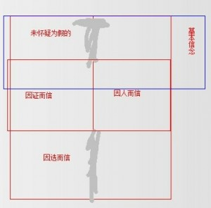
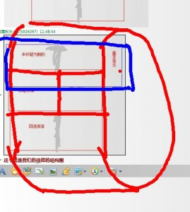
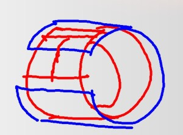
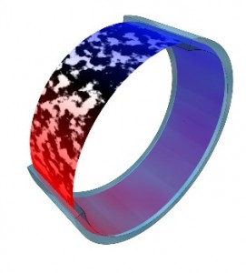

# 1.4.1 信仰的结构

> Posted by 哪吒 on 四 9th, 2013 in 1.4 信仰自立

**1.4 信仰问题**

我们在1.2节里说过，一个完整的独立的人，是由三层构成的：他的信息独立、他的行动自由、他的信仰自主。我们之前已经谈论过了外面的两层，现在我们来谈论最内里的一层，信仰问题。我们要首先谈论信仰的结构——也就是信仰是什么，然后我们要谈论信仰的方法，最后我们要谈论信仰的能力问题。首先，我们要来谈论信仰的结构。

**1.4.1  信仰的结构**

什么是信仰？简单来说，就是我们**信以为真的事物的总和。它客观来说，是一个**命题集**。为什么说它有结构问题？因为这个信以为真存在着多样的来源，这个结构就是因这些来源的不同而呈现出来的。仔细考虑一下你所有的信以为真的东西，你会发现它们逻辑上分为以下几类：1.你从未怀疑不为真的东西;2.因证据为被证明为真的东西;3.因相信他人而信的东西;4.在逻辑的证明能力之外，而你信以为真的东西。

我们首先解释一下什么是**信以为真。第一个问题是：什么是真？**真是和谐的本源**。我们人类有一种神奇的能力，这种能力就是能进行逻辑推导。我们是一种高度协调的社群动物，我们于是要有一些最基本的技能来维持这样的生活方式。譬如我和甲乙丙丁四个人一起出去围猎，我在把猎物往某乙的方向驱赶，因为我知道某乙手里拿着大木棒，可以对付这个猎物。这样的合作，需要各种各样的逻辑推导。这种能力是先于人类成其为人类便已经存在的，在人类还没有什么语言文字和文化的时候，人类就必须要依靠这种能力来进行高于狮群、狼群级别的合作。因此，人类拥有一种发现矛盾的能力，他们分得清什么样的计划行不通，然后去选择至少内部没有逻辑矛盾的计划来进行尝试。一个不具备分辨计划中显然存在的逻辑矛盾的人——譬如，你不能同时认为乙会出现在两个方向上围堵猎物——很快会被自然的淘汰。

既然人有了这样的能力，那么人就能依靠不断的在各种计划内推敲矛盾，而得出一系列工具性的命题，人们把这些命题称作“事实”。譬如：一个人不能同时出现在两个位置;譬如：刚体不能无损的通过比它小的窟窿;譬如：跑得慢的东西不能追上在它前面的跑得快的东西。为什么将这些东西认定为“事实”呢？因为假设其中任何一条出现问题，都会导致大量的计划混乱，大家会发现有大量的计划实施起来会失败。练习日久，人们就产生了一种在付诸实践尝试之前就能看到糟糕的计划的能力。这种能力，就是发现逻辑矛盾的能力。或者更准确的说，发现**逻辑断裂**的能力。

而什么是真呢？就是**能与一切已知的信以为真的命题相协调。**真**是一种性质，是一个形容词。能够协调者即为真，不能协调者即为假，事情就是这么简单。但是，定义的简单，不等于实践的简单。实践的难度迅速的出现了——随着人的见识的增长和应对客观世界需要的增长，你会发现一个非常困难的问题，就是你知道的“事实”太多。哪怕仅仅从时间上说，也不容你将每一个新接触到的命题拿来尝试和所有其它你所知道的命题比较是不是和谐。甚至还有这样更令人痛苦的事实——你甚至都不清楚你到底知道多少事实，它客观上导致你没有能力做完整的逻辑检验，任何人都不行。于是，我们人类不得不转向另一种方法，这种方法就是信**。具体来说，就是进行一个不完全、但是有效率的简略检验，没有发现逻辑矛盾，然后我们**信以为真**。

所谓的**信，就是指这样一种方法——在并无逻辑矛盾的前提下，**假定**其为真。同样，因为我们缺少做完全检验的能力，我们必然的转向一系列的常规检验，而这些用来常规性的检验新命题的系统协调性的命题，就被称之为基本信念**。它是我们的工具，是我们的起点，是整个信仰体系内的基石。现在的问题是，即使是**基本信念这么一个小的命题集，实际上仍然是超出了我们的**通视能力**的(“通视”是指检验一个命题集内全部**的命题之间的协调性)。因为“通视”是一个高度困难的行为。三个命题，人人都可以轻松的做到;五个，这就有部分人会卡住;如果我们给出三十个命题，问你这三十个命题里面是否存在逻辑矛盾，这就非常难做。如果我们把上下文扩展到给你一本小说，问你——这本小说里有多少逻辑矛盾，你会发现这个问题非常非常的困难了。而你的**基本信念这个命题集，远不向你所想象的那样是一个仅仅包括两三个命题的小集合，而事实上是一个数量不明的巨大集合。因为这个**基本信念**集合里面，存在一块巨大的暗区——就是你从未怀疑为假的命题。因为你从未怀疑，你甚至就没有明确的意识到它们的存在。

我们经常遇到这样的情境——一个人大叫，这怎么可能？这怎么可能？！这简直岂有此理！

但是你问他——为什么说这个岂有此理？这人需要好一阵仔细思考。他发现他对这个新命题极其的不舒服，完全无法接受为真，但是却很难明确的说出到底是和什么相矛盾。但是给他足够久的时间，他会找到，他会说“如果这个是真的的话，那么XXXXXXX”，会导致一条简单的谬误。但是你仔细观察，你会发现他发觉谬误的存在，甚至在他找到这条试金石命题**之前，这个过程意味着这条试金石存在于他的**基本信念**集合之中，但是这个人自己却没有明确的意识到它的存在。人可以无意识的进行协调性的检验**，**引用明确意识之外的基本信念来进行**主动意识之外的检验**，而那些被引用的命题，也正是从未怀疑为假的命题**。

这个就是我们的信仰的结构图。

这是一个环。开头是我们未加怀疑的东西，往下是我们有进行过检验的东西。我们的检验有两种：一种是用逻辑推演，一种是依靠从众。而在这两块之下，是我们为自己选择的信仰。这部分在目前来说，是超出了那两种手段所能企及的范围的。譬如世界上有没有神存在？譬如外面的星球到底有没有外星人？这些东西，我们无法用任何手段确证。而假设这些命题对我们又有至关重要的作用，令得我们不得不为它设定一个答案。我们会为自己**选一个答案，而这一层却又巧妙地通向“不疑而信”这个区域。看得明白吗？因为我们一旦选了，就意味着我们将渐渐的因为失焦而客观上不再积极的怀疑它，我们仅能怀疑明确的处在我们的显微镜下的命题。我们的视野很窄，一次只能详细的审视我们眼前关注的若干命题，仅在这个审视的范围之内，我们才有所谓的到底因证而信还是因人而信的问题。超出这个审视范围，那些命题就会慢慢的沉入黑暗，从两端滑入“无怀疑”的暗区。我们会经常审视某一部分因选而信的命题，而有某一部分事实上是因选而信的命题，因为我们长期不去聚焦在它身上，慢慢的会沉入暗区。它会从另一端冒出来，出现在“因不疑而信”的这一端。举个例子来说，譬如我们相信“逻辑是普适的”，或者“客观规律是普适的”，这事实上是我们单方面的**假设**。事实上我们不知道是否在世界(这个概念在此处要比宇宙涵盖更大)的全部角落是不是一律都适用万有引力定律，我们只是相信如此**。我们的检验事实上是不完备的——我们只检验了我们能检验的部分，不是吗？无论我们怎么狂妄，我们也不能不承认对于宇宙，“我们能检验的部分”实际上是一个微不足道的部分。而“宇宙”，对我们来说，也不过是时空连续体之一，我们可以设想还存在其它的时空连续体，而我们甚至不能设想世界上是否还存在时空连续体之外的其它性质的、并列的存在。相信“万有引力定律普适”，这个事实上是我们自己**选的。**但是**，对于相当数量的人来说，这条信念会出现在刚才那个图表的上端，而不是下端。这些人只是从未考虑过“这个居然是一种选择”的可能性，直接当成无需考虑、无需质疑的事实。这就是一个从下端沉入黑暗，然后从上端浮现的例子。因选而信和因不疑而信，在暗区是相通的。

而基本信念的全貌事实上是什么样子的呢？

蓝色覆盖的区域，就是我们的基本信念区。

**不要以为基本信念是一个极小的子集。事实上，基本信念是**沉默的大多数**。真正存在于我们大脑中积极翻滚的那些命题，实际上反而是少数的。尽管我们每天殚精竭虑，以为这些被我们反复思考的东西极其广博辽阔，超越我们的处理能力，但是你反观我们处理能力的有限。事实是很明显的——我们记忆**中大部分的事实，都没有放在这个**被积极思考的框内，它们是不活跃的。但是它们却是我们筛选新命题最强大的基础。我们有个自动的机制，甚至会在新命题真正引起我们的琢磨的兴趣之前，就根据蓝区的命题集把它踢出待考名单。偏偏这个机制是我们活命的关键，否则我们会被无聊的信息淹没。你根本不能指望用主动的意识来接管这个机制，因为光这一条就能耗尽你的运算资源，光“检索一切知识，思考什么是该思考的”，这项任务就足够淹死你了。因此，蓝区必然也只能是真正巨大的部分。它是由**我们从未考虑过错误可能的命题**和我们选择之后停止了怀疑的命题**构成的。

这个就是我们的信仰的构造。

蓝区是**我们所知道而从未怀疑过的命题，红区是**我们选择信以为真的命题**，中间的黑白部分，是我们在意识中主动的考虑之后，或因证而信(白色)，或因人而信(黑色)的命题。这个波动区是变化的，躁动不安的。浅蓝色涵盖的部分，在这个波动区的足迹**之外。这个，是我刚才谈到的**基本信念。事实上，你们可以稍微想象一下我们的结构动态：浅蓝色的边界实际上一直会轻微的跳动，因为它仅包含黑白波动区**足迹**之外的部分。你一旦怀疑了什么，或者改变了你的选择，这个边界就会移动。但是，这个未被覆盖区的面积大体上是稳定的，因为这个事实上受限于你的处理能力。这个区域，我们叫做“逻辑视野”，即你大脑中活跃的逻辑运算的全部上下文范围**。举点实例，譬如，你要在一部小说中寻找矛盾，你就需要在大脑中比较衡量大量的情节;而随着人的不同，这个范围是不同的。有人能发现逻辑距离极其遥远的矛盾，而有些人则超出两章的范围就几乎看不到;两章之前的情节，即使存在着矛盾，他也完全没有能力察觉——如同他是盲的。对于你的整个宏伟的信仰体系(也就是你全部的信以为真的命题总集)而言，你能同时进行逻辑协调性检查的上下文篇幅很有限。而这个“篇幅大小”，在我们的这幅示意图里面，就是这个“未覆盖区的弧度”。因为你的思考，这个黑白活跃区犹如沸腾的开水，有些部分下沉到无需怀疑区，有些部分上升到选择为真区。如果这些沉淀和升华的部分长期不再被涉足，它们上次被踩踏的足迹就会慢慢淡去，渐渐的隐入“基本信念”里面去，直到命运的扰动让它们再次掉入这锅沸汤为止。而又有大量的命题，经过这番烹煮，直接分解、废弃了，既不沉淀，也不升华，而是被归入了“不真”这一区域，直到命运让它再次掉进锅里来再熬一次。而这个不断的由命运驱动的多维度的震荡，则是我们的信仰的**动态结构**。

每个人，都能依据这个基本构造画出他自己的结构图来。甚至，假设存在一个非常敏捷而敏锐的书记官，他甚至能为你做出一副动画，精确的展现你现在的信仰状态。哪些正在波动，哪些沉淀下去了，哪些升华上去了，哪些又在晦暗的基本信念区正在悄悄的慢慢的从因选而信向着因不疑而信转变，哪些被你抛弃了，而哪些又被投入了激烈的运算区。当然，因为真实的命题更类似于超维网络，要想用人类能直接观看的图画样式来表达它是不可能的，因为你无法将这个网络转化成三维的投影——仅仅结构信息已经超过了人类能处理和理解的程度。但是通过这样一个简单的近似，我们能大致的给自己画出一副我们的图来。举个例子来说：有的人的逻辑能力很强，他们也有思考的兴趣，他们事实上以外推黑白区的边界为乐，于是他们的这张图里未覆盖区的弧度会广阔很多。如果动态的看，你们会发现他们的沸腾翻滚非常的迅猛，以至于一个新的命题扔进去，将会非常迅速的得到一种结果——或沉淀，或升华，或被抛弃(被沉淀和升华的很可能会是这个命题的一个变体);以至于他们的区域虽广，但是他们的“水面”却几乎是平静的。这个“图像呈现”不是我们现在关心的主要问题，所以我们点到为止。

以上，就是我们的**信仰的静态与动态结构**。

---
> 整理：四季
> 编辑：小鬼
> 审核：剑寒秋水
> 二次整理：四季
