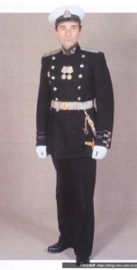
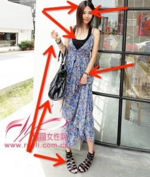
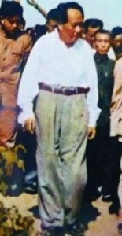
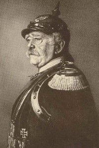
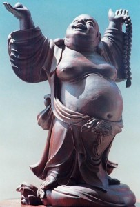
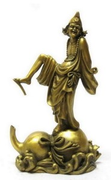
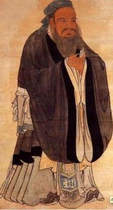
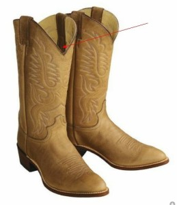

# 1.5.10 服饰 (VIII)

> Posted by 四季 on 五 14th, 2013 in 1.5 内外协调

现在我们开始建造你的第一套costume。

第一步，是要找到一个key，**一个关键元素**。这件关键元素是什么呢？就是你全身能代表你信念的一件东西。

举个例子，譬如你脖子上的吊坠。这吊坠的颜色，就是你整个costume的中心色。这吊坠的材质，就是你整个costume的核心材质。这吊坠的款式所代表的年代，就是你的costume的时代背景。它的信仰背景，就是你的costume的文化背景。

举个典型的例子。譬如，你挑了一个维多利亚风格的十字架，银质的。那么你的整个着装风格就有了一个主key。譬如，衣服的衣料用丝绸或者天鹅绒会很好。松弛的多褶结构，卷曲的百褶边，雕着繁复花纹的金属小部件，复杂盘绕的发型。你要当心，这意味着你不能在手里拿上一个iPhone5，否则就会像叼着卷烟的贾宝玉一样古怪。

选择这个主key的时候，你要仔仔细细的想清楚这件东西能不能作为你整个costume的核心。

举个例子。你选择一个圆圆的玻璃珠吊坠作为这个主key，它身上**很可能没有足够的内涵**，会导致你在选择的时候找不到它自己内生的准则。这个key并非什么东西都可以做，它自身必须要有足够深的内在含义。

作为入门众，我给出几种最容易掌握的选择：

1.它应该和某种世界级的强大文明相关联。

譬如，罗马;譬如幕府世代的日本;譬如拓荒时代的美国;譬如维京海盗全盛期的挪威;譬如古巴比伦;譬如古埃及;譬如斯大林的苏联;甚至包括纳粹德国。

为什么这类背景可以被看作一个足够好的起点呢？因为它们本身在人类的意识世界里影响巨大，它们各自都有相当完整的信念、和思想。这些信念和思想指导之下，它们各自都有非常丰富的实践。你有大量可以现成参考的东西。

举个例子，罗马时代会有什么特点？

罗马人普遍用系带方式固定衣物——领口，腰带，凉鞋。罗马人的衣服材料普遍是细麻布，有时代特征，有地域特征。他们的穿法普遍宽松。

假设你选择了一个罗马式的古朴的臂环作为key，那么你当然应该考虑系带的鞋，并且不要是丝带，应该是细皮带;考虑到罗马人一般皮革都不染色，你显然不能选漆皮带，应该是原色皮带，并且全身任何一处都不该用漆皮;领口收束就要用细绳，而不该用编织绳，更不该用铆钉扣，更加不要提用塑料扣了;罗马人**没有裤子的概念**，因此你应该严肃的考虑配牛仔裤，要配，也该是裙裤;你可以戴手表，但是那手表的形状最好类似丝带，或者金属臂环——不要是链式的，应该是硬体手镯式的;你可以选择吊坠，但是以金属环做颈饰更好;显然你不该戴玉佩，你可以考虑戴地中海式的琉璃挂件，人家不会在上面雕一条龙！你一定要用包，应该用手包，不要用细带硬挎包，更加不要用坑爹的双肩包。

总而言之，每一个配饰，每一块材料，都要放在这个背景下去考察。你最后会得到什么呢？会得到非常**典雅**的结果。为什么？因为“古典主义”这个词就是对着罗马说的。你在现代的时代背景下，能在诸多细节里面令罗马复活，你必定得到典雅的评价。如果你能令斯巴达复活，那么你必定得到武勇的评价。这是非常简单的思路。

至于说配色，很幸运的一点是——古人几乎没有染色技术。因此你会发现上述那些文明背景的配色相当单纯，几乎全是现成的方案。古罗马**没有**印花布，他们的布颜色要么就是无色，要么就是红色，或者褐色，或者染得不成功的黑色。，因为它们只有非常有限的染色工艺。但是他们有高超的编织技术。如果你的衣服上有图案，请确保那是织出来的。于是它几乎必然是几何纹，应该是什么纹？自己去翻剑桥插图世界史，这是文化背景的匹配。

我们要求全部的item具有统一的文化背景，这样我们就很大程度上限制了它们的风格、样式、材料、工艺的选择范围。然后，我们再加入一条到两条硬的线索进去，使所有的item一体化。

我举个例子：

注意看他的帽徽、肩章、腰带、袖扣的纹饰，这就是一条线索。用的是同样的刺绣工艺，近乎一样的材质。这种一致性，却是分布在各种不同的item上的。这条线，就把这些item穿起来了。

譬如牛仔装呢？全身的破损和脏污，就是一根线。主教呢？衣服上滚着红色的边——袖口，襟口，领口。要实现这一点，最简单直接的手段，就是**成套的饰品**。譬如一套的领带夹、胸针和袖扣，成套的领带和手帕。

但是，事实上我不推荐你们去直接购买这样的东西，而是应该自己基于自己的思考去寻找，要想成套非常容易。

举个例子，泰银的东西，用传统手法造的，天生就成套。你可以再加上一条线索——要求上面全都有梵文，然后自己去市场上淘，**寻找上面带有梵文的银饰**。找到第一件，就去找配套的第二件。现在这个时代，你还有淘宝。手指一点可以在成千上万的配件之间匹配，不见的是配饰。

再举个例子，你的鞋和腰带，为什么不可以成套？鞋、腰带、手表的皮带，假如是一样的皮子，如何？再配上同样的细皮绳结做的领饰，这样也可以构成一条线。这是最为简单粗暴的穿线法。

看到"黑色+漆皮"这条线了吗？

注意看她选的这种细皮带，她尽量保持了各处的皮带都是这个宽度，于是这个宽度也成了线索之一。

颜色、材料、质地、花纹、文化背景，你的全部item用这些线穿得越多，这些item就越是紧密的结合成整体。

2.**信念必须放在首位**。

颜色、材质、纹饰、工艺，这样的线索很容易构造。问题在于，你**为什么要用这个颜色？你为什么要选择罗马的工艺而不是日本的工艺？你**为什么**要选择夔龙纹而不选择吉祥如意纹？你为什么要选择麻而不是丝？为什么**？这一连串的为什么，如果答案各异，那么你的costume的系统协调性本身就会是散乱的。

选择红色，因为我喜欢红色;选择麻，则是因为我只买得起麻;那么这就是两个不同的答案。你的线连着，但是你的**纲**断了。

我选择红色，是因为红色表示不惧出头显眼;选择皮带，是因为皮带在战斗中可靠;选择黄铜带扣，是因为它足够结实;选择没有纹饰和原色皮带，是因为这些对于战斗没有必要——于是这些就构成了一套好的军装。它纲举目张。

你不能不断的穿线，但是线与线之间的关联却不加考虑。穿线，能得到外观的和谐。但是纲领化，你则**可以重新定义什么叫和谐**。

如果你仅仅只做穿线这一步，你可以比一般人穿得像样——毋庸讳言，绝大部分人都完全不知道自己在穿什么。而你要是能做到纲领化，你才算创造了一种**风格**，一种 character。任何彻底纲领化的结果，都不但可以免于他人的评判，并且足以反过来教育观众。譬如iphone。这是为什么我们说一定要信念第一，美观居次。因为人的审美观，事实上在极大的程度上是受教育的结果。你之所以觉得某物美，很大程度上是受了主张“此物甚美”的教育。这种教育千千万万人都受过，如果你以此教育本身作为你选择的纲领。可以预料，你的选择将会和千千万万人在很大的程度上本质一样。你必须要往前一步，跳出这个层面，去考虑**是什么让人们觉得此物审美**，去师从那个**美的决定者**。而这东西，很显然，在信念这个层面上，不在美学这个层面上。

You shall dress your beliefs as your armor，since your life is an endless fight.

话说回来,也不是什么人都能穿什么衣服，我觉得还是需要要身材，所以要先管理好身体，再管理好服装？

这身材如何？

这个呢？

还有这身材？

还有这个？

这位的身材也很不咋地。

**美不是只有性感一种途径**，**只有毫无它途者，才会如此绝望的想要性感**。

---
> 整理：四季
> 编辑：小鬼
> 审核：剑寒秋水
> 二次整理：四季
