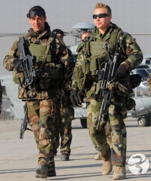
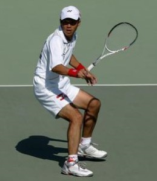
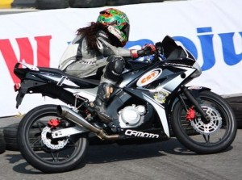
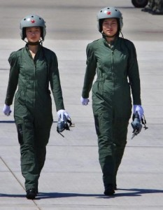
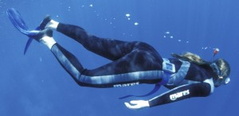

# 1.5.4 服饰 (II)

> Posted by 哪吒 on 四 29th, 2013 IN 1.5 内外协调

下面我们要先分节的介绍几种最典型的策略，然后回头来看待它们背后共同的方法。最后我们再来谈论你怎样可以针对这种方法去磨练你的功力。第一种策略，我们举个例子：

我们来研究这样一个耐人寻味的事实——世界上不存在装备良好而又难看的特种部队。这一点甚至和长相身材的关系都不大。身材并不标准，相貌并不英俊的人，穿上全副武装，也能呈现出高度的协调性。从大众的角度来说，他们堪称奇装异服。

譬如：

但是几乎没人认为他们"不好看"。发现了吗？那么这个事实说明了什么呢？仔细思考这个事实，我们就能发现一种最简明的策略：**目的本位。如果你全身上下的所有附件的选择，都**意在达到同一种目的**，那么它们将会很自然的达成和谐。譬如：

又或者：

又或者：

又或者：

又或者：

看得明白吗？上述例子，他们身上的每一件东西，都是为了服从某种共同的目的。并且每一件东西，都在它们各自的位置上**竭尽可能的匹配了这种目的。没有一样**因为财力的原因**打了折扣。它固然谈不上"奢华"，但是它也绝对受到金钱的限制。只要此处有必要添加这样东西，而这样东西要做到这样才是最好，那么这样东西就会采用这个设计或者这个选择。这里需要一根套马的绳子，那么就会找到性价比最高的绳子。这里需要一个耐磨的护膝，那么就会找到最耐磨的护膝。整体要有视觉伪装性，那么就会全部是绿色或者黑色。如果需要醒目，那么就会很自然各自都会有强烈对比。每一种视觉因素，都存在一个实用的原因**;全部的实用的原因都服从一种总的目的，并且互相之间经过权衡取舍，以便达到**效能的最大化。为了达到这种效能的最大化，做了充分的投资——但是绝不浪费。遵循这种原则，得到的结果无论如何"古怪"，**一定会得到人们的赞许**。这样一种原则，就被称作目的本位的策略**。

为什么我们说这样操作一定会得出一个好的结果呢？是因为以下几点：

1. 这种策略保证了一种内在的和谐。人类必定欣赏和谐——哪怕这种和谐超出他的意料。我们欣赏长颈鹿和大象，欣赏食蚁兽、八爪鱼，为什么呢？其实不是因为它们符合我们的某种"审美"观，不是因为它们符合某种视觉的美学原则(譬如"某种配色要配上某种配色才协调"这种废话)，而是因为我们欣赏它的**目的协调性。我们欣赏这种专注，这种**竭尽一切可能的努力**。我们欣赏最尖锐的矛和最坚固的盾，欣赏为了某种目的殚精竭虑、登峰造极的境界，无论这种努力最后呈现出什么样惊人的外观，我们都会欣赏它。哪怕这种诉求本身是与我们为敌的，我们也能超越自身立场的欣赏。事实上，和谐反而是被**这种殚精竭虑、登峰造极的策略定义的。什么"要对称"，"要配色"，要"讲究画面平衡"，在这种"竭尽一切可能的努力所自然呈现的结果"面前，都是狗屁。

这货就不对称，也没啥配色。至于什么构图啊、画面平衡啊，那是你把它套进镜头里面去才存在的问题。这东西的一切地方目的都很单纯，就是为了用尽量小的代价举起尽量多的东西到尽量广的范围，它身上的每一个螺丝钉都是为了这个目的才存在。它的颜色是为了不压死人，不是为了好看。但是它最后**好看**。

全局服从一个目的，自然会达成和谐，这是达成和谐的一种简单直接的办法。

2. 它无视代价。我们刚才举出的这些东西，它的每一个点都有这种特质：它讲求经济性，但是无视绝对代价。比如，手表里这个轴承，用钻石最好，那么就用钻石。这根吊臂，如果需要用掉这么多钢，那么就用这么多钢。之所以不用更多钢，不是因为不肯付出这个代价。而是因为用更多的钢没有好处，反而损害最终的目的。看清楚这个原则，**只考虑适格性，不考虑绝对代价**。能考虑适合性，考虑的深而且系统，这是智慧。不考虑绝对代价，竭尽能力，这是勇气。人类无法不欣赏这种努力的结果，无法不认为这种结果是美的。你甚至无需在意这个目的本身算不算对欣赏者"有好处"。即使你披坚执锐是要去杀他的，他也一样会从美学上认同你。即使你穿这样是为了在比赛里击败他，他回家也会考虑模仿你。

你把这两条原则贯彻到底，你便无需考虑你"好看不好看"，因为那反而会构成对审视者的考验——看不出、感应不到的，反而是对方有问题。真正困难的，是如何达到高度的协调。那不能是"名牌装备的堆砌"。你的取舍选择，固然不该考虑价格上限，但是你却要在协调性上下真正的苦功，你需要**了解你的目的——不是初入门新手那样的照单扫货。而是经过若干实践，基于真正的经验去选择。每个选择，背后都有真正经过检验的实用性，没有无必要的实体，没有盲目的选择。发现了吗？——这背后的功夫，并不是美学的功夫。美却是对这**并非美学的好功夫**的结果的必然评价。

譬如我们说要了解自己的目的。譬如就说你专以户外旅行为主题来考虑，你也需要不少年头才能有自己关于户外旅行的完整理解。没有这种深入的经验做底子，自然总要从"杂志模仿者"开始。但是，即便是"杂志模仿者"，你也该去模仿《户外》或者《高尔夫》，而不是《ELLE》或者《昕薇》。仅从刚刚讲的这个策略而论，你最入门的模仿对象，应该是本门中的资深专业者——而不是"时尚专家"。

---
> 整理：四季
> 编辑：小鬼
> 审核：剑寒秋水
> 二次整理：四季
