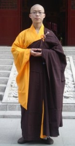
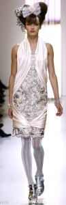
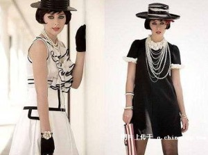
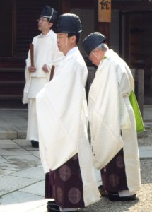
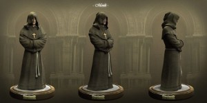
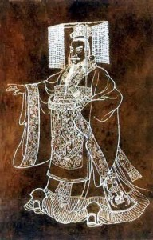
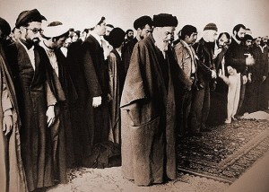
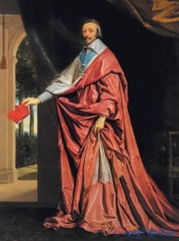
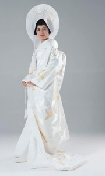
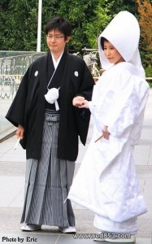

# 1.5.5 服饰 (III)

> Posted by 四季 on 五 11th, 2013 IN 1.5 内外协调

上次我们谈论了"目的为纲"的穿法，现在我们来看另一些例子：

这个策略的核心是：**信仰为纲**。

上次我们谈过**目的为纲**，也就是全身上下每一处都服从于一个一致的目的，并且推向效能的极致。它必定得到认同，因为人类必然欣赏这种专注和努力。

现在我们改换了方向，全身上下每一处，都基于同一信仰的不同原则。全身上下每一处，都基于同一信仰，每一处都是对自己信仰的实践。

以修道士的服饰为例——木质的十字架，麻绳腰带，粗布长袍，遮蔽自己面容的兜帽，不露手的长袖。因为修道士发有坚贞、神贫、服从三愿，于是他们的服装也就体现了这一点。极尽去除修饰的可能，极尽避免展露个人美貌的可能。

不用说，这个也是一样。这全身的衣服并非仅仅是衣服，同时也是对信仰的实践，是信仰的证明，饱含象征意义。

**人类天然的敬重虔敬者**。

于是这类服饰只要贯彻到一定的力度，就能反过来定义美。仔细看，这些衣服即使在他们各自最早出现的年代，在它们各自的人群中也是独特的。在隐修士最早出现的年代，隐修士的服装也与其他人有明显的差异。在秦始皇的年代，秦始皇的服饰也很明显的和他人不同。上面举的每一个例子，都不但在现代算是特别的，在它们各自的历史背景下也都是非常特别的，甚至设计来就是为了和一切其它服饰相区别的。

假设我们并不特别偏颇，我们会发现基于"一般美学原则"来说(譬如配色、平衡、对比等等等等)，它们大部分都是"不协调"的。甚至干脆某些的设计理念就是**反美感**的。譬如隐修士的服装，视炫耀个人形象的秀美为根本禁忌。但是历经千年之后我们再来看待它们，它们**各自重新定义了美感**。你基于你的信仰原则而选择，经过深思熟虑达致精神上的协调。你的信仰体系完全遵循了我们之前一章谈论过的原则与态度，有足够的自省而达致的高度内部协调，那么你只要将这些原则贯彻到底，无论得出的外表如何的独特，只要你表达得彻底，令人看到你这样表达的精神上的指向。对方就不得不钦佩你这种坚持背后的勇气，也不得不佩服你这种坚持背后做的思考功夫，也无法克制自己对这结果的接受。如同普通人必定能接受隐修士、和尚、道士的服饰一样，因为这些结果是超越"时尚"之上的，是不可以用一般的"好看"原则来说它"不好看"的。这根本就不是"好看不好看"的问题了，反倒是反过来，人们将会因为认同和喜爱你这个人，反过来认同这**定义**了一种美。

我举了这么两个策略，你们应该已经看出一定的规律了——怎么做到随心所欲的穿而重新定义美？在这个策略下就是三个要素：**勇气、**智慧**，以及超出审美评判之外的纲领**。

上一个策略的核心是**实用**，我管你好看不好看，我这么穿是为了好干活，你说我不好看我根本都懒得理你。我穿迷彩涂油彩外捆防弹衣下穿作战靴戴风镜钢盔是为了杀人，不是为了好看。超出对方从视觉上评判你的立场之外，你已经立于不败之地——没人能说你"不好看"，说出这话就会被人看成白痴。有人会说特种兵或者和尚穿得"难看"吗？说出来周围人都会翻白眼，因为这是根本性的不懂事。既然根本无法说这些结果不好看，那么只要转头去关注这些结果中包含的合理性，就能油然而生认同感。回头再一看你这家伙能想到这种程度，并且敢穿出来眼睛都不眨，对方必定要认同你的勇气。这三个要素合一，你**怎么穿都是对的**。

而这观点反过来意味着一点：**照着时装杂志穿是最失败的**。你当然仍然可以看时装杂志，不是作为模仿的范本，而是去观察设计师的思路——他的勇气在哪，他的思考在哪(达成协调的思想高度)，他的理念在哪，他如何把这三要素聚拢成一个整体的。去他妈的"受到夏日纷飞的蝴蝶的启发"，这种都是屁话。这种话都是报道者自己水准太低，只能这么跟他们说——也不排除设计者和报道者都是这水准。巴黎纷纷扰扰一年发布几百上千款新设计，每年有几款设计真的流传开了？时尚发布会已经越来越变成"在视觉美学规律下抖机灵"的拼图游戏，甚至已经从之前的时尚设计，降格到**流行元素**了。流行的不是"中山装""旗袍"这类整体设计，而是"圆点"、"蝴蝶结"这样的零件了。这意味着什么？意味着时尚界已经失去代言时尚的思想地位了。它已经不再是学术机构，而是商业机构为第一属性了。他们已经熟悉了自己的生意——如何尽可能的少想，尽可能的低成本，玩出"新"东西来。已经失去了法国宫廷时代设计师的自觉，不再是谦逊的思考者，而是前台的自吹自擂者了。

一个基本的点是——你在法国宫廷时代，你敢照穿他们的设计，你得到的往往是一片好坪。现在这个时代你敢照穿他们最得意的设计，出街往往一片恶评。这并非"民众普遍缺少时尚教育"，而是民众对**设计界抛弃民众的报复。仅从这一点来说，时尚界就**不足效仿，只堪引鉴**。你要重新回到这基本三原则，将他们全体看作同行**，而不是"老师"。看清楚其中相当部分根本不是这条道上的，事实上只是生意人。看清楚哪些是这条道上的，他们怎么在他们的作品中贯彻这三原则的。

本节最后回头点个题：为什么这三原则会让你吸引到对方？道理很复杂吗？因为这三原则背后就是爱的能力。**勇气、**智慧**以及愿力**，性感到死。

这**勇气、**智慧**以及愿力**，还是需要不停得磨练啊？

当然啊，不然很容易变成拙劣的堆砌。

那我这样理解哦。比如，今天我穿衣服的目的，是为了"让自己看起来很性感"，这是我的目的。然后，我就要挑选适合的衣服，能极尽突出"性感"这一部分，里面也包含了我对性感的定义，以及对自身的要求，和我选衣服的功力，还有就是最后我能搭配出一套好衣服，我也要敢穿出去，是这样么？

可以这么说。但是假设你仔细的看清楚前面这两条策略的话，你会发现它们都是"指向与人无关"的。它们的理念部分不依赖于人的认可，你的目标设为性感。性感是一个和他人的认可有关的理念，因此，你这里面要**丢掉**你**自己对性感的理解**，要代之以**他人对性感的理解**。简单说，就是你得照对方的看法来。如果你没有特定对象，你就要照着"大众的标准"来。那么意味着你要对人性本身有洞见，而这其中，最不该的就是**照着自己的标准**来。

最糟糕的一种穿法是：她穿了是打算"显得漂亮"的，但是这个人却又宣称自己不在乎别人的观点，只在乎自己的观点。这于是完全自相矛盾，这不是缘木求鱼吗？这就像去参加赛跑比赛，但是宣布自己要按照自己的的评判标准。要么你不要去比赛，要么你不要自己定规则。两头你只能占一头，两头都占是弱逼。其实就是输不起要耍赖的代名词。相当部分穿得失败的人，就是无意中受了这种影响。在为取悦他人而穿的情境下，莫名其妙的"不在乎别人怎么想"。参加追悼会穿篮球服，这不叫个性，这叫愚蠢到找不到北。

---
> 整理：四季
> 编辑：小鬼
> 审核：剑寒秋水
> 二次整理：四季
