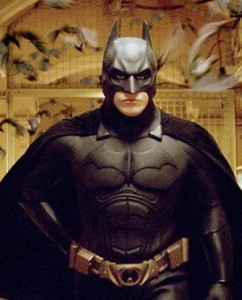
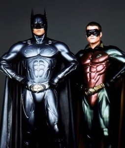
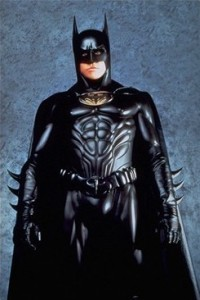
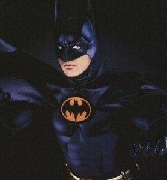
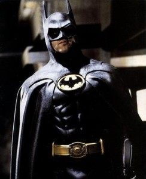
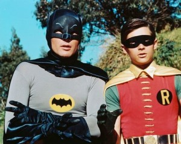

# 1.5.6 服饰 (IV)

POSTED BY 四季 ON 五 12TH, 2013 IN 1.5 内外协调

我们已经介绍了两种最基本的策略——**实用为纲以及**信仰为纲**，并且我们给出了基本的三原则：勇气+智慧+超出美学判断之上的理念核心。我们也解释了为什么这三条一定能造成理想的结果。这三条法则都守住，得出的结果必定能得人肯定，能反向的定义美。

现在我们站在这三条法则之上继续向前看。第一个问题，是这三条法则造成了一种什么样的结果？这个结果有一个名字——costume。这个词现在一般被称为"戏服"。

举个例子，化妆舞会上面大家穿的就是costume。但是，这是一种极大的窄化。事实上，costume泛指一切成套的搭配。譬如——民族服装、工作服、戏服、礼服。任何指向特定身份或者特定用途的全套服装，都被称作costume。我们可以很容易的看出为什么我们刚才谈到的三原则必定会得到一个costume。因为那三原则，最后都要皈依于那个第三原则——那个理念核心。一切的服装要素都要服从那个核心，结果就必定使得服装变成那个核心的载体。而那个核心，要么是实用目的、要么是身份角色(信仰)，要么是两者的综合。换句话说，必定会变成你的职业装、或者身份装、或者两者的混合。

我们要注意，世界服装史分为两个部分。

一个是history of costume。农夫有农夫的装束，武士有武士的装束，女人有女人的装束，僧侣有僧侣的装束。尽管它们各自在各自的类别中有大量的变化，甚至这种变化的总体范围覆盖甚广(譬如袈裟，喇嘛和日本日莲宗的差别就相去甚远)。但是，我们能看得出一种清晰的脉络——它们是Costume。它们甚至会有袈裟、猎装这类专门的名字，甚至专门的造字。

现在貌似在统治着着装原则的fashion本身倒是一种极其近期才出现的东西。它起自于拒绝接受任何既定身份的阶层，那些在大战或者革命中迅速的从一种身份改变到另一种身份，并最终产生"身份虚无主义"的阶层。他们的基本立意就是"反身份"。他们的基本手法，就是打破"一切统一于一个主题"的第三原则。因此他们总是在谈论"反叛"、"先锋"、"扬弃"，不断的采用新的手段去打破已经达成的和谐一致，不断的抛弃(包括他们自己创造的在内的)一切和谐一致的结果。这样的东西，才叫做Fashion。
但是我们现在反观我们现在的社会，我们很巧妙地发现——不管愿不愿意，或者是否自己主动，costume正在悄无声息的占据大部分的地盘。举一个最典型的例子：超级英雄们的扮相——超人从不换衣服;蝙蝠侠拍了这么多集，蝙蝠侠换了好几次装备，材质、色彩搭配，都换过了，但是还是不可避免的形成了"蝙蝠侠costume"。

fashion最为痛恨的就是costume。但是它自己最大的成功，反而是创造出新的costume。这也反过来给了我们这样一种最基本的启示——我们自己的努力，应该是转向**寻找自己的costume**。

所以，我们下面转向这样一个问题：怎样构造自己的costume呢？

---

> 整理：四季
> 编辑：小鬼
> 审核：剑寒秋水
> 二次整理：四季
