# 1.5.8 服饰 (VI)

> Posted by 四季 on 五 12th, 2013 in 1.5 内外协调

我们从这双靴子说起。

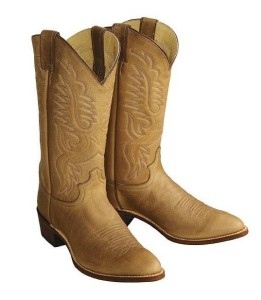

这是一双经典的牛仔靴。

现在是第一个问题：为什么骑马要穿靴子？因为自从有了马镫以后，如何与马镫相配合就成了一个问题。

这个我们稍微说远一点：

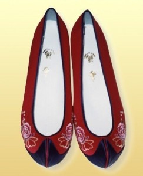

这是一双古代的鞋。

它的最首要特征是什么？为什么浅口？

因为在那个年代，人们缺少现代可以随意获得的伸缩性材料。于是导致一个问题，要是做深了，鞋就很难穿上。的确可以通过在脚背上加上扣带或者穿上绳结这样的问题来解决。但是，这些装置都有个严重的问题——和马镫不兼容。你脚背上不管是缠着绳结还是扣带，都很容易和马镫钩挂，这在上下马的时候一个不小心会要你的命。但是你又不能用浅口设计，因为在颠簸的马上，鞋是很关键的操纵关键，你很不希望两脚一踢鞋掉了。再加上，马时常会穿过树丛和灌木丛，脚踝往往需要额外的保护。外加马具的各种绳索皮条的钩挂，这都要求你最好穿上有护套的鞋。综合下来，就出现了对靴子的需求。

靴子的第一个问题，是靴筒做多长。按照靴子最初的设计需求，很显然是越长越好。极限长度毋庸置疑是及胫，也就是整个小腿。但是，大家不要忘记了古人没有橡皮筋也没有拉链也没有魔术贴。这导致一个很纠结的问题，不管你做多长的靴筒，你总要能把脚穿过靴筒塞进鞋里去，这就导致靴筒必定要能扩张到足够的粗度。要么，你弄个松紧装置，先松开，穿上，再收紧。要么你就不能把靴筒做太长。说是可以系鞋带，殊不知，以古代的技术，他们是没有耐磨的尼龙鞋带这种东西的。唯一耐磨的是皮绳，但是皮绳要求高级的鞣质皮革的技术，甚至棉绳都是很“晚近”才出现的东西。人类早期对棉花的利用技术，都是直接做棉絮填塞，并没掌握纺棉线的技术——棉不像丝，是极长的单根纤维，而是大把的短纤维。古人织布用的是麻里面捶出来的长植物纤维，而不是棉。回头看，整个意思是——人们缺少可以做鞋带的东西。另外在皮子上穿孔打上无数金属铆钉来保护穿孔，这是非常精细的手艺活，是非常晚期才出现的。(这结构也同样保护了鞋带)

综合起来，当时最长的长靴是这样的：

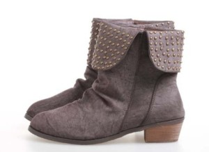

上端开口的翻口设计。假设你不想要这个翻口，你最长也只能做到这样：

再长就穿不进去了。因为这种固定管结构，这个管还必定很粗。

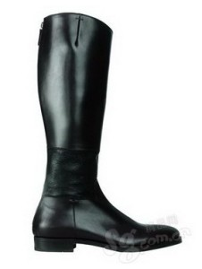

这是现代马靴，注意它的踝部，这个是后面带很长的拉链的。没有拉链和橡皮带，人们根本不能做出后面这种长靴来。不然穿不进去，做出来也没法穿。如果有，则必须要应对这个收口问题。

注意看内侧的简单的皮绳穿插设计。糟糕的是，这个设计不适合骑马，因为这些内侧复杂的穿插容易钩挂。

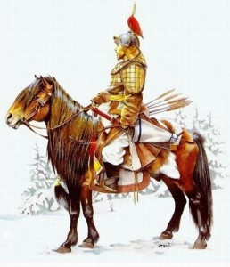

所以古代骑兵也罢，起码牛仔也罢，一般穿的都是这种粗管的半长短靴。

现在再来看这个靴子的尖头，这是为了容易插进马镫。

它的高跟，是为了卡住马镫。它的脚掌部做宽，是为了避免马镫轻易脱出。

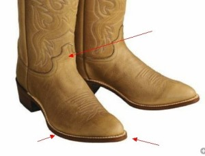

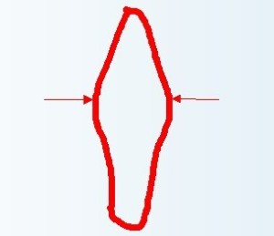

上面多块皮子，是为了耐磨。

向下的豁口，是为了在在保持最大的两侧长度的基础上尽量减少穿脱的麻烦。

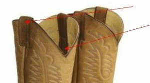

两侧的皮带，是用来穿脱的时候拉住靴筒的。

而之所以要把跟做得这么高，还有另一个用意，就是为了避免装上马刺之后，马刺会碰到地面磨损。

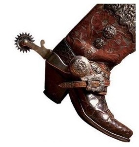

这个是蒙古式马靴：

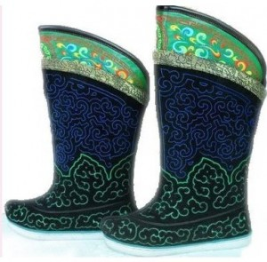

看到了吗，是没有跟的。那时因为蒙古式骑术用马鞭而不用马刺。欧洲骑术之所以用马刺，是因为他们是铠甲骑兵——带着铁手套，一边是盾，一边是长枪，长枪碎掉之后还要拔剑，根本没有空余地方再去拿一根马鞭。而蒙古骑兵是骑射战术，几乎连刀都不用，凑近一通射，然后回头呼啸而去。除了持弓的时候，双手都是空的。

为什么我们要去回头讲述这些设计与历史之间的关系？因为这些设计本身附带的设计语言，和它们的这个“出身”有非常深刻的关系。牛仔的短靴，和牛仔的艰苦无畏精神是融为一体的。你假设要从靴子这一点上展现出这一点，你就要注重你这双靴子的“血统”——尖头、高跟、中腰、宽松筒，这就成了它的基因。就如同白肤金发碧眼深目高鼻是欧洲人的形象上的基因一样。你明了这设计和这设计背后的文化形象的深刻的联系，你就知道什么是不可舍弃的，你才能把它当成一种“语素”来运用。

我们往下会举出更多的例子来演示这种解读，这个例子就先到这里。

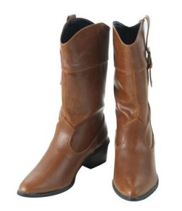

---
> 整理：四季
> 编辑：小鬼
> 审核：剑寒秋水
> 二次整理：四季
