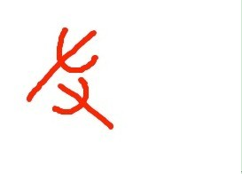
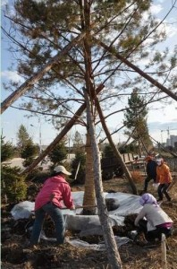
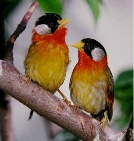

# 2.1.1 安身立命之本 (II)

> Posted by PP on 六 3rd, 2013 in 2.1 安身立命之本

上一节我们讲到了安身立命之本，这一节讲的东西是接着上一节的。

上一节我们讲到了一个重要的概念，就是要建立一个“企业化的自我”的观念。我们引入了一种重要的角色：你的股东。这个词事实上存在一个非常贴切的英文对应者，就是stakeholder。注意这个词的原意是什么？就是“在你身上有赌本的人”。stake，是一个俗语，指的是筹码堆成的“小柱子”。啥叫你的stakeholder呢？就是比如你要下场跟人打架，一般人在外面开赌盘，这些人压了你赢，在他面前就有了一个筹码堆成的小柱子——他可能甚至都不认识你，甚至搞不好跟你本人有过节。但是输赢就是输赢，他相信你能赢，于是他打算在你的胜利中获利，在更高的意义上说，他相信在他的影响下你能赢。这样的存在，就叫做你的stakeholder。注意，这**不是**stockholder——这个范围比一般经济学意义上的股权关系更为宽泛。

stakeholder的定义，实际上是**会因为你的成功而获得净利润或因为你的失败而承受净损失的人**。请注意，我特别强调的把这种人和你的**朋友**分开了——我们再说得仔细一点，以便大家清晰的看清楚这两种存在的区别：朋友，指的是什么人？从君者为朋，助君者为友。

朋，本字已经说的清清楚楚了——这是两个并排的存在。

原本是什么样的字呢？是两只并在一起的鸟。朋，是形容鸟类并排呆在树枝上，并且比翼齐飞聚集成群的样子。

这就是“朋”:

所谓“朋比”，指的就是上图这样的样子：肩并肩像一对小鸟一样并排坐着，这就是“朋”。
“友”指的是两只手：

指的是一只手伸向另一只手。

意思说得再清楚也不过——即是帮助你的人。

那么什么叫做朋友？就是指总跟你一起陪伴着你的人，这种人叫你的“朋”。而伸手帮助你的人，则是你的友。

注意，古人分得非常清楚：他们自己并不认为朋和友是一样的存在。事实上，在古代“朋”和“党”总是和在一起称作“朋党”，指的完完全全就是“总是待一起的人”。这意思就算不是贬义的，至少也是中性的，并没有特意推崇的意思。

在另一个环境里，还有一个词，叫“亲朋故旧”。看得出吗？亲、朋、故、旧，是为四交，这都是非常客观和中性的的伦理联系。它们本身并没有什么说法说这四类人一定是好人，或者一定是很爱你的人，但是它们被列出来被一致看作和你有交情——因而你理所应当要予以高于陌生人的优待的人。因为这个伦理是双向的，那么这四类人等于也对你拥有对等的义务，也应该要优待你，于是这四类人一向被我国的传统伦理当成**默认的**友人。

所以，朋友一词，**并非并列结构**的短语，而是指**因朋而来之友**。看懂了吗？

什么样的人是你的朋友？

简单来说，比如财务部的小红和业务部的小马等等一帮人总是午餐一起吃饭，下班一起唱K，于是小马跑去报销的时候总是特别顺利，小马和小红就是**朋友**。

这个小圈子里面，就都是**朋友**。

你要注意，在古汉语的语境里面，还有诤友、挚友、学友、亲友这些存在，严格说，按照原意这些人指的是各种来源或者特性不同的帮助关系，而绝非是说这是各种各样不同的“朋友”——朋友是朋友，学友是学友，诤友是诤友。只不过在现代汉语之中，我们不假思索的认为这些全是“朋友”，以为这些是“朋友”的不同分类。实际上，它们和“朋友”是并列关系。

现在我们再来看刚才我们谈到的stakeholder。你就会发现stakeholder**很可能**不是你的朋友，而你的朋友也很可能不是你的stakeholder。

比如，小马被升职或者降职，实际上对小红的损伤是非常间接的。但是对小马的上司和下属就有**很直接**的影响。直接到了这样的程度——因为小马工作失败，他的上司和下属都直接损失了收入。尽管他的上司和下属午餐从来不跟他一起吃饭，下班从来不一起唱K，除了开会和交代工作之外，从不多打什么交道——小马甚至不知道自己上司多大年纪，是什么地方人，从哪个大学毕业，是什么学历，但是他的上司是他的stakeholder，甚至向上几层——他的上司的上司的上司，都是他的stakeholder。他的下属的下属，也是他的stakeholder。看明白了吗？

很显然，在法律上认定存在关联财产关系的人——你的父母、子女、配偶——毫无疑问也是你的stakeholder。

我们要切实认清的是这一点——你的stakeholder，才是你的**安身立命之本**，犹如你的树根，犹如你的树干。

而朋友，则类似加固树干的支架。

于是我们可以看到一个非常有趣而又直白的结论：如果你**非要**依靠你的朋友才能不倒下，那么你的状况可以被看作是不够健康的。发现了吗？

注意，我并无贬斥“不够健康”的状态之意，我的意思仅仅是，这是一个识别你自己的状态的方法。

你要记住，你的stakeholder才是你的安身立命之本。

你**必须**要开始有步骤有策略的学习如何处理和stakeholder之间的关系，你必须要学习怎么能建立一个良好的、健壮的、广阔的、stakeholder的群体，要学会怎么主动招募新的stakeholder，怎么面对命运给你安排的stakeholder，怎么处理失败了的stakeholder关系，怎么控制损害并且埋下将来重新恢复关系的伏笔。

眼睛要盯在你的stakeholder上面。

你只有经过经年累月的锻炼，你才能有能力处理好你最大的stakeholder——你爱的人——because the stake has never been higher。

这一节就先说到这里。

---
> 整理：四季
> 编辑：小鬼
> 审核：剑寒秋水
> 二次整理：四季
