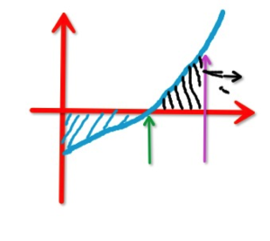
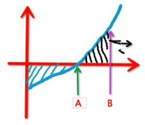
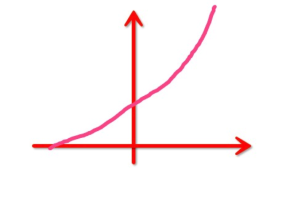

# 2.1.3 安身立命之本 (IV)

> Posted by 炉子 on 六 17th, 2013 in 2.1 安身立命之本

上一节我们讲到了怎么分辨stakeholder的好坏——看他们的**利益相关度与干涉倾向关系曲线**。现在我们来谈一些操作问题。

第一个问题，上哪里去找优质的stakeholder，如何招募他们，如何留住他们。

优质的stakeholder存在一个共同特征，就是**不会跟你讨价还价。我们之前谈过，stakeholder最不好的一面是干涉倾向。而干涉倾向最基本的表现是什么呢？就是喜欢讨价还价——**缺少交易成本意识**。这里的讨价还价是个极其广义的概念，并不只是表示跟你砍价——它包括了一切要求你改变某种行为，修改某种决策或改变某种输出但是却不改变自己报价**的一切行为。请特别注意这个要点——他做要求的时候不会改变他自己的报价。

如果他请你改变某点，但是他给出他自己的报价，那么这个**不算是我们刚才说的“讨价还价”行为。这只是正常的**议价**。被我们看作是干涉倾向发作**的是一种**仅凭借自己的要害地位，通过要挟来改变你的行为的行为。他要你做这个做那个，他的报价未变。——这个叫做“讨价还价”。我们在最初解释stakeholder的时候谈过，stake指的是**赌注**。于是你很自然的会发现，合格的stakeholder是不存在讨价还价的，他下了注，然后就是等结果了。

那么上什么地方去找这种人呢？第一个点，就是找那种在风险面前能收住手不干涉你的人。

我举个具体的例子：比如一个人跟你签了合同，签的是要你几月几号供货，然后他没有写明你如果推迟的话要怎么罚你。结果你真的延迟供货了，结果这人**没有跟你废话要你赔偿。这个过程，就是一个先下注，并且没有讨价还价的例子。他在找你供货并且没有签那个赔偿条款的时候，他实际上下注了，他在赌你会准时供货，后来他看着输了，他**没有**对你施加压力，而是清楚地知道自己是赌输了，不可以在赌局之后来翻脸不认。坏的stakeholder在这个时候是很难忍住不跟你纠结的，他们会举出大量的各种各样的理由来找你赔偿损失，而绝不会照着原样的合同来做。这个人知道按照合同自己是不可以多说什么的，于是他果然没有多说什么，他便受住了考验。不单如此，假如这个人还能做到不觉得你做错了什么，是他自己合同签署上自己有问题**，那么这人就是非常优质的stakeholder了。你应该想方设法把他招进你的圈子里来，因为这种人的干涉性曲线始终都在零点以下。和他进行交易和合作，交易成本很低。仅仅交易成本低这一点，已经足够你拉开和你的竞争对手的成本差距了。这样的例子很多——他在你身上有利益，按照一般世俗的观点，他“有权”来说你两句，但是他知道按照契约来说他没有这种权利，于是他丝毫不拿着前者做虎皮大旗或者鸡毛令箭，能扛住这种诱惑，严守他的权利界限——这样的人，是优质的stakeholder。

一个典型的例子，就是**看着你和别的男人出去逛街但是能忍住不干涉你的男朋友，或者**在你的公司里有股份，但是明白你是大股东，于是在意见被你否决之后能忍住不搞小动作的小股东**，或者一个家里有事，但是清楚他做了这份工就有责任在这里坚守，于是提也不提的员工**。这类人，就属于优质stakeholder的好胚子。他们能承受更高强度的风险分担，这是很自然的。在你走到他们的干涉性曲线的零点上的部分之前，你可以尝试让他们持有更多你的股份。

举个例子，你原来股份是2%，我把你否决了你接受得非常良好，那么你有资格上到4%，注意，有的人上到30%心态就开始歪了。这就是我在之前说的“越过了干涉性曲线的零点”。你对此要有观察，有警觉。

优质的stakeholder的第二个来源，是**无期待的对你下注的人**。举个例子：你坐公交车没带零钱，站在投币机前面挠头，这时候后面一个人上来帮你把卡刷了，什么也没说，这种人，是一个优质的stakeholder的好胚子。

为什么呢？因为**他下了注，却并不执着于非要赢**。从一开始，他就没有非要赢回什么的期待，他没问你是谁，也没说他是谁。但是他在你身上下了两块钱的注，于是，你至少知道两块钱这个点上，他的干涉性是低于零的。这是一个很好的起点。这两个来源，事实上指的是两种试炼。简单来说，能通得过“干涉的诱惑”试炼的人，才有机会成为好的stakeholder，你时常都要多想想你身边有哪些人在这个圈里。有哪些人要是真的祭起“大义名分”就能得着好处的时候，因为对契约和人的尊重而放下了这种贪婪。

我们之前有说过，契约即是礼。这种行为模式，其实说穿了是什么呢？就是**克己复礼。愿赌服输，其实不是别的，恰恰正是**克己复礼**。赌注是我自愿下的，所以输掉了我不可以去怪拳手;我下的是赌注，我没资格去干涉拳手怎么打比赛所以我不干涉，这是stakeholder的礼**。他需要克己才能守住。他守住了，他就是一个好的stakeholder。这样的人在你麾下越多，你越能纵横天下。这种人就是我们说的资产，是产生财富的机器。你要像抓生金蛋的鹅一样的贪图他们的友谊，妈的求爷爷告奶奶也要攀上点关系。不然你上哪去赚钱给妹子买礼物——缺这样的存在，你很自然发现你很穷，各方面看都很穷。同时你应该注意到了——毫无疑问，你的伴侣作为最大的stakeholder，理应是这中间的一员。类似“为了我不许和别的男人交往”这样的话是很成问题的。因为这是经典的越过零点的表现。

现在我们有了寻找优质stakeholder的方向，我们要怎样招募他们呢？

第一步很简单——立刻开始对他们下注。立刻开始下**小额的、无期待的赌注**这是最好的招募法。

第一，这种小额的无期待的对向赌注，在对方看来，**恰恰正是他之前赌注的客观回报**。

第二，这**同样证明你也是一个好的stakeholder的候选人。人有两大基本需求是不能抗拒的，一个是获得盈利，一个是获得更大的盈利。第一点，你给了他盈利;第二点，你给了他获得更大盈利的希望。什么叫做“小额的、无期待的赌注”？比如“顺手帮他带饭”，不等对方请求，主动的做出付出。注意那个前提——**不等对方请求**为什么呢？因为对方一开口请求，实际上客观上就附带了回报的许诺——这是一种默示契约。于是你再做出的行为，就不再是“无期待”的了。

要保持这个**无期待性，你还需要**准备接受对方的呵斥**。因为你是不经对方请求擅自行动，你的作为未必对对方是有利的，甚至可能是有害的。你要清楚对方有呵斥你的权利。你需要提前做好这个心理准备，到时候老老实实的挨着并且不要有什么愤怒或者报复心，你才能证明你的赌注是真正无期待**的。施恩容易，不望报难，懂得且尊重对方有**呵斥的当然权利，你才踩上了一个优质stakeholder的**及格线**。大部分人需要非常努力的憋着才能勉强够到第一根线。最多能接受对方无动于衷——这就心里很不是滋味了;打死也接受不了对方“狗咬吕洞宾”——他要跟人翻脸。事实上，从契约角度上说，你未经对方请求而擅自作出的行动，被对方呵斥是完全不能抱怨的。甚至经由对方请求而作出的行动，你都要有心理准备会被对方批评——因为要正确的领会对方的意图是很难的事，你很容易脑补成你自己喜欢的版本。

刚才我们说了招募的第一步是开始下小额的、无期待的赌注。第二步呢？

是**提高赌注的额度，查看对方的干涉性临界点**这是一个交互的过程：他首先经受住了试炼，然后你下了小额的注。这对他是一种盈利，他将进一步在你身上下注，这对你会是盈利。然后你因为有所盈利，那么你把这份盈利再加上新的“小额的无期待的赌注”重新下在他的身上。于是你们可以看到在这样的往还之间，你们建立了stakeholder关系——stakeholder关系是相互的、成对的。并且，你要注意，你们的关系会慢慢的逼近临界点。人是一种脆弱的动物，利益关系一旦超过一定的限度——哪怕这些利益是额外获得的——也会慢慢的开始产生要依靠强力手段来保持稳定供应的冲动。你能和一个人建立多强的stakeholder关系，取决于那个点有多远。一个强大的人，这个临界点是很远的。于是他能支撑非常深刻的利益共同体关系。

我在这里要特别强调一个要点。这里存在两种策略，我们用图示来解释一下：

这两种策略在这张图上表现为两个点：

A点的意思是：不管以前因为这种stakeholder关系造成多少盈利，一旦开始出现干涉，就停止继续扩大互相持有stake的规模。

B点的意思是：即使出现了干涉行为，只要这种干涉造成的成本不会导致盈利重新回到零点，就可以继续扩大互相持有stake的规模。

在这里，我要强调一个问题：A点是你的止点。因为**自由是无价的。一个人，不管给你带来了多少盈利，你都不可以**允许**他干涉你的自由。否则，你就把你的自由作价卖掉了**。而你不管看起来作了多高的价钱，本质上**必是贱卖。这种**唯利是图的贪婪**可以从数学上给予另一种解释——仔细看你的盈利曲线，你会发现过了这个点，事实上你的投资收益效率**已经开始**下降了。你进一步的允许对方持有更多的stake，对方的干涉性会严重的增加，给你增加无数的麻烦，产生大量的成本。这些成本甚至会把原来因这种关系带来的收益反过来吞吃掉。直到这个关系**占用了你大量的资本，却完全不产生收益**为止。这才是B点的真正含义。

什么意思呢？意思是，只要这东西还在盈利，只要盈利不是零，你就忍不住还要在往里多添点资本。你这种行为，在投资上说表面上是合理的——因为是在盈利嘛——实际上是非常坏的。因为这是贪婪。

这有点像什么呢？打个比方：有点像一个人，往银行里存钱，存十块钱的时候利率是1%，一百块，利率5%，一千块10%到顶了，两千块，利率重新回到5%。这时候这人心想：这利率还是正的么，我要是多存还是会赚到的么。于是他最后往里存了一百万，终于把利率降到**零**了。看懂了吗？

问题是，这个比喻和现实的一种最大的差别是——你往这银行里存的钱你可以取出来。你和stakeholder建立的这种利害关系，绝非可以拍拍巴掌说“我要取回来”这么简单。你交出去的是**自由**。

用自由换“盈利”永远是愚蠢的贪婪，更别提你这么做，实际上有“慢藏诲盗”的问题。本来止步于A点，对方也不会忍不住犯下**侵犯别人自由的原罪**。你为了贪图那点“盈利”，不惜引人犯下越来越大的罪行后面弄成“全副身家被卡在一家利率为零的银行里”真是一种天意的报应！凡是说“我答应你再也不跟别的男人来往了”的妹子们(好吧考虑时代背景，这里再加上)和汉子们，本质上就是越过了A点。不知悔改，就等着在B点全军覆没吧。

现在我们来看整个策略的第三步：在逐步加大stake到触及了A点的时候怎么办？——停止扩大规模，严密的监视A点的变动，如果A点右移，那么你可以扩大你们的stakehold的规模。如果左移，你要缩减规模。什么意思呢？对方伸手干涉你，对方就要受到一定程度“撤资”的惩戒。对方在这个临界点上突然战胜了自我，停止了恶心的试探、操纵或者施压，那么他可以获得“增资”。严格说，前者也不能算是“惩戒”实在只是最一般的风险管理行为——nothing personal.你有多少satkeholder已经越过了A点，越过了多少，有多少甚至越过了B点，这是一个很直白的解释你现在生活现状的量度。

越过B点的只要有**一个，你都可称**贪婪、愚蠢且懦弱**——三样一样你都跑不掉。贪婪是指你居然干到这种程度，愚蠢指你到现在还没看出来，懦弱指你不是没看出来，你是没勇气解决——宁可自欺欺人。你自己反省下看看你是不是一条都没说错你。你的stakeholder里面有三个B点右侧的家伙，你实在不必奇怪为什么你穷得内裤上都有洞。但是你别怪人家，你该怪的是你自己。

上面三步，已经构成了完整的stakeholder策略，有人可能要问：怎么没有退出策略？“那些完全不合格的stakeholder要怎么摆脱啊？”

谈完策略，我们要回头谈论你的心态。你要意识到一个人有他的干涉性临界点是**正常的，甚至可以说是健康的。你固然不能接受别人的干涉，但是你应该**保持耐心**。不要**因为某人犯了这问题，就觉得这人“不可交”，要玩割袍断义划席绝交。你要做的，是控制你的交往深度——或者恰当的下调一些——并保持耐心。通过自己自由范围之内的行为去施加你有权施加的影响，你可以告知，可以演示，可以示范，甚至可以利诱，你可做的努力多得很。你选择不去做这些努力而抛弃对方，哪怕仅在功利上也是愚蠢的。

一个stakeholder是一份珍贵的、容不得你随意浪费的资产。你以为你一生有多少机会遇到多少个？拉网捕鱼一网八千个活蹦乱跳的么？实际上能建立深入的关系，并且不超出你的关系管理能力的stakeholder，往往超不过十个。这些关系是要花费大量的心血来照看的，有点问题你就跑路，这很明显是愚蠢行为。但是，无视A点**绝不可取**——我们上面解释过为什么这个是饮鸩止渴。幸好，A点偏左的人，很自然和你交往也不深，也自然的不会占用你太多的心力。

看到了吗？自自然然，矛盾已经早已被系统预先调和过了。你不乱来，怎么可能出现绝境？

什麼叫亂來？

比如过了A点还放款。

看到朋友喜歡的給她帶禮物不算把？

当然不算啊。

過A點是指對方對你的干涉超過你承受範圍嗎？

不，是指对方哪怕有了丝毫过线的干涉。这就是我们说的完全不合格的stakeholder，也就是在你身上赌注为零就忍不住要干涉你的人。注意到曲线本身已经给了你答案——要想他们不干涉你，他们必须持有“负赌注”。发现这是一种什么关系了吗？这就是**黑社会收保护费**的关系，他没在你铺子里持有一分钱股份，但是他要求你每月给他供应十斤苹果，并且告诉你你铺子里要这样要那样。

你有以下方案：一个是赏他“不杀之恩”，就是展示出你的拳头比较大，没打死他他就已经赚到了，通过不杀，你给了他他想要的“负赌本”;一个是找警察，把他清除出游戏;一个是花钱买自由。

---
> 整理：四季
> 编辑：小鬼
> 审核：剑寒秋水
> 二次整理：四季
